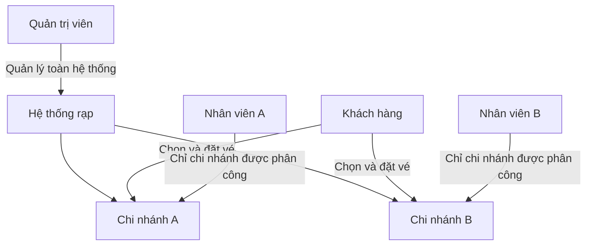
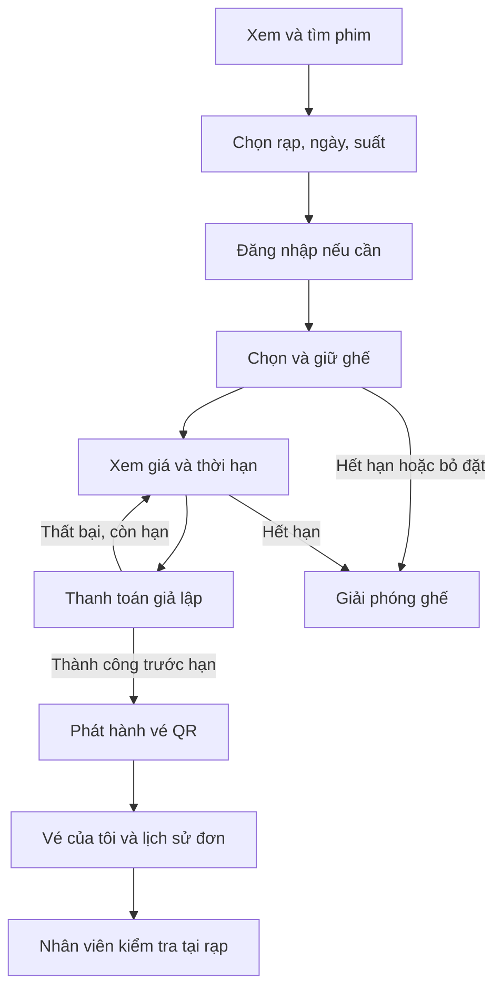
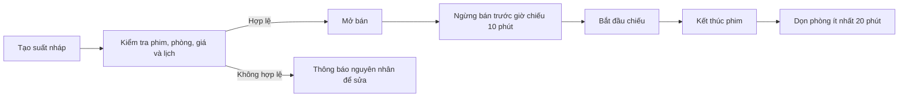
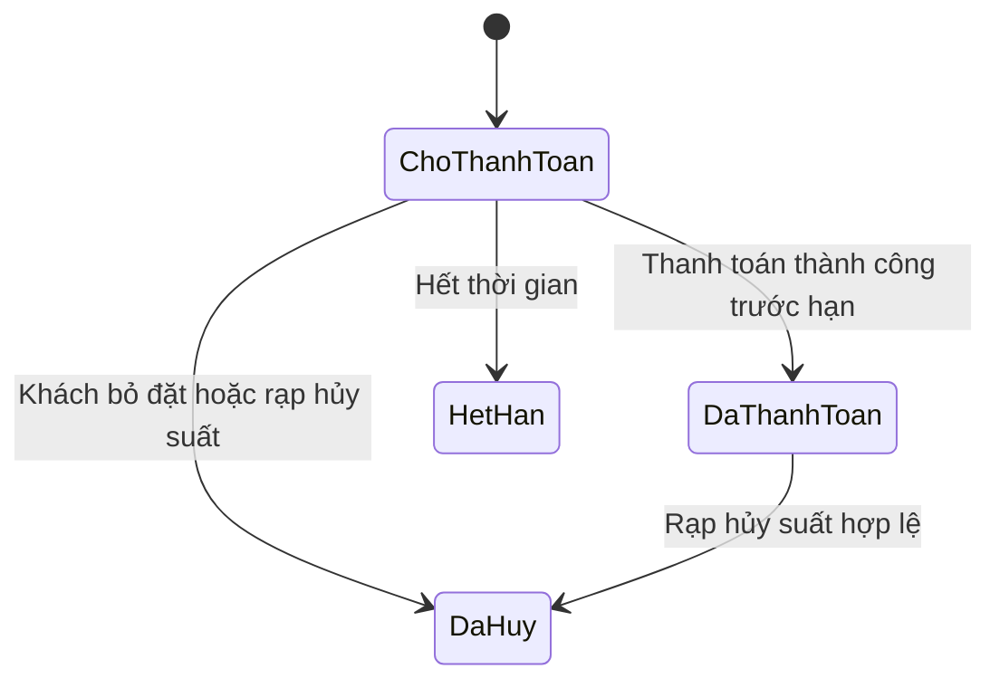
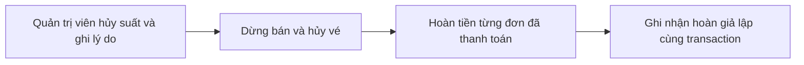
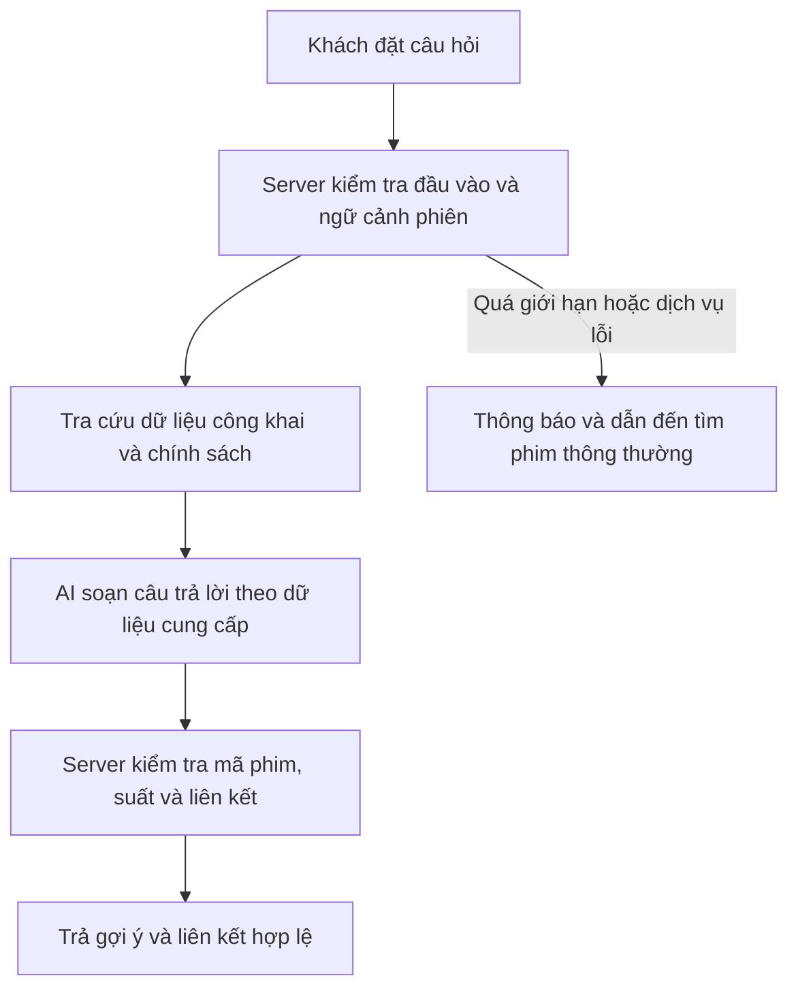
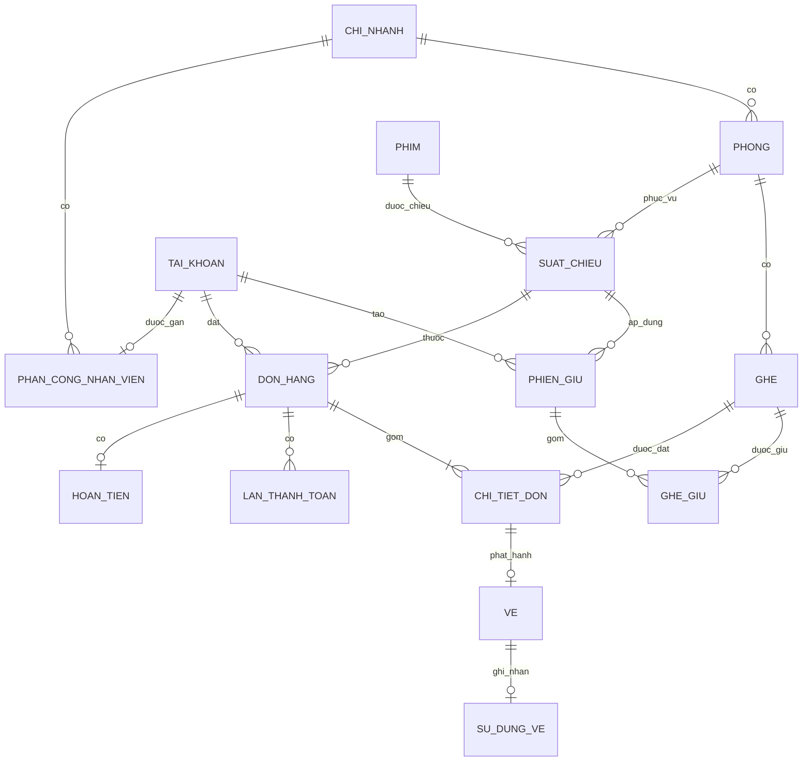

# Đặc tả sản phẩm — Website đặt vé xem phim CineReserve

Ngày cập nhật: 05/11/2026. Phiên bản: 1.5 — giữ phạm vi đồ án tối giản, mở rộng hội thoại trợ lý phim.

Đối chiếu triển khai ngày 04/11/2026: xem [Rà soát và lộ trình v2](11-ra-soat-va-lo-trinh-v2.md). Đặc tả này vẫn là cơ sở yêu cầu; một số chức năng chưa đủ đã được liệt kê rõ, không tự coi có schema hoặc kiểm tra cũ là đã hoàn thành.

Trạng thái: cơ sở yêu cầu cho phiên bản đầu. Các quyết định còn thiếu được trợ lý chốt theo ủy quyền của chủ sản phẩm; không yêu cầu duyệt từng phần. Chủ sản phẩm có thể điều chỉnh trong quá trình đọc và phát triển.

Đây là sản phẩm mới, không phụ thuộc giao diện, dữ liệu hoặc kiến trúc dự án cũ. Tên sản phẩm là **CineReserve**, thống nhất với phiếu giao đề tài giáo viên cập nhật.

Tên đề tài dự kiến cập nhật: **Xây dựng website đặt vé xem phim CineReserve sử dụng Next.js, TypeScript và tích hợp chatbot AI.** Tên bổ sung AI đã thống nhất với chủ sản phẩm; chưa có phiếu giáo viên xác nhận tên mới trong tài liệu được cung cấp. Tài liệu này phục vụ phát triển sản phẩm và làm đầu vào cho báo cáo; không phải bản báo cáo tốt nghiệp hoàn chỉnh. Phiếu giao đề tài yêu cầu sản phẩm, báo cáo, giao diện tiếng Anh/tiếng Việt và thống kê doanh thu theo phim/theo thời gian. Phiếu có hai mục tiêu bị lặp và thời gian 28/07/2025–27/09/2025 cần xác nhận lại với giáo viên; không tự dùng các mốc đó làm lịch phát triển.

## 1. Đọc nhanh

Xây website bán vé cho một doanh nghiệp có nhiều chi nhánh rạp. Khách tự chọn phim, rạp, suất và ghế. Nhân viên kiểm tra vé tại chi nhánh được phân công. Quản trị viên quản lý danh mục, lịch chiếu và hoạt động bán vé.

| Nội dung | Quyết định phiên bản đầu |
| --- | --- |
| Công nghệ | Next.js, React, TypeScript, PostgreSQL, Prisma ORM và CSS Modules |
| Ngôn ngữ giao diện | Tiếng Việt và tiếng Anh ngay trong phiên bản đầu |
| Tài khoản | Phải đăng nhập trước khi giữ ghế và đặt vé |
| Ghế | Thường và VIP; mỗi đơn 1–8 ghế cùng suất |
| Giữ ghế | Tối đa 5 phút; thay ghế và thử lại thanh toán không gia hạn |
| Ngừng bán online | 10 phút trước giờ chiếu |
| Giá | Giá cơ bản theo suất + phụ thu VIP; chưa có khuyến mãi/phí dịch vụ |
| Thanh toán | Giả lập trước, không chuyển tiền thật |
| Vé | Một QR riêng cho mỗi ghế; chỉ được sử dụng một lần |
| Hủy vé | Khách không tự hủy/đổi sau thanh toán; rạp hủy suất thì hoàn toàn bộ tiền đã thu |
| Lịch chiếu | Không trùng phòng; ít nhất 20 phút dọn phòng sau mỗi phim |
| Kiểm tra vé | Từ 30 phút trước giờ chiếu đến trước khi phim kết thúc |
| Báo cáo | Doanh thu theo phim, thời gian và chi nhánh theo quyền |
| Chatbot AI | Tư vấn/gợi ý phim, tra cứu lịch chiếu và hướng dẫn; chỉ nhớ ngữ cảnh trong phiên, không trực tiếp đặt vé |

## 2. Mục tiêu và phạm vi

### Mục tiêu

- Khách hoàn tất hành trình đặt vé và tìm lại vé đã mua.
- Không bán cùng một ghế của một suất cho hai khách.
- Quản trị viên tạo và mở bán lịch chiếu hợp lệ.
- Nhân viên xác minh vé và ngăn dùng lại vé.
- Có lịch sử thao tác để tra cứu khi phát sinh lỗi hoặc tranh chấp.

### Trong phiên bản đầu

Danh mục phim, chi nhánh, phòng, ghế; lịch chiếu; đăng ký/đăng nhập; giữ ghế; đơn hàng; thanh toán giả lập; vé QR; kiểm tra vé; hủy suất và hoàn tiền giả lập; thống kê; nhật ký quản trị; chatbot AI tư vấn/gợi ý phim dựa trên dữ liệu hệ thống.

**Phạm vi nghiệm thu đồ án được thu gọn ngày 04/11/2026:** trọng tâm là luồng khách đặt vé → thanh toán giả lập → QR → nhân viên kiểm tra, quản trị phim/lịch, thống kê và chatbot. Quản lý nhân viên chỉ gồm xem/tìm danh sách, tạo tài khoản mới và gán một rạp ngay khi tạo, bắt buộc đổi mật khẩu tạm. Rạp/phòng/ghế có dữ liệu chuẩn bị bằng seed; không bắt buộc làm đủ màn hình quản trị cơ sở vật chất. Hoàn giả lập toàn bộ khi hủy suất được ghi nhận thành công trong transaction, chưa yêu cầu hàng đợi hoàn thất bại/thử lại. Các ràng buộc chống trùng ghế/lịch, kiểm tra quyền và giữ lịch sử vẫn bắt buộc.

### Để giai đoạn sau

Thanh toán thật, email/SMS, khuyến mãi, tích điểm, đồ ăn và combo, ghế đôi, đặt nhóm lớn, bán tại quầy, khách tự đổi vé, báo cáo nâng cao ngoài doanh thu theo phim/thời gian. Chưa có ứng dụng mobile riêng.

Điều chuyển nhân viên sau khi tạo, khóa/mở/thu hồi tài khoản bằng UI, cấp lại mật khẩu tạm, CRUD rạp/phòng/sơ đồ ghế đầy đủ, màn hình hàng đợi hoàn tiền và công cụ check-in riêng cho ADMIN là mở rộng. Không trình bày chúng như tính năng đã triển khai hoặc điều kiện bắt buộc của bản demo đồ án hiện tại.

## 3. Người dùng và quyền hạn

| Chức năng | Khách | Nhân viên | Quản trị viên |
| --- | --- | --- | --- |
| Xem phim, rạp, lịch chiếu | Có, không cần đăng nhập | Có | Có |
| Đặt vé, xem đơn cá nhân | Có | Không qua tài khoản nhân viên | Không qua tài khoản quản trị |
| Tra cứu đơn tại rạp | Không | Chi nhánh được phân công | Toàn hệ thống |
| Kiểm tra và sử dụng vé | Không | Chi nhánh được phân công | Luồng riêng chưa yêu cầu trong đồ án |
| Quản lý phim, lịch, giá | Không | Không | Có |
| Hủy suất, hoàn giả lập toàn bộ | Không | Không | Có |
| Thống kê | Không | Chi nhánh được phân công | Toàn hệ thống |
| Nhân viên: xem/tạo/gán rạp khi tạo | Không | Không | Có |

Mỗi nhân viên thuộc một chi nhánh trong phiên bản đầu. Server kiểm tra quyền và phạm vi dữ liệu trên mọi thao tác; ẩn nút trên giao diện không thay thế kiểm tra quyền.

Chỉ CUSTOMER được chọn/giữ ghế, tạo đơn và bắt đầu thanh toán mới. ADMIN/STAFF vẫn có thể xem/tải vé cá nhân đã mua trước khi đổi vai trò và bỏ đơn/phiên giữ cũ hợp lệ để giải phóng ghế; không cấp quyền mua mới. Nghiệp vụ vận hành của nhân viên/quản trị được giữ riêng.

## 4. Hành trình khách hàng

Khách chọn phim hoặc bắt đầu từ chi nhánh đều đi đến cùng một luồng chọn suất. Danh sách hỗ trợ tìm theo tên phim, lọc thể loại, phim đang chiếu/sắp chiếu và ngày chiếu. Phim sắp chiếu chỉ đặt được nếu có suất đã mở bán.

## 5. Tài khoản

- Đăng ký bằng họ tên, email, mật khẩu, xác nhận mật khẩu; số điện thoại không bắt buộc.
- Email duy nhất, chuẩn hóa khi đăng ký và đăng nhập. Mật khẩu tối thiểu 10 ký tự, cho phép mật khẩu dài và không lưu dạng đọc được.
- Khách sửa họ tên, số điện thoại và đổi mật khẩu sau khi cung cấp mật khẩu hiện tại. Đổi email và khôi phục mật khẩu qua email nằm ngoài phiên bản đầu.
- Quản trị viên xem/tìm danh sách, tạo tài khoản STAFF mới và gán chi nhánh đang hoạt động ngay khi tạo; nhân viên phải đổi mật khẩu tạm ở lần đăng nhập đầu. Không nâng quyền tài khoản khách có sẵn hoặc tạo ADMIN qua biểu mẫu này.
- Chưa có UI điều chuyển, khóa/mở hoặc cấp lại mật khẩu. Cơ chế server chặn tài khoản LOCKED đã có vẫn giữ để bảo vệ dữ liệu, không đồng nghĩa đã có nghiệp vụ quản trị khóa tài khoản.
- Khóa tài khoản không tự hủy vé đã thanh toán. Khách có thể xuất/lưu QR khi mua vé; nếu không còn truy cập được, nhân viên hỗ trợ tra cứu bằng mã đơn và đối chiếu thông tin, không phát vé chỉ dựa trên tên.

## 6. Phim, chi nhánh và phòng chiếu

| Đối tượng | Thông tin chính |
| --- | --- |
| Phim | Tên, mô tả, poster, thể loại, thời lượng, ngày phát hành, phân loại tuổi, trạng thái |
| Chi nhánh | Tên, địa chỉ, giờ hoạt động, trạng thái |
| Phòng | Chi nhánh, tên phòng, sơ đồ ghế, trạng thái |
| Ghế | Phòng, hàng, số, loại thường/VIP, có được bán hay không |
| Suất | Phim, phòng, giờ bắt đầu/kết thúc, giá cơ bản, phụ thu VIP, trạng thái |

Thời lượng phim tính bằng phút, phải lớn hơn 0. Mã ghế duy nhất trong một phòng. Giá là số nguyên VND, giá cơ bản lớn hơn 0, phụ thu không âm. Không dùng số thập phân để biểu diễn tiền VND.

Danh mục đã có lịch sử sử dụng không xóa vật lý; dùng ngừng hoạt động hoặc lưu trữ. Phim đã gắn suất không đổi thời lượng/phân loại tuổi làm thay đổi suất đang bán; phiên bản đầu khóa các thuộc tính này khi còn suất tương lai đã công bố.

Phân loại tuổi là thông tin cấu hình theo phim. Website hiển thị rõ và yêu cầu khách xác nhận các người xem đáp ứng điều kiện của phim; nhân viên đối chiếu tại rạp khi cần. Website không tuyên bố xác minh tuổi chỉ từ một checkbox. Quy định áp dụng và cách từ chối phục vụ phải được doanh nghiệp kiểm tra trước vận hành thật.

Trước lần thanh toán mới, khách phải tự tích hai xác nhận riêng: mọi người xem đáp ứng điều kiện tuổi/giám hộ và đã đọc/đồng ý chính sách. Không tích sẵn. Ghi phiên bản nội dung và thời điểm server theo lần thử; đơn chụp phân loại từ suất. Đơn thay đổi phải kiểm tra/xác nhận lại, không gia hạn giữ ghế. Gửi lại request key đã xử lý chỉ trả kết quả cũ, không tạo thanh toán/xác nhận mới. Các bản ghi lịch sử trước tính năng này không được tự gán đã xác nhận.

## 7. Xếp lịch chiếu

- Giờ kết thúc = giờ bắt đầu + thời lượng phim; thời lượng được lưu theo suất để lịch sử không đổi khi danh mục thay đổi.
- Hai suất trong cùng phòng không được chồng lấn cả thời gian phim và 20 phút dọn phòng. Kiểm tra cả suất trước và sau, gồm suất nháp chưa hủy.
- Ví dụ phim bắt đầu 19:00, dài 120 phút: kết thúc 21:00; suất kế tiếp sớm nhất 21:20.
- Khoảng phim và dọn phòng phải nằm trong giờ hoạt động chi nhánh. Phiên bản đầu không xếp suất qua nửa đêm.
- Không tạo suất mới với giờ bắt đầu trong quá khứ; chỉ mở bán khi giờ ngừng bán còn ở tương lai và danh mục liên quan đang hoạt động.
- Không sửa phòng, giờ hoặc sơ đồ ghế khi có phiên giữ còn hiệu lực hoặc đơn đã thanh toán. Muốn thay đổi phải xử lý theo chính sách hủy và tạo suất mới.
- Phòng có suất tương lai chưa hủy không được sửa sơ đồ ghế. Ghế hỏng ảnh hưởng suất đang bán cần xử lý các đơn bị ảnh hưởng trước; nghiệp vụ chuyển ghế riêng chưa hỗ trợ.
- Không ngừng hoạt động chi nhánh/phòng khi còn suất tương lai chưa hủy; xử lý suất trước.
- Lưu thời gian có múi giờ; giao diện hiển thị giờ Việt Nam. Server là nguồn thời gian quyết định.

## 8. Chọn ghế, giữ ghế và giá

| Quy tắc | Cách xử lý |
| --- | --- |
| Số ghế | 1–8 ghế cùng suất; không hỗ trợ ghế đôi |
| Khi nào bắt đầu? | Khi server chấp nhận giữ ghế đầu tiên |
| Hạn giữ | Thời điểm sớm hơn giữa lần giữ đầu + 5 phút và giờ ngừng bán |
| Thay đổi ghế | Được phép; không gia hạn; yêu cầu thất bại giữ nguyên lựa chọn cũ |
| Bỏ hết ghế | Giải phóng ghế nhưng phiên vẫn giữ hạn ban đầu |
| Nhiều tab | Dùng chung phiên; tab cũ phải cập nhật trước khi sửa |
| Chuyển suất | Xác nhận bỏ phiên cũ; không bảo đảm lấy lại ghế cũ |
| Hết hạn | Giải phóng; muốn tiếp tục phải kiểm tra ghế và tạo phiên mới |
| Giá | Server tính lại từ giá cơ bản, loại ghế và báo giá phiên |

Giá báo của phiên còn hiệu lực không đổi khi quản trị viên cập nhật giá; phiên mới dùng giá mới. Khách không thể sửa giá bằng dữ liệu gửi từ trình duyệt.

Ví dụ suất 19:00, ngừng bán 18:50:

| Lần giữ đầu | Hạn giữ |
| --- | --- |
| 18:40 | 18:45 |
| 18:48 | 18:50; giao diện báo còn dưới 5 phút |
| 18:50 | Từ chối giữ mới và xác nhận thanh toán mới |

Không tự gia hạn khi tải lại, thử thanh toán hoặc mở tab mới. Bỏ đặt và đăng xuất qua ứng dụng giải phóng phiên; đóng trình duyệt dùng cơ chế hết hạn. Không hỗ trợ tự gia hạn liên tiếp một phiên; hạn chế tần suất tạo phiên mới sẽ được thiết lập và kiểm chứng khi triển khai.

### Thay đổi ghế và xử lý lỗi

Server nhận toàn bộ danh sách ghế mong muốn. Nếu một ghế mới không còn trống hoặc danh sách vượt giới hạn, từ chối toàn bộ lần thay đổi và giữ nguyên lựa chọn cũ. Chỉ hiển thị ghế là đã giữ sau khi server xác nhận. Ví dụ đang giữ A1, A2 và đổi A2 sang A3: nếu A3 bị người khác giữ thì A1, A2 vẫn thuộc phiên cũ; nếu thành công thì giải phóng A2 và giữ A1, A3.

Các tab dùng chung phiên và hạn giữ; tab gửi phiên bản dữ liệu cũ nhận yêu cầu cập nhật, không ghi đè lựa chọn mới. Khi chuyển suất phải xác nhận bỏ phiên cũ, nêu rõ ghế cũ không được bảo đảm khôi phục. Sau tải lại hoặc đăng nhập lại, khôi phục phiên còn hiệu lực từ server.

Phân biệt ghế trống, đang giữ bởi khách hiện tại, giữ bởi người khác và đã bán; không tiết lộ danh tính người khác. Hết hạn hoặc ngừng bán thì dừng thao tác thanh toán và hướng dẫn chọn lại. Khi mất kết nối, không thông báo thành công nếu chưa có xác nhận; kết nối lại phải đọc trạng thái server. Ghế hết hạn có thể được giữ lại ngay theo kiểm tra server, không phụ thuộc tác vụ dọn dữ liệu đã chạy hay chưa.

## 9. Đơn hàng và thanh toán

Đơn lưu khách, suất, các ghế, giá từng ghế, tổng tiền, thời hạn và lịch sử thanh toán. Đặt lại cùng một yêu cầu không tạo đơn hoặc vé trùng.

Thanh toán thất bại là kết quả của một lần thử; đơn còn chờ nếu chưa hết hạn. Đơn đã thanh toán không bị đồng hồ giữ ghế làm hết hạn. Đơn hết hạn/đã hủy không phục hồi trực tiếp để bán lại.

Phiên bản đầu cho thử kết quả giả lập thành công/thất bại, hiển thị rõ “Mô phỏng — không thu tiền thật”. Không thu thập số thẻ hoặc thông tin ngân hàng thật. Xác nhận đơn, ghi nhận ghế đã bán và tạo vé phải nhất quán; lỗi giữa chừng không để lại đơn đã trả tiền mà thiếu vé.

Mất phản hồi sau thanh toán: tra cứu trạng thái đơn trước khi thử lại. Khi tích hợp tiền thật phải bổ sung thông báo đến trễ, đối soát và hoàn tiền; thiết kế giả lập không đủ để tự đưa vào thu tiền thật.

## 10. Phát hành và kiểm tra vé

- Mỗi ghế có một mã vé riêng, khó đoán; QR chứa mã tra cứu, không chứa họ tên, email hoặc dữ liệu thanh toán.
- Vé hiển thị phim, chi nhánh, phòng, ghế, ngày giờ, mã đơn và QR. Có thể lưu/in vé; mã QR là thông tin cần bảo vệ vì người có mã có thể dùng vé.
- Kiểm tra bằng mã nhập trước, sau đó thêm camera QR; luôn có nhập mã dự phòng.
- Nhân viên phải đăng nhập và chỉ kiểm tra tại chi nhánh được phân công.
- Cửa sổ kiểm tra: từ 30 phút trước giờ bắt đầu đến trước giờ kết thúc. Đến muộn trong cửa sổ vẫn được kiểm tra, không gia hạn giờ kết thúc.
- Phòng phải đang phục vụ đúng suất; nếu cửa sổ hai suất nối tiếp nhau chồng lấn, vé suất sau chỉ được sử dụng sau khi suất trước kết thúc và phòng hoàn tất 20 phút dọn phòng. Giao diện báo thời điểm vào phòng sớm nhất.
- Thông tin được đọc trước; nhân viên bấm “Xác nhận sử dụng” mới đánh dấu vé đã dùng, tránh camera tự làm vé hết hiệu lực.
- Hai nhân viên cùng xác nhận một vé: chỉ một lần thành công. Vé đã dùng, đã hủy, sai rạp hoặc ngoài thời gian bị từ chối với lý do rõ.
- Không cho khôi phục vé đã dùng trong phiên bản đầu. Nhân viên xác nhận nhầm phải báo quản trị viên; xử lý ngoại lệ ngoài luồng thường và được ghi nhận.
- Kiểm tra vé yêu cầu kết nối server; chưa hỗ trợ dùng vé offline.

## 11. Hủy suất và hoàn tiền

Khách được bỏ đặt trước thanh toán; sau thanh toán không tự hủy/đổi theo nhu cầu cá nhân. Không đến rạp không tự hoàn tiền.

Quản trị viên chỉ hủy theo luồng thông thường khi suất chưa bắt đầu và chưa có vé được sử dụng. Bản đồ án thực hiện dừng bán, kết thúc giữ ghế, hủy vé và ghi hoàn giả lập toàn bộ số tiền đã thu cho từng đơn đã thanh toán cùng transaction. Ghi lỗi thì rollback cả thao tác; chưa có trạng thái hoàn bên ngoài đang chờ hoặc hàng đợi thử lại.

Nhân viên chỉ hỗ trợ tra cứu; không tự hủy suất hoặc xác nhận hoàn thành công. Hủy nhiều lần không hoàn trùng. Hoàn giả lập ghi rõ không chuyển tiền thật. Sự cố khi đang chiếu và bồi thường riêng chưa nằm trong phiên bản đầu.

### Quy trình hủy và theo dõi hoàn tiền

1. Quản trị viên chọn suất và nhập lý do bắt buộc.
2. Hiển thị chi nhánh, phim, thời gian, số đơn đã thanh toán và tổng tiền cần hoàn trước khi xác nhận.
3. Dừng bán, hủy đơn chưa thanh toán, giải phóng giữ ghế và vô hiệu hóa vé đã phát hành.
4. Ghi hoàn giả lập cho từng đơn đã thanh toán, bằng đúng số tiền thực tế đã thu.
5. Đơn/vé/hoàn được cập nhật nhất quán, không hoàn trùng. Thất bại ghi dữ liệu thì rollback, chưa mô phỏng lỗi từ cổng tiền thật hoặc hàng đợi thử lại.
6. Khách xem lý do, thời điểm hủy và trạng thái hoàn riêng trong lịch sử đơn.

| Tình huống | Ghế/vé | Tiền |
| --- | --- | --- |
| Bỏ đặt hoặc hết hạn trước thanh toán | Giải phóng giữ ghế, chưa phát hành vé | Không hoàn vì chưa thu |
| Thanh toán thất bại, còn hạn | Giữ đến hạn ban đầu, được thử lại | Không thu |
| Khách đổi ý sau thanh toán | Đơn và vé giữ nguyên | Không hoàn theo nhu cầu cá nhân |
| Khách không đến | Không tự đánh dấu vé đã dùng hoặc bán lại ghế | Không tự hoàn |
| Rạp hủy suất hợp lệ | Hủy vé; không bán lại ghế ở suất đã hủy | Hoàn toàn bộ tiền đã thu |

Không xóa đơn/vé để thực hiện hủy. Lưu người thực hiện, lý do, thời điểm và kết quả. Khi thanh toán và hủy suất xảy ra đồng thời: thanh toán hoàn tất trước thì đơn phải được đưa vào danh sách hoàn; suất bị hủy trước thì từ chối xác nhận thanh toán. Không để lại đơn đã thu tiền nhưng thiếu yêu cầu hoàn.

Vé có các trạng thái còn hiệu lực, đã sử dụng, đã hủy; thời gian sử dụng hết khi qua cửa sổ kiểm tra dù chưa được quét. Bản đồ án chỉ lưu khoản hoàn giả lập đã hoàn thành, phát sinh khi đã thu tiền. Chờ/thất bại/thử lại hoàn là thiết kế mở rộng. Trước thanh toán, hiển thị chính sách không hủy/đổi theo nhu cầu cá nhân và hoàn toàn bộ khi rạp hủy suất; có bản tiếng Việt và tiếng Anh tương đương.

## 12. Trang và màn hình cần xây

| Khu vực | Màn hình |
| --- | --- |
| Công khai | Trang chủ, danh sách phim, chi tiết phim/lịch chiếu, chi nhánh |
| Tài khoản | Đăng ký, đăng nhập, hồ sơ, đổi mật khẩu |
| Đặt vé | Sơ đồ ghế, xác nhận và thanh toán, kết quả đặt vé |
| Khách | Vé của tôi, lịch sử và chi tiết đơn |
| Nhân viên | Tra cứu đơn, kiểm tra vé bằng mã/camera, thống kê chi nhánh |
| Quản trị | Tổng quan, phim, lịch/giá, tra cứu đơn (kèm hoàn giả lập), nhân viên tối giản, doanh thu, nhật ký |

Rạp/phòng/ghế được chuẩn bị bằng dữ liệu seed; UI quản lý đầy đủ cơ sở vật chất và hàng đợi hoàn tiền không thuộc phần bắt buộc. Nhân viên tối giản không có nút sửa vai trò, điều chuyển, khóa/mở, xóa hay reset mật khẩu.

Giao diện thiết kế mới, ưu tiên điện thoại cho khách và máy tính cho quản trị. Dùng CSS Modules để tổ chức giao diện. Mọi màn hình cần có trạng thái đang tải, không có dữ liệu và lỗi với hướng xử lý.

### Giao diện tiếng Việt và tiếng Anh

- Hỗ trợ chuyển ngôn ngữ trong khu vực khách, nhân viên và quản trị; mặc định tiếng Việt và ghi nhớ lựa chọn.
- Dịch menu, nhãn, hướng dẫn, lỗi, trạng thái đơn/vé, chính sách, báo cáo và nội dung vé do hệ thống tạo.
- Tổ chức nội dung dịch tập trung từ đầu, không chèn chuỗi giao diện rải rác rồi dịch sau.
- Nội dung phim do quản trị nhập có thể có tên/mô tả cho hai ngôn ngữ; thiếu bản dịch thì dùng bản tiếng Việt, không tự bịa bản dịch. Tên người, địa chỉ và tên riêng không bắt buộc dịch.
- Đổi ngôn ngữ không mất phiên giữ, không đặt lại đồng hồ, không đổi giá hay đơn. VND và giờ Việt Nam giữ nguyên, nhãn và định dạng hiển thị phù hợp ngôn ngữ.

## 13. Chatbot AI, thống kê và truy vết

### Chatbot AI tư vấn và gợi ý phim

Giao diện chat mở từ nút hỗ trợ tại khu vực khách, có tin nhắn, gợi ý câu hỏi, thẻ phim/liên kết suất, trạng thái đang trả lời, thông báo lỗi và nút “Cuộc trò chuyện mới”. Trên điện thoại không che thao tác xác nhận đặt vé. Chatbot không phải bước bắt buộc của luồng mua vé.

Chatbot dành cho khách, dùng được khi chưa đăng nhập, hỗ trợ tiếng Việt và tiếng Anh. Tích hợp Gemini có sẵn qua dịch vụ phía server, model cấu hình qua biến môi trường; không tự huấn luyện mô hình. Mốc 0.2.6 có hội thoại tự nhiên, câu ngắn/tiếp nối và tối ưu độ trễ; đọc [hành vi và giới hạn](17-tro-ly-phim-hoi-thoai-va-toc-do.md).

| Nhu cầu | Cách đáp ứng |
| --- | --- |
| Gợi ý theo sở thích, thể loại, độ tuổi | Dùng mô tả phim, thể loại và phân loại tuổi; hỏi thêm khi thiếu thông tin |
| Tìm phim chiếu tại rạp/ngày cụ thể | Server tra cứu phim, chi nhánh và suất thực tế rồi cung cấp cho chatbot |
| Hỏi cách đặt vé hoặc chính sách | Dùng nội dung hướng dẫn/chính sách đã công bố, có bản vi/en |
| Trò chuyện ngắn, kiến thức và so sánh phim | Cho phép câu hỏi thông thường, nhãn kiến thức AI; không giả vờ có tin tức trực tiếp hoặc lịch/giá đã xác nhận |
| Câu ngắn, thiếu ý, tham chiếu phim mơ hồ | Dùng ngữ cảnh giới hạn; nếu không rõ thì hỏi lại, không yêu cầu gõ đúng câu mẫu |
| Muốn đặt vé | Trả liên kết phim/suất hợp lệ để khách tự đi qua luồng đặt vé |

- Không truy cập đơn cá nhân, tài khoản, thanh toán, dữ liệu nhân viên hoặc báo cáo nội bộ; không có công cụ ghi database, giữ ghế, tạo đơn, hủy vé hay thanh toán.
- Không tạo phim vào catalogue hoặc suy đoán giá/lịch; kiến thức phim nói chuyện chung có nhãn AI riêng. Không có suất phù hợp thì nói rõ và đề nghị đổi điều kiện. Giá nếu hiển thị lấy từ server; tình trạng ghế chỉ được xác nhận lại khi khách vào chọn ghế.
- Liên kết và thẻ phim/suất do server dựng từ ID đã kiểm tra, không dùng URL tùy ý do mô hình tạo. Câu trả lời gắn nhãn AI, có thể sai; hướng dẫn khách xem chi tiết trước đặt.
- Ngữ cảnh giữ tạm trong bộ nhớ của tab, không dùng localStorage/cookie/database để lưu nội dung chat. Tải lại, đóng tab hoặc bấm “Cuộc trò chuyện mới” xóa ngữ cảnh; không đồng bộ sang thiết bị khác. Trước mỗi câu hỏi mới, tra cứu lại dữ liệu động thay vì tin lịch/giá từ tin nhắn cũ.
- Browser chỉ gửi số lượt gần nhất và độ dài giới hạn; server kiểm tra lại toàn bộ đầu vào. Các giới hạn số ký tự, số lượt, tần suất và ngân sách AI sẽ cấu hình và thử nghiệm khi triển khai.
- Không lưu nội dung hội thoại lâu dài trong hệ thống. Chỉ ghi log kỹ thuật tối thiểu như requestId, độ trễ, kết quả, lượng sử dụng và lỗi đã loại dữ liệu nhạy cảm. Trước khi phát hành phải kiểm tra chính sách lưu dữ liệu của dịch vụ AI; không cam kết nhà cung cấp không lưu chỉ vì ứng dụng không lưu.
- Không gửi thông tin tài khoản/đơn/QR cho mô hình; nhắc khách không nhập dữ liệu nhạy cảm. Khóa API chỉ ở server. Nội dung người dùng và dữ liệu phim không được xem là chỉ dẫn để đổi quyền hoặc truy cập dữ liệu nội bộ.
- Dịch vụ AI lỗi/quá thời gian/quá ngân sách không ảnh hưởng luồng bán vé; hiển thị cách dùng tìm kiếm/lọc thông thường. Chatbot không bảo đảm xác minh tuổi, chỉ tư vấn theo phân loại phim và thông tin khách tự cung cấp.

### Thống kê vận hành

- Lọc theo khoảng ngày và chi nhánh theo quyền.
- Hiển thị tiền thu từ thanh toán thành công, tiền hoàn thành công và tiền thu ròng; khoản hoàn đang chờ hiển thị riêng.
- Vé đã bán: vé phát hành của đơn đã thanh toán, không gồm vé đã hủy. Vé đã dùng thống kê riêng.
- Tỷ lệ lấp đầy theo suất = vé còn hiệu lực đã bán / ghế được mở bán; không tính giữ ghế tạm thời hoặc suất đã hủy.
- Thống kê tiền theo thời điểm giao dịch; báo cáo theo ngày chiếu có nhãn riêng để không nhầm với ngày thu tiền.
- Có báo cáo doanh thu theo phim và theo thời gian (ngày/tháng), kết hợp bộ lọc chi nhánh. Mỗi nhóm hiển thị tiền thu, tiền hoàn, tiền thu ròng và số vé còn hiệu lực theo tiêu chí thời gian được ghi rõ.
- Báo cáo tiền theo ngày giao dịch: tiền thu thuộc ngày thanh toán, tiền hoàn thuộc ngày hoàn; tổng nhóm theo phim dùng phim của đơn gốc. Số vé bán trong khoảng xét theo ngày thanh toán và trạng thái hiện tại, ghi rõ không phải lượng khách xem trong khoảng. Báo cáo theo suất/ngày chiếu dùng tập đơn của các suất tương ứng và gắn nhãn riêng.
- Nhật ký lưu người thực hiện, thời điểm, đối tượng và thay đổi quan trọng: lịch, giá, nhân viên, hủy suất, hoàn tiền và sử dụng vé.
- Không ghi mật khẩu, mã phiên đăng nhập hoặc toàn bộ mã QR vào log thông thường.

## 14. Bức tranh dữ liệu dự kiến

Đây là mô hình khái niệm, chưa phải schema cuối cùng. Phòng và suất thuộc chi nhánh thông qua các quan hệ này; tên và giá quan trọng được lưu tại đơn/vé để giữ lịch sử.

Giữ ghế và chi tiết đơn cần một cơ chế chung kiểm soát ghế đang hoạt động tại database; chỉ có hai bảng riêng và kiểm tra từ giao diện sẽ không đủ chống đặt trùng. Cách ràng buộc, transaction và xử lý hết hạn sẽ được thiết kế ở bước kỹ thuật.

## 15. Yêu cầu chất lượng

- Kiểm tra dữ liệu, quyền, giá và thời gian ở server; database bảo vệ các ràng buộc quan trọng.
- Mật khẩu băm, phiên đăng nhập được bảo vệ, thao tác nhạy cảm có kiểm soát; giới hạn thử đăng nhập và tạo phiên giữ.
- Giao diện thao tác bằng bàn phím, nhãn biểu mẫu rõ; trạng thái ghế không chỉ phân biệt bằng màu.
- Có log lỗi, hướng dẫn cấu hình, migration, dữ liệu mẫu không chứa người thật và kế hoạch sao lưu/khôi phục trước vận hành.
- Kiểm tra responsive và một luồng đặt vé trên điện thoại; camera cần quyền truy cập và HTTPS khi triển khai.
- Chưa đặt cam kết lượng truy cập hoặc thời gian phản hồi khi chưa đo. Trước phát hành cần đo với dữ liệu và tải dự kiến, rồi ghi kết quả thực tế.

## 16. Tiêu chí nghiệm thu chính

| Mã | Kết quả phải kiểm chứng |
| --- | --- |
| AC-01 | Khách chưa đăng nhập xem được lịch nhưng không giữ/đặt ghế |
| AC-02 | Hai khách tranh cùng ghế chỉ một người giữ/đặt thành công |
| AC-03 | Giữ ghế hết hạn được giải phóng; tải lại/thay ghế không gia hạn |
| AC-04 | Giá sửa từ trình duyệt không thay đổi số tiền server xác nhận |
| AC-05 | Thanh toán lặp hoặc mất phản hồi không tạo đơn/vé trùng |
| AC-06 | Thanh toán thành công tạo đủ vé; thất bại không tạo vé |
| AC-07 | Nhân viên sai chi nhánh không tra cứu hoặc sử dụng vé đó |
| AC-08 | Một vé chỉ sử dụng được một lần, kể cả hai nhân viên xác nhận đồng thời |
| AC-09 | Hủy suất vô hiệu hóa vé và hoàn đúng tiền, không hoàn trùng |
| AC-10 | Hai suất cùng phòng không trùng phim hoặc thời gian dọn phòng |
| AC-11 | Đúng mốc ngừng bán/hết hạn thì từ chối xác nhận mới |
| AC-12 | Báo cáo đối chiếu được với thanh toán/hoàn tiền và vé |
| AC-13 | Mọi thay đổi quan trọng có lịch sử; không xóa mất đơn đã phát sinh |
| AC-14 | Các màn hình và thông báo hệ thống có tiếng Việt/tiếng Anh; đổi ngôn ngữ không mất phiên giữ hoặc đơn |
| AC-15 | Báo cáo theo phim và ngày/tháng đối chiếu được với tiền thu, tiền hoàn và tiền thu ròng |
| AC-16 | Thay ghế thất bại giữ nguyên lựa chọn; từ chối ghế trùng, sai phòng, vượt giới hạn và danh sách rỗng khi thanh toán |
| AC-17 | Nhiều tab không tạo phiên trùng hoặc ghi đè dữ liệu mới; mất kết nối khôi phục theo server |
| AC-18 | Kiểm tra trước/đúng/sau hạn bằng thời gian server tại thao tác ghi dữ liệu; đổi giờ máy khách không ảnh hưởng |
| AC-19 | Trong mô phỏng: hủy và thanh toán đồng thời không bỏ sót đơn phải hoàn, không hoàn trùng; lỗi ghi dữ liệu rollback nhất quán. Hoàn thất bại tại cổng và hàng đợi thử lại chuyển sang mở rộng |
| AC-20 | Phiên đang hiệu lực giữ báo giá cũ, phiên mới nhận giá mới; hết hạn không cần chờ tác vụ dọn dữ liệu |
| AC-21 | Chatbot gợi ý theo điều kiện từ dữ liệu thật; phim, suất, giá và liên kết được đối chiếu với kết quả server |
| AC-22 | Không có kết quả thì nói rõ; thiếu rạp/ngày thì hỏi thêm thay vì tạo lịch |
| AC-23 | Chatbot không truy cập dữ liệu riêng hoặc thực hiện giữ ghế/thanh toán, kể cả khi được yêu cầu bỏ qua quy tắc |
| AC-24 | Reset/tải lại xóa ngữ cảnh phía ứng dụng; không có bảng hoặc log chứa nội dung chat lâu dài |
| AC-25 | Chatbot dùng được vi/en; lỗi, timeout và giới hạn sử dụng có phương án tìm phim thay thế |

Đánh giá chatbot bằng bộ câu hỏi có đáp án tham chiếu: sở thích/thể loại/độ tuổi, lịch theo rạp/ngày, câu hỏi thiếu điều kiện, không có kết quả, chính sách, yêu cầu ngoài phạm vi và yêu cầu truy cập dữ liệu riêng. Ghi kết quả đúng/sai, mức phù hợp gợi ý, độ trễ và chi phí thực tế khi thử nghiệm; không coi đầu ra AI luôn chính xác.

## 17. Lộ trình triển khai và học

| Chặng | Kết quả hoàn chỉnh | Kiến thức giải thích khi làm |
| --- | --- | --- |
| 1. Thiết kế | Database, luồng màn hình, cấu trúc ứng dụng và dữ liệu mẫu | Quan hệ bảng, khóa, component, đường đi dữ liệu |
| 2. Danh mục và lịch | Quản trị tạo phim/suất; rạp/phòng/ghế chuẩn bị bằng seed; khách xem được lịch | Array/object, biểu mẫu, API, kiểm tra dữ liệu và xếp lịch |
| 3. Tài khoản | Đăng ký/đăng nhập, vai trò và chi nhánh | Hàm, điều kiện, xác thực và phân quyền |
| 4. Giữ ghế | Chọn ghế, đồng hồ, giá và hết hạn | State, async/await, transaction và xử lý đồng thời |
| 5. Đơn và vé | Thanh toán giả lập, lịch sử, QR, kiểm tra vé | Trạng thái nghiệp vụ, yêu cầu lặp và tính nhất quán |
| 6. Vận hành | Hủy suất, hoàn giả lập, thống kê và nhật ký | Tổng hợp dữ liệu, lỗi, kiểm thử và truy vết |
| 6a. Chatbot | Tư vấn dựa trên danh mục/lịch và chính sách, không lưu chat lâu dài | Gọi dịch vụ AI, ngữ cảnh, tra cứu dữ liệu, kiểm tra đầu ra và giới hạn chi phí |
| 7. Chạy thử | Kiểm thử hành trình, responsive, triển khai và hướng dẫn | Debug, cấu hình môi trường, sao lưu và đọc log |

Nội dung song ngữ được chuẩn bị ở chặng 1 và triển khai cùng từng màn hình; kiểm thử cả hai ngôn ngữ ở chặng 7. Báo cáo theo phim và thời gian thuộc chặng 6, không để sang mở rộng.

Chặng 2 dùng môi trường phát triển nội bộ; các API quản trị phải được bảo vệ bằng quyền trước khi triển khai công khai. Từng chặng chia thành phần nhỏ có thể chạy và kiểm tra, không đợi hoàn thành mọi màn hình mới thử nghiệp vụ.

Trợ lý trực tiếp viết code và kiểm tra. Người học được giải thích từng bài toán bằng ví dụ thực tế, một ý mỗi lượt, đoạn code khoảng 5–10 dòng. Những quyết định ảnh hưởng bản chất hệ thống sẽ có điểm dừng giải thích; không yêu cầu người học tự viết toàn bộ hoặc học hết lý thuyết trước.

## 18. Cách cập nhật tài liệu

Tài liệu này là bản tổng hợp duy nhất của yêu cầu sản phẩm, thay thế các tài liệu riêng 01–03 đã được hợp nhất. README chỉ hướng dẫn đọc. Nếu phát hiện mâu thuẫn trong các mục, cập nhật quy tắc và tiêu chí nghiệm thu liên quan cùng lúc.

Mỗi thay đổi nghiệp vụ ghi ngày, nội dung, lý do và phần bị ảnh hưởng. Theo quyết định tổ chức tài liệu mới, thiết kế database, giao diện, API và kiểm thử được tách theo nhiệm vụ và liên kết qua README. Tài liệu này giữ yêu cầu nghiệp vụ; không ghi phương án chưa triển khai như tính năng đã hoàn thành.

Thiết kế dữ liệu chi tiết: [Thiết kế database](02-thiet-ke-database.md). Sơ đồ ở mục 14 là bức tranh khái niệm; các bảng và ràng buộc triển khai xem trong tài liệu thiết kế.

| Ngày | Phiên bản | Thay đổi |
| --- | --- | --- |
| 08/10/2026 | 1.0 | Gom yêu cầu đã chốt; bổ sung lịch chiếu, kiểm tra vé, tài khoản, thống kê, tiêu chí nghiệm thu và lộ trình theo ủy quyền |
| 08/10/2026 | 1.1 | Đồng bộ phiếu giáo viên: tên CineReserve, song ngữ ngay phiên bản đầu, CSS Modules và báo cáo theo phim/thời gian; hợp nhất chi tiết từ tài liệu 01–03 |
| 24/10/2026 | 1.2 | Bổ sung chatbot AI vào tên dự kiến, phạm vi, luồng dữ liệu, giới hạn, tiêu chí đánh giá và lộ trình; không lưu lịch sử chat lâu dài |
| 04/11/2026 | 1.3 | Làm rõ chỉ CUSTOMER mua mới, quyền đọc/dọn đơn cũ của tài khoản nội bộ, hai xác nhận tuổi/chính sách, snapshot và replay không tạo xác nhận hồi tố |
| 04/11/2026 | 1.4 | Theo yêu cầu chủ đồ án: nhân viên chỉ xem/tạo/gán rạp khi tạo; điều chuyển/khóa/mở/reset và vận hành nâng cao chuyển sang mở rộng; làm rõ phạm vi rạp/phòng và hoàn giả lập, cập nhật AC-19 và màn hình nghiệm thu |
| 05/11/2026 | 1.5 | Mở rộng trợ lý hội thoại/câu ngắn, giữ ranh giới dữ liệu và giao dịch; độ trễ và lỗi được đánh giá riêng |
