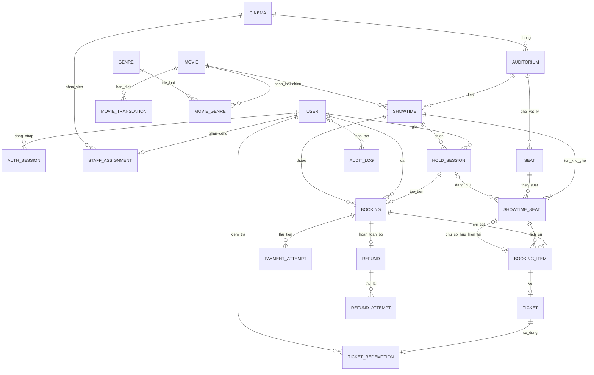
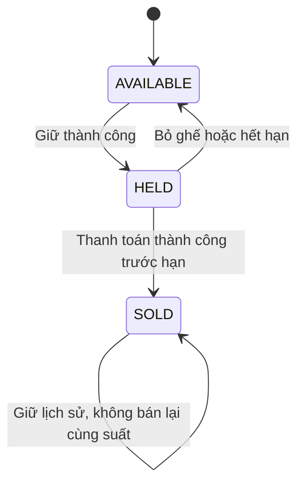
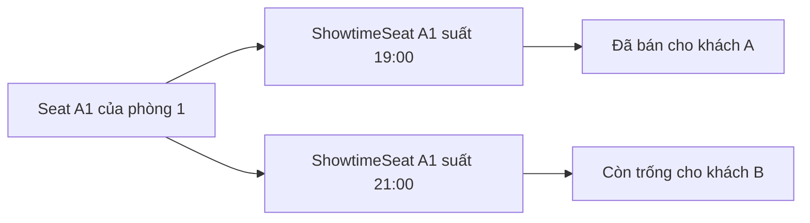

# Thiết kế database CineReserve

Bổ sung 04/11/2026: chatbot không thêm bảng nghiệp vụ; chỉ đọc danh mục/lịch công khai, dùng bộ đếm AuthRateLimit với namespace hash riêng. Không lưu nội dung hội thoại. Đã kết nối và thử Gemini thật ở local; chi tiết: [Chatbot tư vấn phim](10-chatbot-tu-van-phim.md).

Phiên bản 1.9 — 04/11/2026. Trạng thái: đã triển khai danh mục/lịch, tài khoản, giữ ghế, đơn/thanh toán/hoàn giả lập, QR, sử dụng vé một lần, thống kê doanh thu và xác nhận tuổi/chính sách.

### Bổ sung 04/11/2026 — quyền mua và xác nhận checkout

Vẫn 21 bảng. Booking bổ sung ageRatingCode bắt buộc, backfill từ Showtime.ageRatingSnapshot, CHECK phân loại hợp lệ. PaymentAttempt thêm confirmationVersion/confirmedAt nullable, CHECK cùng NULL hoặc cùng có giá trị; bản ghi cũ giữ NULL, không tạo xác nhận hồi tố. Lần thử mới được service kiểm tra hai boolean và phiên bản chính sách hiện tại, rồi ghi thời điểm server cùng transaction thanh toán. Replay cũ không tạo lần mới hoặc yêu cầu xác nhận lại. [Chi tiết và kiểm thử](13-quyen-mua-ve-va-xac-nhan.md).

### Bổ sung 03/11/2026 — báo cáo doanh thu

Vẫn có 21 bảng nghiệp vụ. Booking bổ sung movieId/cinemaId bắt buộc, có FK và index để chụp nguồn doanh thu lúc tạo đơn; dữ liệu cũ được backfill từ suất/phòng. PaymentAttempt thêm index outcome/createdAt, Refund thêm index completedAt. Không tạo bảng tổng hợp sao chép số tiền. Báo cáo lấy SUCCESS và Refund thực tế trong snapshot RepeatableRead, tính theo thời điểm thu/hoàn, không dựa vào trạng thái đơn hiện tại.

Kết nối PostgreSQL chuẩn hóa UTC, hiển thị và chia ngày theo Asia/Ho_Chi_Minh. Migration riêng đã hiệu chỉnh các cột thời gian do adapter ghi trước đây dưới timezone local, giữ nguyên các cột do PostgreSQL now() tạo; sao lưu dữ liệu local trước khi chuyển. Kiểm tra DB đối chiếu epoch thực với Date đọc qua Prisma và giữ kiểm tra constraint chống trùng phòng. Chi tiết: [Thống kê doanh thu](09-thong-ke-doanh-thu.md).

### Bổ sung 03/11/2026 — sử dụng vé

Thêm TicketStatus.USED và TicketRedemption (tổng 21 bảng nghiệp vụ), ticketId UNIQUE, `(staffUserId, requestKey)` UNIQUE, nhân viên/rạp/thời điểm. Ghi USED + redemption + audit cùng transaction; không cho hủy suất có vé đã dùng. Composite FK ShowtimeSeat ↔ đúng BookingItem đã được đưa vào relation Prisma và đồng bộ bằng migration tiếp theo để bảo toàn ràng buộc khi schema diff. Chi tiết: [QR và kiểm tra vé](08-qr-va-kiem-tra-ve.md). Các mô tả tiến độ dưới đây là lịch sử của từng bước.

### Bổ sung 03/11/2026 — đơn và thanh toán mô phỏng

Migration `20261103010000_orders_and_mock_payments` thêm Booking, BookingItem, PaymentAttempt, Ticket, Refund (tổng 20 bảng); HoldStatus.CONVERTED; ShowtimeSeat.soldBookingItemId unique và composite FK đến đúng BookingItem của ghế. Tổng/thu/hoàn dùng BigInt, API trả chuỗi. Unique một SUCCESS/đơn, key thanh toán/đơn, vé/item, refund/đơn; CHECK giá/version và không vừa held vừa sold. Giá/tổng/owner/deadline đối chiếu tại service transaction. Refund hiện chỉ toàn bộ và hoàn thành ngay trong mô phỏng, chưa có trạng thái cổng thật. Chi tiết: [Đơn hàng và thanh toán giả lập](07-don-hang-va-thanh-toan-gia-lap.md). Các tiến độ bên dưới là lịch sử, mô hình đích có phần chưa code.

### Bổ sung 03/11/2026 — ghế theo suất và giữ ghế

Migration `20261103000000_seat_holds` thêm `ShowtimeSeat` và `HoldSession` (tổng 15 bảng nghiệp vụ), backfill ghế các suất đang có. Ghế snapshot hàng/số/loại/isSellable, nullable holdSessionId; không có enum AVAILABLE/HELD/SOLD hay soldBookingItemId ở bản này vì chưa có đơn/vé. AVAILABLE/HELD/MINE/BLOCKED là DTO suy ra sau dọn hạn. Phiên dùng ACTIVE/EXPIRED/CANCELLED, giá chụp và version; CONVERTED sẽ thêm khi có đơn. Partial unique bảo vệ một ACTIVE/tài khoản; CHECK hạn không quá 5 phút, version/giá hợp lệ. Chi tiết triển khai và khác biệt với mô hình đích: [Chọn ghế và giữ ghế](06-chon-ghe-va-giu-ghe.md).

### Bổ sung 02/11/2026 — quản trị

Migration `20261102000000_admin_catalogue`: thêm `MovieStatus.DRAFT`, `Movie.releaseDate` (Date), `Movie.version`, `Showtime.version`, `Showtime.cancelledAt/cancellationReason` và bảng `AuditLog` (actor, action, entity, JSON trước/sau, reason, occurredAt). Tổng 13 bảng nghiệp vụ. Service quản trị đã kiểm tra giờ hoạt động, vòng đời lịch, bảo vệ phim có suất tương lai, version và ghi nhật ký trong cùng transaction. Chi tiết: [Quản lý phim/lịch](05-quan-ly-phim-va-lich-chieu.md). Các mô tả tiến độ 31/10 bên dưới là lịch sử tại mốc đó; mô hình đích ở các mục sau vẫn có phần chưa code.

Đã bổ sung migration auth: User, AuthSession, StaffAssignment và AuthRateLimit. Có authVersion trên tài khoản/phiên để thu hồi hiệu lực sau đổi mật khẩu; xóa session khi đăng xuất thay vì lưu revokedAt. Kiểm tra vai trò, trạng thái và rạp hiện tại ở server; chi tiết cùng kết quả kiểm thử nằm trong [Đăng nhập và phân quyền](04-dang-nhap-va-phan-quyen.md). Mô hình đích ở các mục sau được dùng để tham chiếu; đọc tiến độ triển khai để phân biệt phần đã code.

### Tiến độ triển khai ngày 31/10/2026

Đã tạo PostgreSQL 17 portable riêng ở `127.0.0.1:55432`, schema Prisma, migration đầu và seed có thể chạy lại. Có 8 bảng nghiệp vụ: Movie, MovieTranslation, Genre, MovieGenre, Cinema, Auditorium, Seat, Showtime. Website đã đọc danh mục và lịch từ DB qua service phía server; lịch lọc đúng phim, chi nhánh, ngày và mốc ngừng bán. Database chứa dữ liệu phát triển: 6 phim, 2 rạp, 7 phòng, 224 ghế và 105 suất trong lần seed đầu.

Đã kiểm tra bản dịch vi/en, ràng buộc thời lượng dương và PostgreSQL exclusion constraint chống trùng phòng (gồm thời gian dọn). Chạy seed hai lần không nhân đôi bản ghi. Chưa tạo bảng tài khoản, tồn kho ghế theo suất hoặc giao dịch; chưa thể đặt vé. Mô hình chi tiết bên dưới vẫn là đích thiết kế, không khẳng định toàn bộ đã triển khai.

Ở bước danh mục, MovieStatus dùng NOW_SHOWING/COMING_SOON/ARCHIVED thay cho tách trạng thái công bố và ngày phát hành; cần bổ sung DRAFT/publication khi xây CRUD quản trị. Giá suất dùng Int trong phạm vi giá từng vé, tổng tiền giao dịch BigInt chưa triển khai. Kiểm tra giờ hoạt động, chính sách sửa lịch và phân quyền sẽ được bổ sung ở service quản trị; hiện chưa có API ghi công khai.

Phim/rạp hiển thị lấy từ database nhưng nội dung vẫn là mẫu. Hướng dẫn chạy và bảo quản `.local/postgres`: [README project](../README.md).

Cơ sở nghiệp vụ: [Đặc tả sản phẩm](00-dac-ta-san-pham.md). Database dùng PostgreSQL; Prisma ánh xạ bảng và truy vấn. Các ràng buộc đặc thù PostgreSQL sẽ được cài bằng migration SQL khi cần.

## 1. Đọc nhanh

Database chia thành năm nhóm: tài khoản, danh mục rạp/phim, lịch chiếu, đặt vé/thanh toán, kiểm tra vé/nhật ký.

**Điểm quan trọng nhất:** `Seat` là ghế vật lý, còn `ShowtimeSeat` là ghế đó trong một suất cụ thể. A1 ở suất 19:00 và A1 ở suất 21:00 có hai bản ghi `ShowtimeSeat` khác nhau.

| Ví dụ | Bảng lưu |
| --- | --- |
| Rạp Bắc Ninh, phòng 1, ghế A1 | Cinema → Auditorium → Seat |
| A1 của suất phim lúc 19:00 đang được giữ | ShowtimeSeat liên kết HoldSession |
| Khách trả 100.000 đồng cho A1 | Booking → BookingItem và PaymentAttempt |
| Vé của A1 đã vào rạp | Ticket → TicketRedemption |

Không cần học thuộc tên bảng. Đọc mục 2, 5 và 6 trước để hiểu luồng, sau đó dùng mục 4 làm tài liệu tra cứu.

## 2. Sơ đồ quan hệ

Ký hiệu `||` là một, `o|` là không có hoặc một, `o{` là không có hoặc nhiều. Hai liên kết giữa `BookingItem` và `ShowtimeSeat` phục vụ hai mục đích: lưu lịch sử lựa chọn và xác định người sở hữu ghế hiện tại.

## 3. Quy ước dữ liệu

- Khóa chính `id`: UUID. Khóa ngoại kết nối bằng ID, không bằng tên phim hoặc mã ghế.
- Thời gian sự kiện: `timestamptz`, lưu thời điểm tuyệt đối; hiển thị `Asia/Ho_Chi_Minh`. Ngày phát hành dùng `date`; giờ hoạt động dùng phút từ đầu ngày trong giờ địa phương.
- Tiền: số nguyên VND dùng `bigint`; API chuyển thành chuỗi số khi cần để tránh lỗi JSON/độ chính xác. Giá từng ghế và tổng tiền không âm, giá cơ bản lớn hơn 0.
- Bảng có thể chỉnh sửa có `createdAt`, `updatedAt`; giao dịch thêm thời điểm chuyển trạng thái riêng. Trường `?` dưới đây được phép trống.
- Enum là tập giá trị cho phép, tránh lỗi viết sai trạng thái.
- Dùng `RESTRICT` cho xóa dữ liệu đã có lịch sử nghiệp vụ; không cascade xóa đơn, vé, giao dịch hoặc nhật ký. Danh mục dùng trạng thái ngừng hoạt động/lưu trữ.
- Quy tắc “chỉ có một phiên giữ đang hoạt động” cần hết hạn và khóa đồng thời, không chỉ kiểm tra ở trình duyệt.

## 4. Từ điển bảng

### 4.1. Tài khoản và phân quyền

| Bảng | Trường chính | Ràng buộc/ý nghĩa |
| --- | --- | --- |
| User | id, name, emailNormalized, passwordHash, phone?, role, status, preferredLocale, mustChangePassword | Email chuẩn hóa UNIQUE; role CUSTOMER/STAFF/ADMIN; status ACTIVE/LOCKED; locale vi/en |
| AuthSession | id, userId, tokenHash, expiresAt, revokedAt? | Chỉ lưu hash token; tokenHash UNIQUE; phiên hết hạn/thu hồi không được dùng |
| StaffAssignment | id, userId, cinemaId | userId UNIQUE: một nhân viên thuộc một chi nhánh |

Ứng dụng kiểm tra phân công chỉ dành cho role STAFF, và nhân viên phải có phân công trước khi thao tác. Bản đồ án 1.4 chỉ tạo STAFF mới/gán rạp khi tạo và ghi audit, không có UI đổi role/điều chuyển/khóa. Nếu mở rộng các thao tác này sau đó phải xử lý phiên và lịch sử nhất quán; các kiểm tra tài khoản LOCKED hiện có vẫn giữ. Cấu trúc dữ liệu hỗ trợ mở rộng không đồng nghĩa UI đã được làm.

### 4.2. Danh mục phim và rạp

| Bảng | Trường chính | Ràng buộc/ý nghĩa |
| --- | --- | --- |
| Movie | id, slug, originalTitle, posterUrl, durationMinutes, releaseDate?, ageRatingCode, status | slug UNIQUE; duration > 0; status DRAFT/PUBLISHED/ARCHIVED |
| MovieTranslation | id, movieId, locale, title, synopsis | UNIQUE(movieId, locale); locale vi/en; phim công bố phải có tiếng Việt |
| Genre | id, code, nameVi, nameEn | code UNIQUE |
| MovieGenre | movieId, genreId | Khóa chính ghép; một phim có nhiều thể loại |
| Cinema | id, code, name, address, timezone, opensAtMinute, closesAtMinute, status | code UNIQUE; múi giờ Asia/Ho_Chi_Minh; 0 ≤ mở < đóng ≤ 1440 |
| Auditorium | id, cinemaId, code, name, status | UNIQUE(cinemaId, code); ACTIVE/INACTIVE |
| Seat | id, auditoriumId, rowLabel, seatNumber, type, isSellable | UNIQUE(auditoriumId, rowLabel, seatNumber); số ghế > 0; type STANDARD/VIP |

Phân loại tuổi là mã cấu hình, không tự suy ra tuổi từ tên phim. Chuỗi giao diện dịch ở ứng dụng; nội dung phim dịch trong MovieTranslation. Chưa thiết kế thêm bảng dịch cho mọi nhãn hệ thống.

### 4.3. Suất chiếu và tồn kho ghế

| Bảng | Trường chính | Ràng buộc/ý nghĩa |
| --- | --- | --- |
| Showtime | id, movieId, auditoriumId, startsAt, endsAt, cleanupEndsAt, salesCutoffAt, basePrice, vipSurcharge, durationMinutesSnapshot, ageRatingSnapshot, status, cancelledAt?, cancelledById?, cancellationReason? | DRAFT/ON_SALE/CLOSED/FINISHED/CANCELLED; kết thúc > bắt đầu; dọn ≥ kết thúc + 20 phút; cutoff = bắt đầu − 10 phút |
| ShowtimeSeat | id, showtimeId, seatId, seatLabelSnapshot, seatTypeSnapshot, isSellable, state, holdSessionId?, heldUntil?, soldBookingItemId? | UNIQUE(showtimeId, seatId); state AVAILABLE/HELD/SOLD; soldBookingItemId UNIQUE khi có giá trị |

`ShowtimeSeat` được tạo từ sơ đồ phòng khi tạo suất; chỉ mở bán khi bộ ghế đầy đủ và hợp lệ. Snapshot giữ nguyên mã/loại ghế của suất, tránh lịch sử thay đổi theo danh mục. Server xác minh Seat thuộc đúng Auditorium của suất.

Ràng buộc CHECK cho trạng thái ghế:

- AVAILABLE: không có phiên giữ, hạn giữ hoặc chủ sở hữu đã bán.
- HELD: phải có phiên giữ và hạn giữ, không có chủ sở hữu đã bán.
- SOLD: phải có `soldBookingItemId`, không có phiên/hạn giữ.

Không có trạng thái CANCELLED cho từng ghế: khi suất bị hủy, server từ chối bán dựa trên Showtime; dữ liệu ghế đã bán được giữ để truy vết.

### 4.4. Phiên giữ, đơn và chi tiết đơn

| Bảng | Trường chính | Ràng buộc/ý nghĩa |
| --- | --- | --- |
| HoldSession | id, userId, showtimeId, status, startedAt, expiresAt, quotedBasePrice, quotedVipSurcharge, version | ACTIVE/CONVERTED/EXPIRED/CANCELLED; version tăng mỗi thay đổi; expiresAt cố định |
| Booking | id, code, userId, showtimeId, holdSessionId, status, totalAmount, paidAt?, expiredAt?, cancelledAt?, cancellationReason?, movieTitleViSnapshot, movieTitleEnSnapshot?, cinemaNameSnapshot, auditoriumNameSnapshot, startsAtSnapshot | code UNIQUE, holdSessionId UNIQUE; PENDING/PAID/EXPIRED/CANCELLED |
| BookingItem | id, bookingId, showtimeSeatId, seatLabelSnapshot, seatTypeSnapshot, unitAmount | UNIQUE(bookingId, showtimeSeatId); lưu giá từng ghế |

Một HoldSession có tối đa một Booking, được tạo khi khách sang bước thanh toán. Khi sửa lựa chọn trước trả tiền, đồng bộ các dòng đơn và tổng tiền trong cùng transaction; khóa cả đơn, từ chối sửa nếu đã thanh toán hoặc đang xác nhận thanh toán. Phiên bỏ hết ghế có thể tiếp tục ACTIVE nhưng không được thanh toán và không gia hạn; đơn chưa thanh toán nếu có không còn dòng ghế thì tổng bằng 0.

PostgreSQL partial unique index trên `HoldSession(userId) WHERE status = 'ACTIVE'` bảo vệ một phiên/tài khoản. Trước tạo phiên mới phải đánh dấu phiên ACTIVE đã quá hạn là EXPIRED và giải phóng ghế trong transaction. Không dùng `now()` trong điều kiện unique index để tự coi phiên hết hạn.

Các BookingItem chưa trả tiền không chiếm ghế độc lập. Chỉ `ShowtimeSeat` quyết định tồn kho; nhiều dòng lịch sử có thể tham chiếu cùng ghế/suất, nhưng chỉ một dòng được chỉ định ở `soldBookingItemId`.

### 4.5. Thanh toán, vé và hoàn tiền

| Bảng | Trường chính | Ràng buộc/ý nghĩa |
| --- | --- | --- |
| PaymentAttempt | id, bookingId, idempotencyKey, requestHash, amount, currency, provider, providerTransactionId?, status, createdAt, completedAt?, failureCode? | key UNIQUE; MOCK ở phiên bản đầu; VND; PENDING/SUCCEEDED/FAILED |
| Ticket | id, bookingItemId, tokenHash, tokenCiphertext, status, issuedAt, cancelledAt? | bookingItemId UNIQUE; tokenHash UNIQUE; VALID/USED/CANCELLED |
| TicketRedemption | id, ticketId, checkedById, cinemaId, redeemedAt | ticketId UNIQUE: tối đa một lần dùng; người kiểm tra và rạp lưu để truy vết |
| Refund | id, bookingId, paymentAttemptId, amount, status, reason, requestedById, requestedAt, succeededAt? | bookingId UNIQUE; PENDING/SUCCEEDED/FAILED; hoàn toàn bộ một lần |
| RefundAttempt | id, refundId, idempotencyKey, status, providerReference?, createdAt, completedAt?, failureCode? | key UNIQUE; giữ lịch sử thử lại, không ghi đè lần thất bại |

Thêm partial unique index `PaymentAttempt(bookingId) WHERE status = 'SUCCEEDED'` và `RefundAttempt(refundId) WHERE status = 'SUCCEEDED'`. Cùng key nhưng nội dung yêu cầu khác phải bị từ chối; key không thay thế kiểm tra quyền sở hữu.

Mã QR là token ngẫu nhiên đủ mạnh. Hash dùng tra cứu khi quét; bản mã hóa dùng dựng lại QR trong “Vé của tôi”. Khóa mã hóa nằm ngoài database, không ghi token vào log. Đây là phương án thiết kế, thuật toán và quản lý khóa sẽ được chọn khi triển khai.

Quan hệ vòng `ShowtimeSeat.soldBookingItemId` và `BookingItem.showtimeSeatId` xử lý bằng tạo BookingItem trước rồi cập nhật ghế trong cùng transaction. Bổ sung composite FK bằng SQL để bảo đảm chủ sở hữu bán thực sự tham chiếu đúng ShowtimeSeat, không chỉ là một BookingItem bất kỳ. Chi tiết đơn phải thuộc cùng suất với đơn; giá/tổng/quan hệ thanh toán và hoàn tiền được kiểm tra trong service transaction.

### 4.6. Nhật ký

| Bảng | Trường chính | Ý nghĩa |
| --- | --- | --- |
| AuditLog | id, actorUserId?, action, entityType, entityId, cinemaId?, beforeData?, afterData?, reason?, requestId?, occurredAt | Nhật ký thêm mới, không chỉnh sửa qua ứng dụng; actor trống cho tác vụ hệ thống |

Không lưu mật khẩu, token, thông tin thẻ hoặc dữ liệu cá nhân không cần thiết vào JSON nhật ký. Sửa phim/giá/lịch, phân công nhân viên, hủy suất, hoàn tiền và dùng vé phải có dấu vết.

## 5. Ghế thay đổi như thế nào?

Trạng thái HELD lưu ở database nhưng `heldUntil <= giờ server` nghĩa là giữ đã hết hiệu lực. Truy vấn sơ đồ phải hiểu điều này; không chờ tác vụ dọn dữ liệu mới coi ghế là có thể đặt lại. Khi có yêu cầu giữ mới, server khóa và giải phóng bản ghi hết hạn trước khi gán người mới.

Ghế hết hạn/bỏ giữ chỉ giải phóng khi vẫn thuộc đúng phiên đó; thao tác cũ không được xóa phiên giữ mới của người khác.

## 6. Transaction và chống tranh chấp

Transaction là nhóm thao tác dữ liệu cùng thành công hoặc cùng được hoàn tác. Row lock là quyền xử lý độc quyền tạm thời trên bản ghi; nó không phải thời gian giữ ghế 5 phút của khách.

### 6.1. Thứ tự khóa thống nhất

Trong các thao tác đặt/hủy/kiểm tra: khóa Showtime trước, rồi User khi cần, HoldSession, Booking, các ShowtimeSeat theo thứ tự ID, sau đó Payment/Ticket/Refund liên quan. Khi một thao tác liên quan nhiều suất hoặc nhiều tài khoản, khóa theo thứ tự ID thống nhất. Không khóa tất cả bằng quyền ghi độc quyền nếu không cần: thao tác đặt dùng khóa chia sẻ trên suất, hủy/sửa lịch dùng khóa độc quyền. Chi tiết SQL và phương án retry deadlock sẽ được kiểm chứng khi code.

### 6.2. Giữ hoặc thay ghế

1. Kiểm tra tài khoản, quyền, suất đang bán và thời điểm cutoff.
2. Khóa tài khoản để tuần tự hóa việc tạo/chuyển phiên; xử lý phiên hết hạn.
3. Khóa phiên hiện tại, kiểm tra `version`, hạn và quyền sở hữu; tạo phiên nếu cần.
4. Khóa toàn bộ ghế cũ và mới theo ID; kiểm tra ghế thuộc suất, được bán và có sẵn hoặc thuộc phiên hiện tại.
5. Nếu bất kỳ ghế không hợp lệ: hoàn tác toàn bộ thay đổi. Nếu hợp lệ: bỏ ghế cũ, giữ ghế mới, đồng bộ đơn PENDING nếu có và tăng version.
6. Lấy thời gian server thực tế sau khi chờ khóa để kiểm tra lại trước cập nhật. Không dùng thời gian đầu transaction để xác nhận một phiên đã hết hạn trong lúc chờ.

### 6.3. Thanh toán giả lập thành công

1. Khóa suất, phiên, đơn và ghế theo thứ tự chung; kiểm tra quyền, hạn và trạng thái.
2. Kiểm tra toàn bộ 1–8 ghế vẫn thuộc phiên; tính tổng từ báo giá server, so với chi tiết đơn.
3. Với kết quả giả lập thành công: ghi PaymentAttempt, đổi đơn PAID, đổi ghế SOLD, kết thúc phiên CONVERTED và tạo đủ Ticket trong cùng transaction.
4. Kết quả thất bại chỉ ghi lần thử; phiên giữ hạn cũ.
5. Key hoặc đơn đã xử lý: trả kết quả đã lưu sau kiểm tra quyền; không phát hành thêm vé.

Khi tích hợp cổng thật, không gọi dịch vụ mạng trong khi giữ transaction khóa database. Cần bổ sung inbox/webhook, đối soát và xử lý thu tiền sau hết hạn; đây là thiết kế giai đoạn sau, không giả định thay MOCK bằng tên cổng là đủ.

### 6.4. Kiểm tra vé

Đọc thông tin không dùng vé. Khi nhân viên xác nhận, khóa suất và vé; kiểm tra chi nhánh, cửa sổ thời gian, suất không hủy và vé VALID. Đổi vé USED và thêm TicketRedemption trong cùng transaction. UNIQUE(ticketId) và cập nhật có điều kiện bảo vệ việc sử dụng một lần.

### 6.5. Hủy suất và hoàn tiền

Khóa độc quyền suất, kiểm tra chưa bắt đầu/chưa dùng vé, chuyển CANCELLED; kết thúc phiên giữ, hủy đơn chưa trả tiền và vé đã phát hành, tạo Refund cho từng đơn PAID, ghi audit trong transaction. Khóa này ngăn thanh toán hoặc dùng vé xen vào giữa. Đơn đã trả tiền chuyển CANCELLED nhưng paidAt và giao dịch thu vẫn được giữ.

Sau commit, xử lý từng Refund riêng; thất bại có thể thử lại. Không cần hoàn mọi đơn trong một transaction lớn. Trước thành công phải kiểm tra khoản thu gốc, số tiền, trạng thái và unique index chống hoàn trùng.

## 7. Ngăn lịch chiếu trùng phòng

Đề xuất PostgreSQL exclusion constraint với `btree_gist`: cùng auditoriumId không có khoảng `[startsAt, cleanupEndsAt)` giao nhau khi status khác CANCELLED. Dấu `[` bao gồm đầu, `)` không gồm cuối nên suất tiếp theo có thể bắt đầu đúng khi dọn phòng xong.

Ràng buộc áp dụng cả DRAFT để tránh tạo hai lịch nháp xung đột. Kiểm tra ứng dụng giải thích lỗi dễ hiểu; ràng buộc database bảo vệ khi hai quản trị viên cùng tạo lịch. Migration cần kiểm tra khả năng dùng extension trên môi trường triển khai. Nếu không hỗ trợ, phương án thay thế là khóa bản ghi Auditorium rồi kiểm tra khoảng lịch trong mọi transaction tạo/sửa; không bỏ cơ chế đồng thời.

## 8. Chỉ mục và báo cáo

| Nhu cầu | Chỉ mục dự kiến |
| --- | --- |
| Đăng nhập | User.emailNormalized UNIQUE |
| Xem lịch theo phim/ngày | Showtime(movieId, startsAt), Showtime(auditoriumId, startsAt) |
| Sơ đồ ghế | ShowtimeSeat(showtimeId, seatId) UNIQUE |
| Dọn phiên hết hạn | HoldSession(status, expiresAt), ShowtimeSeat(holdSessionId) |
| Lịch sử khách | Booking(userId, createdAt), Booking.code UNIQUE |
| Quét vé | Ticket.tokenHash UNIQUE |
| Tiền theo thời gian | PaymentAttempt(status, completedAt), Refund(status, succeededAt) |
| Tra cứu nhật ký | AuditLog(entityType, entityId, occurredAt), AuditLog(cinemaId, occurredAt) |

Tiền thu lấy từ PaymentAttempt SUCCEEDED theo completedAt; tiền hoàn lấy Refund SUCCEEDED theo succeededAt; thu ròng = thu − hoàn. Nhóm theo phim qua Booking → Showtime → Movie, chi nhánh qua Auditorium → Cinema. Tổng hợp thu và hoàn riêng trước khi ghép để tránh nhân đôi tiền khi JOIN nhiều lần thử thanh toán/hoàn.

Không dùng `Booking.totalAmount` của mọi đơn làm doanh thu, vì gồm đơn chưa trả tiền và đã hủy. Vé bán theo ngày thanh toán, loại vé CANCELLED; vé đã dùng tính qua TicketRedemption. Tỷ lệ lấp đầy theo từng suất dùng ghế được mở bán làm mẫu số.

## 9. Ràng buộc database và kiểm tra ứng dụng

| Database bảo vệ trực tiếp | Service kiểm tra trong transaction |
| --- | --- |
| ID, FK, email/mã/QR duy nhất | Quyền khách, role, chi nhánh |
| Một ghế/suất, cấu trúc trạng thái ghế | Hạn giữ/cutoff và cửa sổ kiểm tra |
| Một phiên ACTIVE/tài khoản | Hết hạn phiên trước khi tạo phiên mới |
| Một thanh toán thành công/đơn | Giá, tổng tiền, 1–8 ghế, cùng suất |
| Một vé/dòng đơn, một lần dùng/vé | Phát hành chỉ khi thanh toán thành công |
| Một Refund/đơn, một lần hoàn thành công | Khoản thu gốc, số tiền hoàn và quyền hủy |
| Không trùng khoảng lịch bằng exclusion | Giờ hoạt động, phòng/phim hợp lệ |

Ràng buộc xuyên bảng chưa được FK/CHECK bao phủ phải được kiểm tra có khóa trong service, không viết rải rác trong từng màn hình. Khi triển khai migration sẽ liệt kê chính xác các constraint và test dữ liệu sai.

## 10. Dữ liệu cho chatbot AI

Chatbot phiên bản đầu không yêu cầu thêm bảng Conversation, Message, UserPreference hoặc vector database. Ngữ cảnh chỉ nằm tạm trong bộ nhớ tab và gửi kèm yêu cầu có giới hạn; không lưu lịch sử chat lâu dài vào PostgreSQL.

| Nhu cầu chatbot | Nguồn dữ liệu đọc |
| --- | --- |
| Tên, mô tả, thể loại và độ tuổi phim | Movie, MovieTranslation, Genre, MovieGenre |
| Chi nhánh, ngày/giờ, giá cơ bản | Cinema, Auditorium, Showtime còn mở bán và chưa qua cutoff |
| Tình trạng ghế khi có hiển thị | Tổng hợp ShowtimeSeat theo thời điểm server; không lấy holdSessionId hoặc thông tin khách |
| Chính sách đặt/hủy/giữ ghế | Nội dung công khai vi/en quản lý cùng ứng dụng; chưa cần bảng FAQ |

Server dùng truy vấn có tham số và bộ lọc được cho phép; không chạy SQL do mô hình viết. Chỉ gửi dữ liệu công khai đã chọn trường sang dịch vụ AI. Không gửi User, AuthSession, Booking, PaymentAttempt, Ticket, Refund hoặc AuditLog. Nếu triển khai tài khoản database riêng cho chatbot, chỉ cấp đọc trên view công khai; dù dùng chung kết nối ứng dụng vẫn phải tách service tra cứu và giới hạn trường.

Không thêm nội dung chat vào AuditLog. Log kỹ thuật AI tối thiểu không chứa câu hỏi/câu trả lời nguyên văn; cấu hình rate limit và bộ đếm tạm được thiết kế ở tầng ứng dụng, chưa giả định bảng dữ liệu nghiệp vụ giải quyết hạn mức.

Khi muốn lưu lịch sử hoặc cá nhân hóa theo tài khoản trong tương lai, phải thiết kế thêm quyền sở hữu, thời hạn lưu/xóa và sự đồng ý trước khi thêm bảng. Hiện không làm thay đổi mô hình giữ ghế, thanh toán hoặc vé QR.

## 11. Dữ liệu mẫu và tiêu chí kiểm chứng thiết kế

Dữ liệu phát triển: hai chi nhánh, mỗi chi nhánh hai phòng, ghế thường/VIP, một số phim có bản dịch vi/en, suất ở các ngày tương lai; tài khoản thử CUSTOMER/STAFF/ADMIN. Không dùng thông tin người thật, mật khẩu mẫu hoặc giả lập tiền trong môi trường thu tiền thật.

Trước coi schema hoàn thành cần kiểm chứng:

- Migration tạo đầy đủ FK, unique/partial index, CHECK và exclusion constraint hoặc phương án khóa thay thế.
- Hai khách cùng ghế chỉ một người thành công; thử cả giữ và thanh toán đồng thời.
- Phiên hết hạn giải phóng đúng chủ; nhiều tab/đổi suất không tạo hai phiên ACTIVE.
- Lỗi giữa lúc tạo đơn/ghi ghế/tạo vé hoàn tác toàn bộ; retry không trùng đơn hoặc vé.
- Hai nhân viên dùng một vé chỉ một người thành công; hủy suất đồng thời không lọt thanh toán hoặc sử dụng vé.
- Hoàn lại sau lỗi không vượt tiền thu; báo cáo không nhân đôi các lần thử.
- Xếp lịch đồng thời không trùng phòng; snapshot giữ nguyên giá, nhãn ghế và lịch sử.

Đây là tiêu chí cho bước code và kiểm thử, chưa phải kết quả đã chạy. Bước tiếp theo: giải thích sơ đồ với người học, ánh xạ thành Prisma schema và migration khi bắt đầu khởi tạo project.
