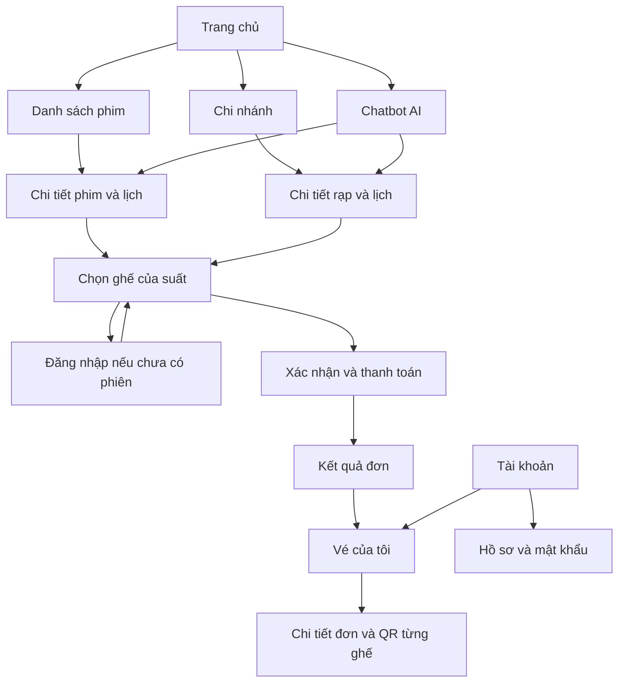
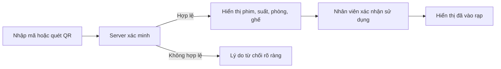

# Thiết kế giao diện và luồng màn hình CineReserve

**Cập nhật phạm vi đồ án 04/11/2026:** màn hình nhân viên tối giản đã có danh sách/tìm kiếm/tạo mới/gán rạp lúc tạo; không có điều chuyển, khóa/mở hoặc reset mật khẩu. Các màn hình vận hành rạp/phòng/hoàn tiền nâng cao trong thiết kế ban đầu bên dưới là hướng mở rộng, không phải chức năng đã triển khai. Đọc [phạm vi 1.4](00-dac-ta-san-pham.md) và [hướng dẫn nhân viên](14-quan-ly-nhan-vien-toi-gian.md) để biết hiện trạng.

Bản thiết kế gốc 1.0 — 24/10/2026, giữ để tham chiếu bố cục. Tiến độ và phạm vi hiện tại theo đặc tả 1.4 và các tài liệu triển khai liên kết phía trên; không dùng trạng thái của bản gốc làm kết luận phần nào đã được code.

Cơ sở: [Đặc tả sản phẩm](00-dac-ta-san-pham.md) và [Thiết kế database](02-thiet-ke-database.md). Đây là thiết kế mới; không dùng giao diện project cũ làm khuôn.

### Cập nhật nhận diện ngày 02/11/2026

Đã thay icon vé có sẵn bằng biểu tượng SVG riêng: chữ C kết hợp tam giác phát phim. Màu chủ đạo vàng hổ phách `#EDC076`, chữ trắng ngà trên nền tối. Component `src/components/brand.tsx` dùng chung ở header và footer; trên mobile thu gọn kích thước và ẩn dòng chữ phụ. Biểu tượng tab ở `src/app/icon.svg` có nền tối để nhìn rõ trên tab sáng/tối.

Nguồn vector: `public/brand/cinereserve-mark.svg` (biểu tượng nền trong suốt), `public/brand/cinereserve-lockup.svg` (bản có tên và dòng chữ phụ trên nền tối, chữ dùng font hệ thống). Wordmark trong website dùng font hiện có của ứng dụng. Tài sản này được tạo mới trong project, không phụ thuộc file ảnh bên ngoài.

## 1. Đọc nhanh và hướng thiết kế

Khách cần tìm được suất phù hợp, hiểu mình đang đặt gì và biết đặt vé đã thành công hay chưa. Nhân viên cần kiểm tra vé nhanh. Quản trị viên cần dữ liệu rõ và tránh sửa nhầm lịch hoặc tiền.

| Khu vực | Hướng thiết kế |
| --- | --- |
| Khách | Phong cách điện ảnh hiện đại, nền tối, poster nổi bật, điểm nhấn vàng hổ phách; ưu tiên điện thoại |
| Nhân viên | Gọn, tương phản rõ, nút lớn, dùng tốt trên điện thoại/máy tính bảng |
| Quản trị | Nền sáng, sidebar, bảng dữ liệu và biểu mẫu; ưu tiên máy tính |
| Chữ và trạng thái | Font hỗ trợ tiếng Việt; trạng thái có nhãn/biểu tượng, không chỉ dựa vào màu |
| Song ngữ | Chuyển VI/EN, nhãn ngắn, có chỗ cho chữ tiếng Anh dài hơn; không mất dữ liệu khi đổi ngôn ngữ |

Đây là hướng thiết kế được chọn để triển khai bản đầu, có thể tinh chỉnh sau khi nhìn giao diện thật. Tránh hiệu ứng nền hoặc chuyển động làm chậm việc chọn suất và ghế.

## 2. Sơ đồ điều hướng



Trang chọn ghế có thể hiển thị thông tin suất khi chưa đăng nhập nhưng không cho giữ ghế. Lúc chọn ghế đầu tiên thì yêu cầu đăng nhập; sau đăng nhập quay lại đúng suất, đọc lại tình trạng ghế, không hứa giữ lại lựa chọn chưa được server chấp nhận.

## 3. Danh sách trang khách hàng

Đường dẫn dưới đây là kế hoạch điều hướng, chưa phải các route đã xây dựng.

| Trang | Đường dẫn dự kiến | Nội dung và hành động chính |
| --- | --- | --- |
| Trang chủ | `/` | Phim nổi bật, đặt nhanh, đang chiếu/sắp chiếu, giới thiệu rạp và chatbot |
| Danh sách phim | `/movies` | Tìm tên, lọc thể loại/trạng thái; mở chi tiết phim |
| Chi tiết phim | `/movies/[slug]` | Poster, mô tả, tuổi, thời lượng, thể loại, lịch theo ngày/rạp; chọn suất |
| Danh sách rạp | `/cinemas` | Tên, địa chỉ và nút xem lịch từng chi nhánh |
| Chi tiết rạp | `/cinemas/[code]` | Địa chỉ, giờ hoạt động, phim và suất theo ngày |
| Đăng nhập/đăng ký | `/login`, `/register` | Biểu mẫu, lỗi, chuyển đổi giữa hai trang và quay lại hành trình |
| Chọn ghế | `/booking/[showtimeId]` | Thông tin suất, sơ đồ ghế, giá, đồng hồ và tiếp tục |
| Thanh toán | `/checkout/[bookingCode]` | Kiểm tra đơn, chính sách, kết quả thanh toán mô phỏng |
| Kết quả/chi tiết đơn | `/account/bookings/[code]` | Trạng thái thực tế, QR hoặc hướng xử lý; không tin tham số URL báo thành công |
| Vé/lịch sử | `/account/bookings` | Bộ lọc sắp chiếu, đã qua, đã hủy; mở đơn |
| Hồ sơ | `/account/profile` | Họ tên, số điện thoại, đổi mật khẩu |
| Chính sách | `/policies` | Giữ ghế, hủy/hoàn tiền và sử dụng vé |

Header khách: logo, Phim, Rạp, VI/EN, tài khoản. Mobile dùng menu thu gọn; giữ các hành động mua vé dễ tìm. Footer có thông tin giới thiệu dự án, liên kết chính sách và nhãn thanh toán mô phỏng; không bịa đối tác hoặc thông tin doanh nghiệp thật.

## 4. Bố cục trang chủ và chi tiết phim

### Trang chủ

```text
┌───────────────────────────────────────────────┐
│ CineReserve   Phim   Rạp       VI/EN  Tài khoản │
├───────────────────────────────────────────────┤
│ PHIM NỔI BẬT                                  │
│ Tên phim · thể loại · thời lượng · phân loại    │
│ [Xem lịch chiếu]                              │
├───────────────────────────────────────────────┤
│ ĐẶT NHANH: [Rạp] [Phim] [Ngày] [Xem suất]       │
├───────────────────────────────────────────────┤
│ Đang chiếu / Sắp chiếu                         │
│ [Poster] [Poster] [Poster] [Poster]             │
│ Tên · Tuổi · Thời lượng · [Xem lịch]            │
├───────────────────────────────────────────────┤
│ Các chi nhánh     |     Bạn chưa biết xem gì?  │
│                  |     [Hỏi trợ lý phim]      │
├───────────────────────────────────────────────┤
│ Footer và chính sách                          │
└───────────────────────────────────────────────┘
```

Một phim nổi bật thay vì carousel tự chạy. Đặt nhanh chỉ dẫn sang danh sách suất đã lọc, không tự giữ ghế. Mobile xếp các ô lọc thành hàng dọc, lưới poster hai cột khi đủ chỗ.

### Chi tiết phim

Phần đầu có poster, tên, nội dung, thời lượng, phân loại và nút “Chọn suất”. Bên dưới có ngày, chi nhánh, các suất nhóm theo rạp; mỗi suất thể hiện giờ, phòng, giá từ dữ liệu thật và trạng thái nhận đặt. Suất ngừng bán vô hiệu hóa nút kèm nhãn, không chỉ làm mờ.

Không có suất thì nói rõ ngày/rạp đang chọn chưa có lịch và cho đổi bộ lọc. Phim không tồn tại có trang 404; ảnh lỗi có ảnh thay thế, không để vỡ bố cục.

## 5. Chọn ghế

```text
┌─────────────────────────────────────────────────────┐
│ Phim > Suất > Ghế > Thanh toán                       │
│ Tên phim · Chi nhánh · Phòng · Ngày giờ               │
├────────────────────────────────┬────────────────────┤
│           MÀN HÌNH             │ ĐƠN CỦA BẠN        │
│                                │ Ghế A1, A2         │
│ A  [1] [2] [3] ...              │ Loại và giá/ghế    │
│ B  [1] [2] [3] ...              │ Tổng tiền          │
│ C  [1] [2] [3] ...              │ Còn 04:32          │
│                                │ [Tiếp tục]         │
│ Chú giải trạng thái và loại ghế │ [Bỏ đặt]           │
└────────────────────────────────┴────────────────────┘
```

- Desktop: sơ đồ bên trái, tóm tắt bên phải. Mobile: sơ đồ có vùng cuộn ngang nếu cần; thanh tổng tiền/tiếp tục cố định phía dưới, không che hàng ghế cuối.
- Mỗi ghế có tên truy cập như “A1, VIP, đang trống”; kích thước bấm đủ lớn. Cho phép cuộn sơ đồ thay vì thu nhỏ ghế đến khó bấm.
- Tách loại ghế (thường/VIP) và trạng thái (trống/của tôi/người khác giữ/đã bán). Thể hiện thao tác đang chờ server, không báo đã giữ quá sớm.
- Chưa chọn ghế: nút tiếp tục vô hiệu, chưa có đồng hồ. Ghế đầu được giữ thành công: hiển thị hạn và số giây còn lại.
- Hết hạn: bỏ trạng thái lựa chọn đã giữ, thông báo và tải lại sơ đồ; khách phải chọn lại. Bỏ đặt hoặc chuyển suất có xác nhận rõ ghế sẽ được trả.
- Bỏ hết ghế giữ nguyên đồng hồ của phiên; đổi ngôn ngữ/tải lại không gia hạn.
- Khi tab cũ hoặc mạng lỗi, hiển thị thông báo và đồng bộ server; không ghi đè lựa chọn mới.

## 6. Thanh toán và kết quả

Thanh toán hiển thị phim, rạp, phòng, suất, từng ghế và giá, tổng tiền, thời hạn, điều kiện tuổi và chính sách không hủy/đổi theo nhu cầu cá nhân. Nhãn “Thanh toán mô phỏng — không thu tiền thật” luôn rõ. Không có biểu mẫu số thẻ hoặc tài khoản ngân hàng thật.

Khách xác nhận đã đọc chính sách và điều kiện xem phim; đây không phải xác minh tuổi. Nút xác nhận thanh toán bị khóa trong lúc gửi để tránh bấm lặp nhưng server vẫn phải chống trùng độc lập.

Trong môi trường thử nghiệm có thể chọn kết quả giả lập thành công/thất bại, ghi rõ đây là công cụ demo. Khi mất phản hồi, hiển thị “Đang kiểm tra kết quả” và tra cứu đơn, không lập tức báo thất bại rồi yêu cầu trả lại.

| Kết quả server | Giao diện |
| --- | --- |
| Đã thanh toán | Mã đơn, tóm tắt và vé QR từng ghế; nút xem vé |
| Thất bại, vẫn còn hạn | Giải thích, nút thử lại và đồng hồ hạn cũ |
| Hết hạn | Không có QR; nút chọn lại suất/ghế |
| Đơn bị rạp hủy | Lý do, vé không hiệu lực, trạng thái hoàn riêng |
| Đang xác minh kết quả | Trạng thái chờ, nút kiểm tra lại; không tạo thanh toán mới tùy tiện |

## 7. Vé của tôi

Danh sách đơn có phim, rạp, thời gian, ghế và trạng thái; phân biệt đơn, vé và hoàn tiền. Không gọi vé chưa quét là “đã dùng” chỉ vì phim đã qua.

Chi tiết đơn có thẻ vé từng ghế: QR, mã vé, phòng, ghế và giờ. QR chỉ tải qua endpoint có quyền hoặc từ dữ liệu người sở hữu được phép xem, không qua URL công khai có thể đoán. Vé đã hủy/đã dùng hiển thị trạng thái lớn, không tiếp tục thể hiện như vé mới. Có lưu/in vé và hướng dẫn bảo vệ mã; không đưa mã đầy đủ vào analytics/log.

Đơn không thuộc người đang đăng nhập trả thông báo không thể truy cập, không tiết lộ dữ liệu khách khác. Ngày chiếu và trạng thái tài chính hiển thị riêng.

## 8. Chatbot AI

Widget ở khu vực khách, không che chọn ghế hoặc nút thanh toán. Trên điện thoại mở thành màn hình/panel đầy đủ, đóng lại quay đúng vị trí trước đó.

```text
┌───────────────────────────────────┐
│ Trợ lý phim AI                [×] │
│ Gợi ý có thể sai; xem chi tiết    │
│ trước khi đặt vé.                 │
│ [Hành động tối nay] [Đi cùng trẻ] │
│                                   │
│ Bạn: Có phim nào tối nay ở ...?    │
│ AI: Các suất phù hợp ...          │
│ [Thẻ phim] [Xem suất chiếu]        │
│                                   │
│ [Nhập câu hỏi...          ] [Gửi] │
│ [Cuộc trò chuyện mới]             │
└───────────────────────────────────┘
```

Gợi ý đầu vào cho thể loại, chi nhánh, ngày; thiếu điều kiện thì hỏi tiếp. Có trạng thái đang trả lời, không có kết quả, quá giới hạn và dịch vụ lỗi. Link phim/suất dựa trên ID đã được server kiểm tra. Chatbot không đặt vé thay khách, không hỏi mật khẩu/thông tin thanh toán.

Ngữ cảnh chỉ trong bộ nhớ tab; đóng panel không xóa nhưng tải lại/đóng tab hoặc chọn “Cuộc trò chuyện mới” xóa. Hai ngôn ngữ giao diện hỗ trợ câu hỏi vi/en, không tự dịch hoặc thay nội dung khách đã gửi. Không có danh sách lịch sử chat hoặc đồng bộ tài khoản trong phiên bản đầu.

## 9. Khu vực nhân viên

| Màn hình | Nội dung |
| --- | --- |
| `/staff` | Chi nhánh được phân công, suất hôm nay, lối vào kiểm tra vé |
| `/staff/check-in` | Nhập mã, quét camera và kết quả xác minh |
| `/staff/bookings` | Tìm mã đơn, lọc suất/ngày, xem vé và hỗ trợ khách |
| `/staff/reports` | Thống kê chi nhánh theo quyền |



Camera chỉ tra cứu, không tự sử dụng vé. Chỉ màn hình xác nhận thành công từ server được hiển thị khách đã vào. Quét trùng/sai rạp/ngoài giờ/vé hủy có nhãn rõ; chưa đủ giờ vào phòng có thời điểm sớm nhất. Quyền camera bị từ chối thì hướng dẫn nhập mã. Có nút “Kiểm tra vé tiếp theo” để tránh nhầm kết quả cũ.

## 10. Khu vực quản trị

Sidebar: Tổng quan, Phim, Chi nhánh, Phòng và ghế, Lịch chiếu, Đơn hàng, Hoàn tiền, Nhân viên, Nhật ký.

| Màn hình dự kiến | Nội dung chính |
| --- | --- |
| `/admin` | Tiền thu/hoàn/ròng, vé bán/dùng, bộ lọc thời gian và chi nhánh |
| `/admin/movies` | Danh sách, thêm/sửa phim, nội dung vi/en, thể loại và phân loại tuổi |
| `/admin/cinemas` (mở rộng) | Chi nhánh, địa chỉ, giờ hoạt động; bản đồ án chuẩn bị dữ liệu qua seed |
| `/admin/auditoriums` (mở rộng) | Phòng, sơ đồ và loại ghế; bản đồ án dùng dữ liệu chuẩn bị |
| `/admin/showtimes` | Lịch theo phòng/ngày, thêm/sửa/mở bán/hủy suất |
| `/admin/orders` | Đã có: tìm đơn, lọc trạng thái, xem giao dịch và trạng thái vé/hoàn giả lập |
| `/admin/refunds` (mở rộng) | Hàng đợi/thử lại hoàn thất bại, chưa triển khai |
| `/admin/staff` | Đã có: danh sách/tìm kiếm, tạo STAFF mới, gán rạp khi tạo, đổi mật khẩu tạm ở lần đăng nhập đầu |
| `/admin/audit` | Lọc người thao tác, đối tượng, thời gian; chỉ đọc |

Biểu mẫu suất chọn chi nhánh → phòng → phim → ngày/giờ → giá. Tự tính giờ kết thúc và dọn phòng, hiển thị bên cạnh giờ bắt đầu. Khi trùng lịch, chỉ rõ suất xung đột. Việc giao diện kiểm tra trước không thay thế ràng buộc server/database.

Hủy suất là hành động có xác nhận riêng: hiển thị phim, rạp, giờ, số đơn, tổng tiền phải hoàn và lý do bắt buộc. Không dùng cùng nút với lưu thay đổi thường. Chưa có dữ liệu không hiển thị số liệu demo như số thật; báo cáo ghi rõ theo ngày giao dịch hay ngày chiếu.

## 11. Component và trạng thái dùng chung

| Thành phần | Dùng ở đâu |
| --- | --- |
| Header, Footer, LocaleSwitcher | Khu vực khách |
| MovieCard, MovieFilters, ShowtimeButton | Danh mục, lịch, kết quả gợi ý |
| SeatMap, SeatButton, SeatLegend | Chọn ghế |
| HoldTimer, BookingSummary | Ghế, thanh toán |
| TicketCard, StatusBadge | Vé, đơn, kiểm tra vé |
| ChatPanel, MovieSuggestionCard | Chatbot |
| DataTable, FilterBar, Pagination | Quản trị và nhân viên |
| FormField, ErrorMessage, ConfirmDialog | Toàn hệ thống |

Trạng thái chung: đang tải, không có dữ liệu, lỗi mạng, không đủ quyền, hết phiên đăng nhập, tài nguyên không tồn tại. Lỗi biểu mẫu nằm cạnh trường và có tóm tắt khi cần. Thông báo quan trọng dùng nội dung đọc được bởi công cụ hỗ trợ; không chỉ toast tự biến mất.

Điều hướng quay lại giữ bộ lọc nếu phù hợp, nhưng dữ liệu ghế/đơn luôn đọc lại server. Không dùng dữ liệu nhạy cảm trên URL hoặc lưu QR vào bộ nhớ trình duyệt không cần thiết. Chỉ cho chuyển hướng sau đăng nhập tới đường dẫn nội bộ hợp lệ.

## 12. Thứ tự code và tiêu chí kiểm tra giao diện

1. Khung ứng dụng, màu/chữ, song ngữ, trang chủ và danh sách/chi tiết phim với dữ liệu mẫu có nhãn phát triển.
2. Chi nhánh, lịch và trạng thái không có suất; sau đó nối dữ liệu database.
3. Đăng nhập/phân quyền và trang quản trị danh mục/lịch; không công khai công cụ quản trị chưa được bảo vệ.
4. Chọn ghế, thanh toán, vé/lịch sử và kiểm tra vé.
5. Hủy suất/hoàn tiền, báo cáo và nhật ký.
6. Chatbot khi dữ liệu phim/lịch và chính sách đã hoạt động; kiểm tra toàn bộ hành trình và responsive.

Các điểm cần kiểm tra khi giao diện được xây:

- Luồng khách từ tìm phim đến nhận QR hoàn thành trên mobile và desktop.
- Không che nút chính bởi thanh cố định, chatbot, bàn phím ảo hoặc thông báo.
- Đổi VI/EN không mất lựa chọn server đã giữ, hạn giữ, bộ lọc hoặc đơn.
- Ghế thao tác bằng bàn phím, có nhãn/trạng thái; không có chuyển động bắt buộc.
- Hai ngôn ngữ không tràn nút/bảng, thông báo lỗi có hướng xử lý.
- Màn hình thành công/hủy/hoàn dựa vào server, không dựa vào điều hướng hoặc màu nút.
- Bố cục tham chiếu kiểm tra ở khoảng 360px, 768px và 1440px; bảng quản trị có cuộn ngang hoặc chế độ rút gọn, không ép chữ nhỏ để vừa màn hình.

Đã triển khai trang chủ, danh sách/tìm/lọc phim, chi tiết và lịch mẫu, danh sách chi nhánh, hướng dẫn và VI/EN. Chi tiết chi nhánh và các màn hình giao dịch còn ở kế hoạch. Đã kiểm tra thủ công luồng đặt nhanh đến đúng rạp/phim/ngày, chuyển ngôn ngữ giữ query, lọc hoạt hình đang chiếu, không có kết quả, thông báo suất mẫu, trang phim không tồn tại và menu mobile. Đã xem bố cục ở viewport desktop mặc định và mobile 390px (vùng nội dung 375px do thanh cuộn), không phát hiện tràn ngang ở các trang đã kiểm tra. Chưa kiểm thử giao dịch thực tế vì chưa có backend.

Điểm dừng học đầu tiên: hiểu component là phần giao diện tái sử dụng, props là dữ liệu truyền vào; xem `src/components/movie-card.tsx`. Dữ liệu mẫu nằm ở `src/lib/catalogue.ts`, chưa phải dữ liệu lấy từ database.
