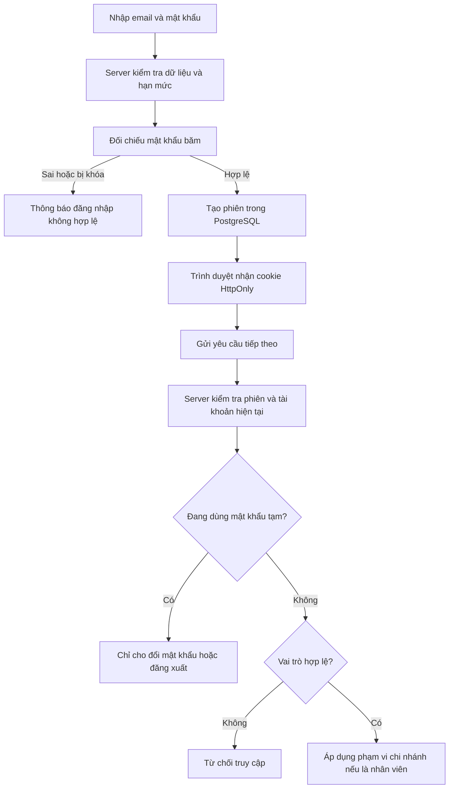

# Đăng nhập và phân quyền CineReserve

Ngày cập nhật: 31/10/2026. Trạng thái: đã triển khai và kiểm thử local, chỉ trong project mới `D:/DA`.

Bổ sung v2: ADMIN đã có màn hình tạo STAFF/gán rạp ngay khi tạo, dùng cơ chế mật khẩu tạm và phân quyền của tài liệu này. Script tài khoản phát triển vẫn phục vụ khởi tạo local; không còn là cách duy nhất tạo nhân viên. UI điều chuyển/khóa/mở/reset nằm ngoài phạm vi đồ án hiện tại. Xem [Nhân viên tối giản](14-quan-ly-nhan-vien-toi-gian.md).

## 1. Đọc nhanh

| Phần | Đã làm |
| --- | --- |
| Đăng ký | Khách tự tạo tài khoản CUSTOMER; chuẩn hóa email, xác nhận mật khẩu |
| Đăng nhập/đăng xuất | Cookie HttpOnly và phiên lưu trong PostgreSQL; đăng xuất thu hồi phiên ở server |
| Hồ sơ | Xem/sửa tên, điện thoại của chính tài khoản; không cho tự sửa email, role hoặc chi nhánh |
| Mật khẩu | Băm scrypt với salt riêng; đổi mật khẩu phải biết mật khẩu hiện tại; thu hồi toàn bộ phiên cũ |
| Phân quyền | CUSTOMER, STAFF, ADMIN được kiểm tra tại server trên trang và API |
| Nhân viên | Chỉ đọc lịch của chi nhánh được phân công; không tin mã rạp khách gửi |
| Tài khoản nội bộ | Có mật khẩu tạm, phải đổi trước khi vào workspace/API nghiệp vụ |
| Song ngữ | Các form, lỗi và hướng dẫn có tiếng Việt/tiếng Anh |

Khu vực quản trị hiện có tổng số phim/rạp/tài khoản; khu vực nhân viên có lịch sắp chiếu của rạp mình. Đây là nền phân quyền, chưa có CRUD quản trị, giữ ghế, đơn đặt vé hoặc kiểm tra QR.

## 2. Hai khái niệm cần hiểu

**Xác thực** trả lời “người này là ai?”. Email và mật khẩu hợp lệ cho phép tạo phiên đăng nhập.

**Phân quyền** trả lời “người này được làm gì?”. Nhân viên đã đăng nhập không có nghĩa được xem mọi rạp hoặc trở thành quản trị viên.



Ví dụ đoạn kiểm tra ở API quản trị:

```ts
await requireViewer(["ADMIN"]);
const count = await getDb().movie.count();
```

Dòng đầu phải thành công mới chạy truy vấn phía sau. Trình duyệt sửa giao diện hoặc gọi API trực tiếp vẫn phải đi qua kiểm tra này.

## 3. Quy tắc dữ liệu và phiên

- Mật khẩu 10–128 ký tự, không tự cắt khoảng trắng trong mật khẩu. Họ tên 2–80 ký tự, email tối đa 254 ký tự, email lưu dạng trim và lowercase, có UNIQUE trong database.
- `scrypt` tạo hash với salt ngẫu nhiên cho từng mật khẩu. Không lưu mật khẩu gốc trong User hoặc trả hash về browser.
- Mỗi lần đăng nhập tạo token ngẫu nhiên 32 byte. Cookie chứa token; database chỉ lưu SHA-256 của token. Cookie `HttpOnly`, `SameSite=Lax`, path `/`, hạn tối đa 7 ngày; bật `Secure` ở production HTTPS.
- Mọi lần xác minh lấy role, trạng thái và chi nhánh hiện tại từ database. Khóa tài khoản hoặc đổi role có tác dụng ở yêu cầu kế tiếp, không đợi cookie hết hạn.
- Đổi mật khẩu tăng `authVersion`, xóa các phiên cũ và phát hành một phiên mới. So khớp authVersion ngăn phiên tạo từ mật khẩu cũ trong yêu cầu đồng thời tiếp tục hoạt động.
- Đăng xuất xóa phiên tương ứng và cookie. Không có phiên đăng nhập lưu trong localStorage.
- Chuyển hướng sau đăng nhập chỉ nhận đường dẫn nội bộ của vi/en đang dùng; chặn URL ngoài, dấu gạch chéo ngược và đường dẫn login/register gây vòng lặp.

## 4. Các bảng mới

| Bảng | Vai trò |
| --- | --- |
| User | Danh tính, mật khẩu băm, vai trò, trạng thái, ngôn ngữ và authVersion |
| AuthSession | Hash của token, tài khoản, phiên bản xác thực và hạn dùng |
| StaffAssignment | Mỗi nhân viên có tối đa một chi nhánh |
| AuthRateLimit | Bộ đếm yêu cầu và mốc reset, dùng chung giữa các process của ứng dụng |

Không tự cấp quyền nhân viên/admin qua đăng ký hoặc cập nhật hồ sơ. Phân công thiếu hoặc rạp ngừng hoạt động khiến tài khoản STAFF không vào được nghiệp vụ nhân viên.

## 5. Trang và API

| Đường dẫn | Điều kiện |
| --- | --- |
| `/vi/login`, `/en/login` | Công khai; đăng nhập xong quay về trang hợp lệ hoặc khu vực theo role |
| `/vi/register`, `/en/register` | Công khai; chỉ tạo CUSTOMER |
| `/{locale}/account/profile` | Đã đăng nhập và không còn mật khẩu tạm |
| `/{locale}/account/password` | Đã đăng nhập, cho phép đổi mật khẩu tạm |
| `/{locale}/admin` | Chỉ ADMIN |
| `/{locale}/staff` | Chỉ STAFF có chi nhánh hoạt động |
| `/{locale}/forbidden` | Thông báo không đủ quyền, không hiển thị dữ liệu nghiệp vụ |

| API | Phương thức | Kiểm tra |
| --- | --- | --- |
| `/api/auth/register` | POST | Dữ liệu, hạn mức, email duy nhất; role cố định CUSTOMER |
| `/api/auth/login` | POST | Mật khẩu và trạng thái tài khoản |
| `/api/auth/logout` | POST | Thu hồi phiên hiện tại nếu có |
| `/api/auth/me` | GET | Trả DTO tài khoản của phiên hiện tại hoặc user=null |
| `/api/auth/profile` | POST | Sửa chính tài khoản, chỉ tên/điện thoại |
| `/api/auth/password` | POST | Mật khẩu hiện tại, xác nhận mật khẩu mới, authVersion |
| `/api/admin/overview` | GET | ADMIN; trả số lượng tổng hợp |
| `/api/staff/showtimes` | GET | STAFF; giới hạn theo chi nhánh lấy từ database |

API bảo vệ trả 401 nếu chưa đăng nhập, 403 nếu sai quyền/chi nhánh, 428 nếu cần đổi mật khẩu tạm, 429 nếu vượt hạn mức. Trang được bảo vệ chuyển tới login/đổi mật khẩu/trang không đủ quyền; việc chuyển trang không thay thế kiểm tra độc lập trên API.

## 6. Kiểm soát yêu cầu và giới hạn hiện tại

- POST yêu cầu JSON, giới hạn body 8KB, kiểm tra Origin khớp origin server và từ chối yêu cầu cross-site. Khi triển khai reverse proxy phải kiểm tra cấu hình origin/host thực tế, không tự tin header forwarded tùy ý.
- Giới hạn theo email cho login/register: 10 yêu cầu/15 phút; đăng ký toàn hệ thống 30/15 phút; auth tổng 150/15 phút; đổi mật khẩu 10/15 phút/tài khoản. Các giới hạn này phù hợp thử nghiệm local, cần đo và bổ sung lớp theo nguồn truy cập trước vận hành thật để hạn chế việc cố tình làm cạn quota chung.
- Chưa có xác minh email, khôi phục mật khẩu, OAuth, MFA, màn hình quản lý nhân viên/khóa tài khoản hoặc nhật ký quản trị đầy đủ. Không xem đây là bộ auth đã đủ mọi yêu cầu production.
- Phiên hết hạn và bucket throttle cũ không còn hiệu lực dù bản ghi vẫn tồn tại. Cần bổ sung tác vụ dọn bản ghi định kỳ khi xây vận hành.
- Chưa có giữ ghế nên đăng xuất chưa cần giải phóng phiên giữ; bổ sung cùng chặng giữ ghế sau này.

## 7. Tài khoản để chủ sản phẩm thử

Chạy `npm run auth:dev-accounts` chỉ trên PostgreSQL local riêng của `D:/DA`. Script tạo ba tài khoản nếu chưa tồn tại, không đổi mật khẩu/tự nâng quyền tài khoản có sẵn:

- `admin@cinereserve.local`: ADMIN.
- `staff.hanoi@cinereserve.local`: STAFF tại Hà Nội.
- `staff.bacninh@cinereserve.local`: STAFF tại Bắc Ninh.

Mật khẩu tạm ngẫu nhiên nằm ở `.local/dev-accounts.md` (được gitignore, không in ở terminal/chat). Người dùng tự đổi mật khẩu khi đăng nhập lần đầu; file này không tự cập nhật sau khi đổi. Không chia sẻ/đưa file vào báo cáo hoặc Git. Khách hàng có thể tự đăng ký trên giao diện, không có mật khẩu khách mặc định.

## 8. Kết quả kiểm tra

`npm run test:auth` thực hiện 44 kiểm tra tích hợp qua HTTP với tài khoản QA ngẫu nhiên, sau đó xóa đúng các tài khoản/phiên QA đã tạo. Script chỉ cho chạy trên database local của project và cần dev server cổng 3001.

Đã đạt: đăng ký, chuẩn hóa/trùng email, sai mật khẩu, không tự nâng role, cookie flags, dữ liệu trả về không có hash, bảo vệ trang/API, nhân viên sai rạp, mật khẩu tạm, đổi mật khẩu/thu hồi phiên, profile, role thay đổi, tài khoản khóa, phiên hết hạn, đăng xuất, hạn mức và redirect nội bộ.

Đã xem giao diện đăng nhập trên desktop và mobile 390px, trường nhập có nhãn, hỗ trợ Enter, hiển thị lỗi server và chuyển VI/EN. Chưa kiểm thử vận hành HTTPS/reverse proxy, gửi email hoặc reset mật khẩu vì các phần đó chưa triển khai.

## 9. Điểm đọc code để học

1. `src/components/auth-form.tsx`: lấy dữ liệu form và gửi yêu cầu; không quyết định quyền.
2. `src/app/api/auth/[action]/route.ts`: kiểm tra và xử lý đăng ký/đăng nhập.
3. `src/lib/auth/session.ts`: kiểm tra thẻ phiên và role hiện tại.
4. `src/app/api/staff/showtimes/route.ts`: ví dụ server tự áp dụng chi nhánh nhân viên.

Chỉ cần nắm luồng “form → server → database → cookie phiên → server kiểm tra quyền”. Các chi tiết scrypt, token hash và thu hồi phiên sẽ được giải thích từng phần khi người học cần, không yêu cầu nhớ toàn bộ ngay.
