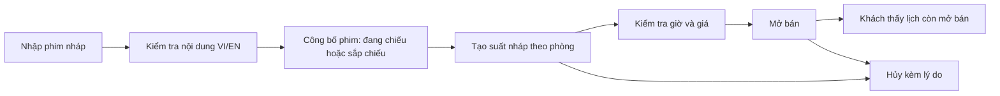
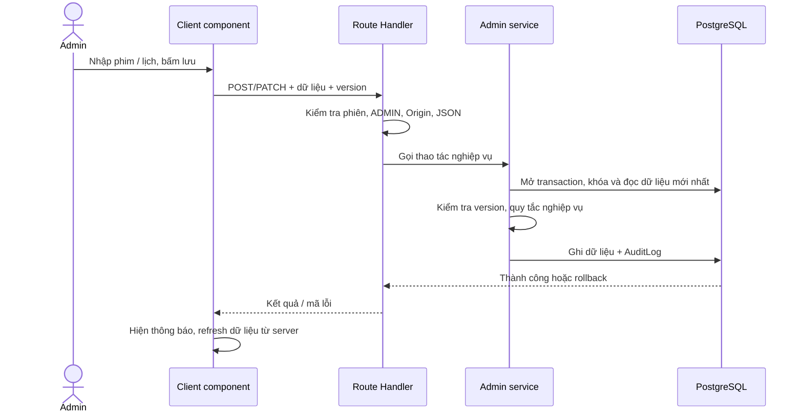

# Quản lý phim và lịch chiếu

Ngày triển khai: 02/11/2026. Áp dụng cho project CineReserve mới tại `D:/DA`.

Cập nhật thanh toán 03/11: chặn sửa suất có đơn PAID. Hủy suất hủy đơn chờ, ghi hoàn tiền giả lập toàn bộ đơn đã trả và hủy mã vé trong cùng transaction. Lịch sử thu vẫn giữ. Chi tiết ở [tài liệu 07](07-don-hang-va-thanh-toan-gia-lap.md); không có hoàn tiền qua cổng thật.

Cập nhật 03/11: đã có [chọn và giữ ghế](06-chon-ghe-va-giu-ghe.md). Admin bị chặn sửa suất có phiên giữ ACTIVE; phòng không đổi sau khi có lịch sử giữ. Hủy suất kết thúc phiên giữ và giải phóng ghế cùng transaction. Phần ghi “chưa có giữ ghế” bên dưới mô tả mốc 02/11; đơn/vé và hoàn tiền vẫn chưa triển khai.

## 1. Đọc nhanh và dùng thử

Đăng nhập bằng tài khoản ADMIN của project mới. Nếu còn mật khẩu tạm, đổi mật khẩu theo yêu cầu trước khi vào quản trị. Thông tin tài khoản phát triển ở `.local/dev-accounts.md`; script tạo tài khoản không reset tài khoản đã có.

| Màn hình | Địa chỉ | Đã làm |
| --- | --- | --- |
| Phim | `/vi/admin/movies` | Tìm tên/slug, lọc trạng thái, phân trang, thêm/sửa nội dung VI/EN, lưu trữ |
| Lịch chiếu | `/vi/admin/showtimes` | Lọc ngày/rạp, phân trang, tạo nháp, sửa, mở bán, hủy kèm lý do |
| Nhật ký | `/vi/admin/audit` | Người sửa, giờ Việt Nam, hành động, dữ liệu trước/sau, lý do hủy |

Đổi `/vi` thành `/en` để dùng giao diện tiếng Anh. STAFF và CUSTOMER không được truy cập các trang/API quản trị này. Nhân viên vẫn chỉ xem lịch của rạp được phân công ở khu vực nhân viên.



Phim được công bố không tự có suất chiếu. Suất nháp cũng chiếm khoảng thời gian của phòng để tránh hai kế hoạch trùng nhau; chỉ suất mở bán mới hiển thị cho khách. Phim sắp chiếu có thể có lịch bán trước.

## 2. Quy tắc dữ liệu

### Phim

- Trạng thái: `DRAFT`, `NOW_SHOWING`, `COMING_SOON`, `ARCHIVED`. Nháp/lưu trữ ẩn ở danh mục và trang chi tiết công khai.
- Tên và mô tả tiếng Việt bắt buộc; tiếng Anh nhập đủ tên và mô tả hoặc để trống cả hai để dùng tiếng Việt dự phòng.
- Slug duy nhất, chữ thường/số/gạch nối. Thời lượng 1–360 phút, năm 1888–2100, phân loại P/K/T13/T16/T18. Chọn ít nhất một trong bốn thể loại đang hỗ trợ.
- Ngày phát hành tùy chọn; trạng thái công bố do admin chọn, chưa tự đổi theo ngày.
- Poster/ảnh nền nhập URL HTTPS hoặc đường dẫn nội bộ bắt đầu bằng `/`. Chưa có tải file hoặc kiểm tra URL ảnh có tải thành công; thẻ phim vẫn có ảnh dự phòng.
- Có suất tương lai chưa hủy, kể cả nháp: chặn đổi thời lượng, phân loại tuổi và chuyển phim về nháp/lưu trữ. Các thông tin nội dung khác vẫn sửa được. Không xóa phim khỏi database.

### Suất chiếu

- Chỉ xếp lịch cho phim công bố, phòng/rạp đang hoạt động và phòng có ít nhất một ghế được bán.
- Server tự tính kết thúc phim, kết thúc dọn phòng, mốc ngừng bán trước 10 phút và chụp lại thời lượng/phân loại tuổi. Không nhận các giá trị này từ giao diện.
- Tất cả ô nhập giờ dùng giờ Việt Nam UTC+7; database lưu thời điểm `timestamptz`.
- Suất mới bắt buộc nháp, kể cả client gửi trạng thái mở bán. Mở bán là một thao tác riêng.
- Sửa/mở bán chỉ được trước mốc ngừng bán; giờ mới cũng phải cách hiện tại hơn 10 phút.
- Phim và 20 phút dọn phòng phải nằm trong giờ hoạt động, cùng ngày. Fixture rạp hiện tại mở 09:00–23:30.
- Giá thường là số nguyên 1.000–10.000.000 VND, phụ thu VIP là 0–10.000.000 VND. Đây là giới hạn nhập liệu phiên bản đầu, không phải bảng giá thương mại.
- Hủy trước giờ bắt đầu, lý do 5–500 ký tự, giữ bản ghi và nhật ký. Suất đã hủy không sửa/mở lại; muốn thay thế thì tạo suất mới.

Ví dụ phim 120 phút bắt đầu 10:00: kết thúc 12:00, dọn đến 12:20. Cùng phòng, suất 12:10 bị từ chối; suất 12:20 được phép. Phòng khác có thể chiếu đồng thời.

**Giới hạn hiện tại:** chưa có giữ ghế, đơn hàng hoặc vé nên chưa có khách bị ảnh hưởng khi sửa/hủy suất. Khi xây phần đặt vé, phải bổ sung chặn sửa phim/phòng/giờ/giá khi có giữ ghế hoặc đơn liên quan, cùng quy trình hoàn tiền khi rạp hủy. Không sử dụng chức năng hủy hiện tại để xử lý vé đã thu tiền thật.

## 3. Luồng code cần hiểu



### A. Component nhận dữ liệu rồi gửi yêu cầu

Trang server đọc database, truyền `items`, `locale` và các lựa chọn vào component. `MovieManager`/`ShowtimeManager` giữ state của biểu mẫu bằng `useState`; chúng không tự kết nối database.

```tsx
const response = await fetch("/api/admin/movies", {
  method: "POST",
  headers: { "Content-Type": "application/json" },
  body: JSON.stringify(body),
});
// Kiểm tra response.ok, hiển thị lỗi hoặc cập nhật lại danh sách.
```

`fetch` là yêu cầu từ trình duyệt đến server. Ẩn nút không đủ để phân quyền; API vẫn kiểm tra ADMIN cho từng yêu cầu. Server kiểm tra lại đầu vào vì người dùng có thể tự gửi yêu cầu mà không qua form.

### B. Version ngăn ghi đè thay đổi của người khác

```ts
if (before.version !== version)
  throw new AdminError("STALE_VERSION", 409);
// Khi lưu thành công:
data: { ...values, version: { increment: 1 } }
```

Ví dụ hai admin cùng mở phim phiên bản 2. Admin A lưu trước, phim thành phiên bản 3. Admin B gửi bản 2 sẽ bị từ chối, cần tải lại. Cách này bảo vệ dữ liệu khỏi bị ghi đè âm thầm; không tự gộp nội dung hai người sửa.

### C. Transaction bảo đảm dữ liệu và nhật ký đi cùng nhau

Nếu lưu lịch được nhưng ghi nhật ký lỗi, toàn bộ thao tác phải hoàn tác. Transaction nhóm các bước thành một lần thay đổi: hoặc tất cả thành công, hoặc không thay đổi gì.

Các thao tác quản trị hiện dùng một khóa PostgreSQL theo transaction (`pg_advisory_xact_lock`) để lần lượt xử lý ghi danh mục/lịch. Cách đơn giản này phù hợp lượng admin nhỏ và tránh việc vừa đổi thời lượng vừa tạo lịch. Khi nhiều chi nhánh ghi đồng thời với tải lớn, sẽ cần khóa theo phim/phòng, quy định thứ tự khóa và kiểm thử lại khả năng đồng thời.

Database còn có exclusion constraint độc lập chống hai khoảng chiếm phòng giao nhau: `[startsAt, cleanupEndsAt)`. Kiểm tra ở service giúp báo lỗi rõ; constraint là lớp bảo vệ cuối nếu có đường ghi khác.

## 4. Tìm code ở đâu

| File/thư mục | Vai trò |
| --- | --- |
| `src/app/[locale]/admin` | Trang server đọc dữ liệu, bộ lọc, kiểm tra quyền |
| `src/components/admin/movie-manager.tsx` | Form và bảng phim |
| `src/components/admin/showtime-manager.tsx` | Form, dự kiến giờ kết thúc, các thao tác lịch |
| `src/app/api/admin/movies` và `showtimes` | API có xác thực và quyền ADMIN |
| `src/lib/admin/service.ts` | Kiểm tra nghiệp vụ, transaction, version, audit |
| `src/lib/admin/shared.ts` | DTO an toàn, trạng thái, thông báo lỗi VI/EN |
| `prisma/migrations/20261102000000_admin_catalogue` | Thêm phim nháp, ngày phát hành, version, thông tin hủy và AuditLog |
| `scripts/check-admin.ts` | Kiểm thử qua HTTP + đối chiếu database |

API ghi phim trả `{ movie }`, lịch trả `{ showtime }`. API danh sách trả `{ items, total, page, pages }`; lịch có thêm `date`. Mỗi trang 20 bản ghi. Lỗi thường gặp: 400 dữ liệu sai, 401 chưa đăng nhập, 403 sai quyền/Origin, 409 trùng lịch/slug hoặc dữ liệu cũ, 428 cần đổi mật khẩu tạm.

## 5. Kiểm chứng và phần tiếp theo

`npm run test:admin` cần PostgreSQL và dev server đang chạy. Đã đạt **73 kiểm tra tích hợp**, gồm:

- ADMIN được thao tác; khách/nhân viên/không đăng nhập bị chặn; chặn yêu cầu ghi khác Origin.
- Tạo/sửa/công bố/lưu trữ phim, bản dịch, lọc/tìm kiếm, dữ liệu không hợp lệ và version cũ.
- Lịch nháp/mở bán/hủy hiển thị đúng với khách; phim sắp chiếu vẫn có lịch bán trước.
- Chặn lịch trùng và trùng thời gian dọn; cho phép đúng biên và khác phòng; hai yêu cầu cùng phòng đồng thời chỉ một thành công.
- Chặn giờ sai, ngoài giờ mở cửa, phòng không hoạt động/không có ghế; bảo vệ phim có lịch tương lai.
- Hủy có lý do, không mở lại, giải phóng khoảng phòng; nhật ký trước/sau và không ghi nhật ký khi thao tác thất bại.
- Trang quản trị VI/EN trả nội dung thành công.

Kiểm thử tạo tài khoản/rạp/phòng/phim QA riêng và dọn sau khi chạy, không sửa fixture hoặc tài khoản phát triển của bạn. Chưa thay thế được kiểm thử tải lớn hay một hành trình mua vé hoàn chỉnh.

Bước tiếp theo: thiết kế và triển khai ghế theo suất, giữ ghế 5 phút và chống hai khách giữ cùng ghế. Cần hiểu `Seat` là ghế vật lý, còn trạng thái bán phải gắn với **ghế trong một suất cụ thể** trước khi code bước đó.
