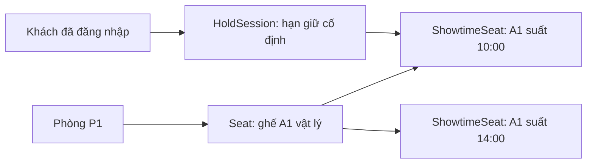
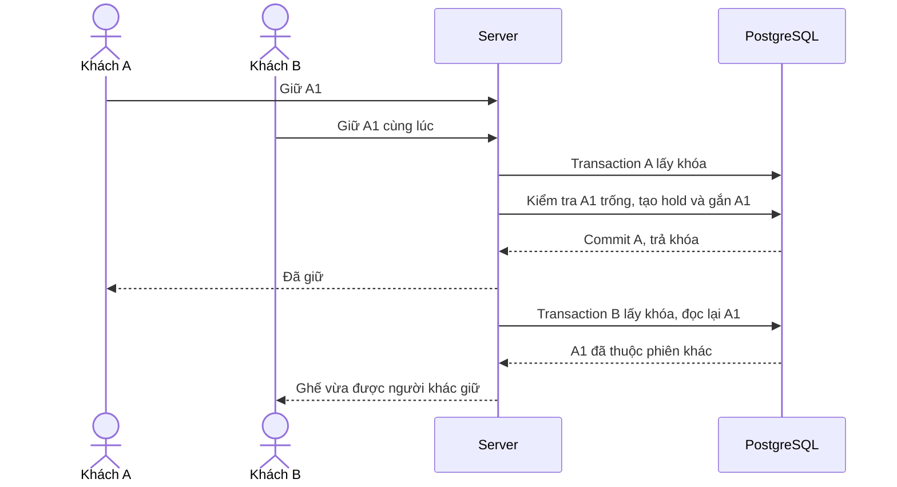
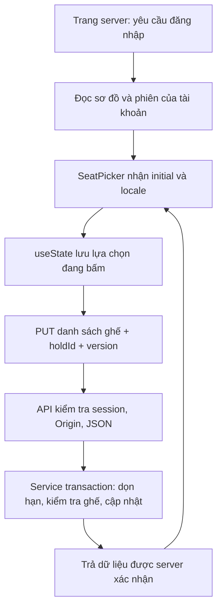

# Chọn ghế và giữ ghế 5 phút

Ngày triển khai: 03/11/2026. Project mới độc lập tại `D:/DA`.

Cập nhật tiếp trong ngày: đã triển khai [đơn hàng và thanh toán giả lập](07-don-hang-va-thanh-toan-gia-lap.md), ghế SOLD và phiên CONVERTED. Sau giữ ghế có nút tiếp tục checkout; đơn chờ đồng bộ khi đổi ghế và không gia hạn. Mô tả “chưa có đơn/vé” bên dưới là mốc trước bước này; hiện có mã vé, chưa QR/check-in hoặc tiền thật.

## 1. Dùng thử

1. Đăng nhập. Tài khoản local được bổ sung theo yêu cầu: **`admin` / `admin`**. Có thể dùng tài khoản khách tự đăng ký để thử đặt ghế.
2. Vào danh sách phim → chi tiết phim → chọn ngày và suất đang mở bán.
3. Chọn 1–8 ghế, xem giá rồi bấm **Giữ ghế trong 5 phút**.
4. Ghế chuyển vàng sau xác nhận thành công; đồng hồ hiển thị hạn giữ còn lại. Ghế thường và VIP có giá khác nhau theo phụ thu của suất.
5. Đổi lựa chọn rồi bấm **Cập nhật ghế đã giữ**, hoặc **Bỏ giữ toàn bộ ghế** để kết thúc phiên.

Đã có giao diện VI/EN, sơ đồ ghế theo hàng, màu phân biệt ghế VIP/đã giữ/đang chọn/không khả dụng và bảng giá. Chưa có thanh toán, đơn hàng hay phát hành vé. Giữ ghế không đồng nghĩa mua vé thành công.

Tài khoản `admin` là bí danh đăng nhập của `admin@local.cinereserve.test`, tách khỏi các tài khoản nội bộ đã tạo trước. Mật khẩu được băm như các tài khoản khác. Bí danh và tài khoản này chỉ đăng nhập khi `ALLOW_LOCAL_ADMIN_LOGIN=true`, ứng dụng không chạy production và database đúng local `127.0.0.1:55432/cinereserve`. Tắt điều kiện cũng làm phiên của tài khoản này mất hiệu lực. Không hạ yêu cầu 10–128 ký tự của đăng ký hoặc đổi mật khẩu. Script `npm run auth:local-admin` tạo nếu chưa có; chạy lại không reset mật khẩu hoặc nâng quyền tài khoản hiện hữu.

## 2. Hai loại dữ liệu ghế — phần cần hiểu trước



`Seat` mô tả ghế vật lý của phòng. `ShowtimeSeat` là bản chụp ghế trong một suất: hàng, số, loại ghế và có bán hay không. Vì thế A1 suất 10:00 có thể đang được giữ nhưng A1 suất 14:00 vẫn trống.

`HoldSession` là phiên giữ của một tài khoản, gắn với một suất. Mỗi tài khoản có tối đa một phiên ACTIVE. Các `ShowtimeSeat` được giữ trỏ đến phiên đó bằng `holdSessionId`. Chưa có trạng thái SOLD vì phần đơn/vé chưa triển khai; sẽ bổ sung cùng thanh toán và ràng buộc chủ sở hữu vé.

Migration tạo bản chụp cho lịch đang có. Khi admin tạo suất mới, inventory ghế được tạo cùng transaction; seed cũng tạo bản chụp cho lịch mẫu mới và không sửa sơ đồ đã chụp.

## 3. Quy tắc giữ ghế

| Tình huống | Cách xử lý đã code |
| --- | --- |
| Bắt đầu giữ | Sau khi server chấp nhận danh sách ghế đầu tiên; không bắt đầu khi chỉ mở trang hoặc bấm chọn tại trình duyệt |
| Hạn giữ | `min(lần giữ đầu + 5 phút, salesCutoffAt)`; cutoff trước giờ chiếu 10 phút |
| Thay đổi ghế | Gửi toàn bộ danh sách mới; cùng phiên, giữ nguyên hạn, tăng version |
| Ghế mới bị giữ mất | Từ chối toàn bộ thay đổi; lựa chọn đã giữ và version cũ không đổi |
| Bỏ chọn hết rồi cập nhật | Giải phóng ghế, phiên vẫn ACTIVE với hạn cũ; có thể chọn lại trước hạn |
| Bấm bỏ giữ | Kết thúc phiên CANCELLED và giải phóng các ghế của đúng phiên đó |
| Tải lại / đổi ngôn ngữ / mở tab | Khôi phục cùng phiên từ database, không gia hạn |
| Tab cũ gửi dữ liệu | Đối chiếu holdId/version, từ chối bản cũ và đọc lại trạng thái |
| Chuyển suất khi còn phiên | Báo có phiên khác, dẫn về phiên cũ để tiếp tục hoặc bỏ giữ trước |
| Hết hạn | Phiên EXPIRED; ghế được tái sử dụng sau kiểm tra server. Muốn giữ lại phải gửi yêu cầu tạo phiên mới rõ ràng |
| Đăng xuất qua app | Thu hồi phiên đăng nhập đó và giải phóng phiên giữ của tài khoản trong cùng transaction |
| Khóa tài khoản | Không được thao tác tiếp; lần kiểm tra giữ ghế kế tiếp giải phóng phiên của tài khoản bị khóa |
| Admin hủy suất | Kết thúc các phiên ACTIVE, giải phóng ghế và ghi nhật ký cùng transaction hủy |
| Admin sửa suất đang có hold | Chặn sửa khi còn phiên ACTIVE. Không đổi phòng sau khi đã có lịch sử hold; hủy và tạo suất khác nếu cần |
| Tạo phiên mới liên tục | Tối đa 5 phiên mới/tài khoản/15 phút; đổi ghế trong phiên không tính thêm lượt |

Ví dụ 18:48 giữ ghế suất 19:00, cutoff 18:50: chỉ giữ đến 18:50, không phải 18:53. Giá do server tính từ báo giá được chụp trong phiên và loại ghế. Dữ liệu giá/tổng giả do client gửi bị bỏ qua.

## 4. Hai khách bấm cùng ghế thì sao?



**Transaction** nhóm các thao tác thành một lần thay đổi. **Khóa database** chỉ tồn tại trong lúc xử lý yêu cầu, thường rất ngắn; không giữ kết nối hoặc khóa SQL suốt 5 phút. Thời gian 5 phút được lưu bằng `expiresAt`.

Hiện dùng chung khóa advisory theo transaction với quản trị (`20261102`) để lần lượt xử lý các thao tác inventory và sửa/hủy lịch. Đây là lựa chọn đơn giản cho đồ án và tải nhỏ. Không phải thiết kế chịu tải cho chuỗi rạp lớn: trước khi mở rộng cần chuyển sang khóa theo suất/tài khoản/ghế với thứ tự thống nhất, đo tải và kiểm thử deadlock.

Database có UNIQUE ghế trong suất và partial unique index bảo vệ một phiên ACTIVE/tài khoản. Ràng buộc CHECK bảo vệ hạn giữ không quá 5 phút, giá và version không âm. Việc xác minh ghế cùng suất, quyền sở hữu, giới hạn 8 ghế và kiểm tra hết hạn nằm ở service transaction; không nên ghi trực tiếp bảng giữ ghế bằng công cụ database.

## 5. Đồng hồ và giải phóng hết hạn

Server đọc giờ PostgreSQL dưới dạng epoch milliseconds để tránh chuyển đổi múi giờ khi đọc raw timestamp qua adapter. `expiresAt` là thời điểm tuyệt đối. DTO trả `serverNow` cùng hạn giữ; giao diện dùng mốc server và thời gian đã trôi qua để đếm xuống, không lấy giờ máy khách làm quyết định nghiệp vụ.

Giao diện đọc lại trạng thái khoảng 5 giây/lần khi tab hiện, khi quay lại cửa sổ và khi đồng hồ hết hạn. Phản hồi cũ hơn trạng thái hiện tại bị bỏ qua. Đây là polling, chưa dùng WebSocket.

Chưa chạy worker/cron dọn nền. Trước mỗi lần đọc/ghi inventory, server đánh dấu các phiên hết hạn và giải phóng ghế trong transaction. Dù bản ghi chưa được dọn khi không có ai truy cập, khách kế tiếp vẫn lấy được ghế sau hạn; không cần chờ một lịch cron. Lỗi nghiệp vụ như ghế bị giữ/phiên cũ được trả ra sau khi phần dọn hạn đã commit; lỗi database sẽ rollback giao dịch.

## 6. Luồng code để học



Ví dụ tại client:

```ts
await fetch(`/api/showtimes/${id}/seats`, {
  method: "PUT",
  headers: { "Content-Type": "application/json" },
  body: JSON.stringify({ seatIds, holdId, version }),
});
```

`selected` chỉ là ghế người dùng đang định chọn. `data.hold` mới là phiên đã được xác nhận. Không đổi ghế thành “đã giữ” ngay lúc bấm nếu chưa có kết quả từ server. Đây là lý do giao diện có hai dòng **ghế đang chọn** và **ghế đã giữ**.

| File | Vai trò |
| --- | --- |
| `src/app/[locale]/showtimes/[id]/seats/page.tsx` | Bảo vệ trang, nạp dữ liệu đầu |
| `src/components/seat-picker.tsx` | Sơ đồ, lựa chọn, đồng hồ, polling, cập nhật/bỏ giữ |
| `src/app/api/showtimes/[id]/seats/route.ts` | GET sơ đồ; PUT giữ/đổi; DELETE bỏ giữ |
| `src/lib/booking/service.ts` | Kiểm tra nghiệp vụ, phiên đăng nhập trong transaction, bảo vệ giá/quyền/version |
| `src/lib/booking/maintenance.ts` | Khóa, giờ DB, hết hạn, giải phóng, chụp sơ đồ |
| `src/lib/booking/shared.ts` | DTO an toàn và thông báo VI/EN |
| `scripts/check-holds.ts` | Kiểm thử tranh chấp, hết hạn, giá và các luồng liên quan |

API chỉ trả thông tin phiên giữ của chính người đang đăng nhập. Với ghế người khác, chỉ trả “đã giữ”, không trả mã phiên/tài khoản người sở hữu.

## 7. Kiểm chứng

Đã đạt **64 kiểm tra tích hợp giữ ghế**, đồng thời 73 kiểm tra quản trị và 44 kiểm tra auth vẫn đạt. Bộ giữ ghế dùng tài khoản/rạp/phim/ghế QA riêng và dọn sau khi chạy. Tình huống hết hạn được kiểm tra bằng điều chỉnh thời gian của bản ghi QA, không chờ đủ 5 phút và không sửa dữ liệu của bạn.

Đã thử trên trình duyệt với dữ liệu mẫu: A1 thường + C1 VIP = 200.000đ; tải lại và đổi VI/EN vẫn giữ đúng ghế, đồng hồ tiếp tục giảm. Đã bỏ giữ ghế dùng thử sau kiểm tra.

```sh
npm run db:generate
npm run db:deploy
npm run dev
# Terminal khác khi DB và website đang chạy:
npm run test:holds
```

Bước tiếp theo là đơn hàng và thanh toán giả lập: chỉ chuyển ghế thành đã bán khi giao dịch xác nhận thành công, xử lý yêu cầu lặp và hết hạn trong lúc thanh toán. Sau đó mới phát hành QR cho từng ghế.
