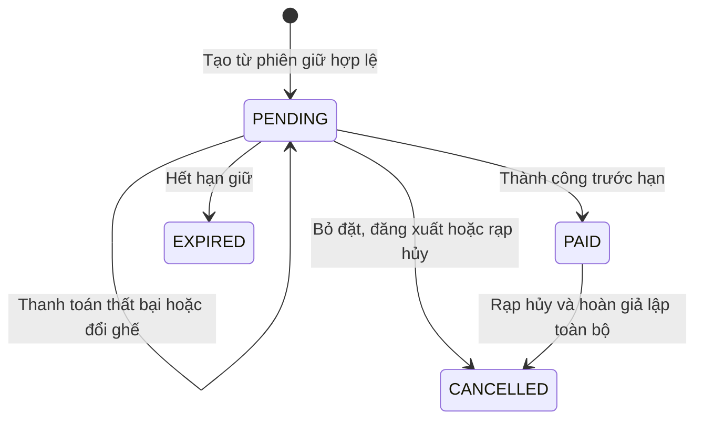
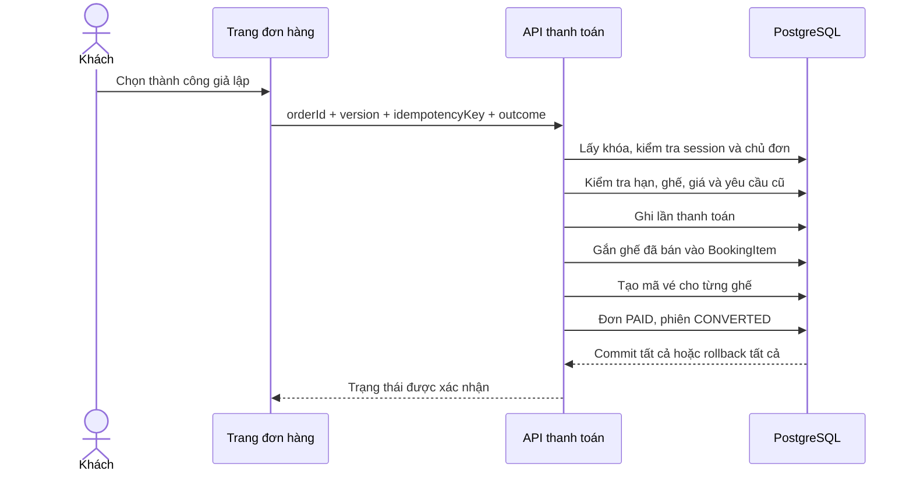
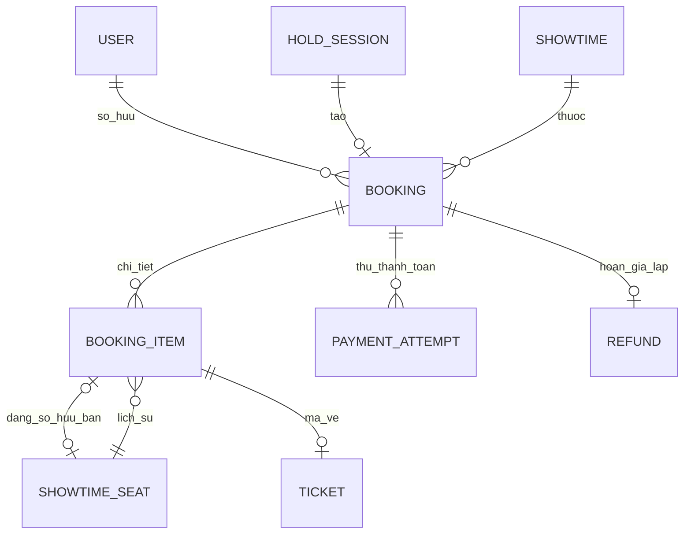

# Đơn hàng và thanh toán giả lập

Ngày triển khai: 03/11/2026. Áp dụng riêng project mới tại `D:/DA`.

Cập nhật tiếp: đã có [QR và kiểm tra vé](08-qr-va-kiem-tra-ve.md), trạng thái USED, thời điểm dùng và chặn hủy suất đã có vé dùng. Các mô tả “chưa QR/check-in” bên dưới là mốc trước bước này; thanh toán/hoàn vẫn chỉ giả lập.

## 1. Dùng thử

1. Đăng nhập → chọn phim/suất → giữ 1–8 ghế.
2. Bấm **Tiếp tục đến thanh toán**. Nếu đã thay đổi lựa chọn, cần cập nhật ghế đã giữ trước.
3. Kiểm tra phim/rạp/phòng/giờ, ghế và tổng tiền. Đồng hồ tiếp tục từ hạn giữ ban đầu, không bắt đầu lại 5 phút.
4. Chọn **Giả lập thanh toán thất bại** hoặc **Giả lập thanh toán thành công**. Không nhập thông tin thẻ, không chuyển tiền thật.
5. Thành công: đơn PAID, ghế đã bán, mỗi ghế có một mã vé. Vào **Đơn hàng** trên header để xem lại.

Giao diện có VI/EN, lịch sử thanh toán, kiểm tra trạng thái và phân trang đơn của chính tài khoản. Mã vé hiện là mã thử nghiệm; chưa có QR, quét vé, PDF/email hay giá trị vào rạp thật.

## 2. Trạng thái đơn



| Tình huống | Xử lý đã code |
| --- | --- |
| Bấm tạo đơn nhiều lần | Một đơn cho một phiên giữ, trả lại đơn hiện có |
| Thanh toán thất bại | Ghi một lần thử FAILED; đơn vẫn PENDING, ghế và hạn giữ không đổi |
| Đổi ghế khi đơn đang chờ | Đồng bộ chi tiết ghế, giá và tổng trong transaction; tăng version đơn |
| Bỏ chọn hết ghế | Đơn chờ có 0 dòng/tổng 0; không thể thanh toán; chọn lại trong cùng hạn nếu còn thời gian |
| Tab cũ thanh toán | Version cũ bị từ chối; phải kiểm tra đơn mới nhất |
| Hết hạn trước thanh toán | Đơn EXPIRED, giải phóng ghế; không phục hồi trực tiếp đơn cũ |
| Thanh toán thành công | Ghi SUCCESS, đơn PAID, phiên CONVERTED, ghế SOLD và mã vé được tạo cùng transaction |
| Tải lại sau thanh toán | Đọc đơn PAID, không hết hạn theo đồng hồ giữ ghế |
| Khách hủy đơn | Chỉ hủy PENDING, giải phóng ghế; không được tự hủy đơn đã trả |
| Đăng xuất | Hủy đơn PENDING của phiên giữ, giữ nguyên các đơn PAID |
| Admin sửa suất có đơn PAID | Chặn sửa để không thay đổi nội dung suất đã bán |
| Admin hủy suất | Hủy đơn chờ; đơn đã trả được hoàn giả lập toàn bộ, mã vé CANCELLED; giữ paidAt và lịch sử thanh toán |

Tối đa 10 lần thử thanh toán/đơn; gửi lại cùng yêu cầu không tính thêm lượt. Hủy và thanh toán đồng thời cũng qua cùng khóa transaction: hoặc thanh toán thành công trước rồi rạp hủy/hoàn, hoặc hủy trước khiến thanh toán bị từ chối.

## 3. Transaction — tránh đơn trả tiền nhưng ghế chưa bán



Các bước trên phải cùng thành công. Nếu tạo mã vé lỗi, không được để lại thanh toán SUCCESS hoặc ghế SOLD dở dang. Bộ kiểm thử đã cố ý thêm một ràng buộc SQL từ chối mã vé của đúng một item QA, gửi thanh toán và kiểm tra: đơn vẫn PENDING, ghế vẫn được giữ, không thêm SUCCESS hay vé. Sau đó gỡ ràng buộc QA và thử lại thành công. Ràng buộc thử và dữ liệu QA được dọn sau kiểm tra.

Server tính lại giá từ báo giá phiên và loại ghế, đối chiếu chủ phiên, số ghế, tổng tiền và deadline ngay trước quyết định thanh toán. Không tin `total`, giá, userId hoặc trạng thái đơn do client gửi.

## 4. Idempotency — gửi lại không tạo thanh toán trùng

Mỗi lần khách chủ động thử thanh toán có một `idempotencyKey` UUID. Server lưu mã cùng đơn, kết quả giả lập, số tiền và version đầu vào.

```ts
const request = {
  idempotencyKey: crypto.randomUUID(),
  version: order.version,
  outcome: "SUCCESS", // hoặc FAILED, chỉ cho mô phỏng
};
// Nếu mất phản hồi: gửi lại cùng request, không tự đổi mã.
```

Ví dụ server đã xử lý thành công nhưng trình duyệt mất mạng trước khi nhận kết quả. Gửi lại mã cũ trả trạng thái hiện tại và mã vé cũ, không tạo thêm thanh toán hoặc vé. Dùng lại mã với outcome/version khác bị từ chối. Hai mã khác nhau cùng thanh toán một đơn cũng chỉ một thành công vì transaction đọc lại trạng thái PAID.

Ở giao diện, khi chưa rõ kết quả, tạm ngăn tạo lượt mới và cung cấp **Kiểm tra trạng thái đơn** / **Gửi lại yêu cầu cũ**. Nếu tải lại toàn trang, request đang chờ không được lưu trong storage; trang đọc trạng thái đơn từ server trước. Trạng thái PAID và unique index vẫn ngăn bán/ghi SUCCESS hai lần. Chưa có webhook, callback hoặc tác vụ đối soát cổng tiền thật.

## 5. Dữ liệu và ràng buộc



Migration `20261103010000_orders_and_mock_payments` thêm 5 bảng, tổng **20 bảng nghiệp vụ**:

| Bảng | Nội dung |
| --- | --- |
| Booking | Khách, phiên/suất, mã đơn, trạng thái, snapshot tên VI/EN/rạp/phòng/giờ, hạn giữ, tổng, version, paidAt/thông tin hủy |
| BookingItem | Ghế theo suất, nhãn/loại ghế và giá chụp của từng dòng |
| PaymentAttempt | Mã yêu cầu, outcome SUCCESS/FAILED, amount, version lúc gửi, thời điểm quyết định |
| Ticket | Mã ngẫu nhiên riêng từng ghế, VALID/CANCELLED; chưa có QR/token quét hoặc check-in |
| Refund | Một lần hoàn giả lập toàn bộ cho một đơn, amount/lý do/thời điểm; tồn tại nghĩa là mô phỏng đã hoàn tất |

`ShowtimeSeat.soldBookingItemId` xác định chủ sở hữu đã bán, khác với các BookingItem lịch sử. UNIQUE và composite FK bảo đảm item được chỉ định thuộc đúng ghế đó. CHECK không cho vừa HELD vừa SOLD. Mỗi item có tối đa một vé, mỗi đơn có tối đa một SUCCESS và một Refund. Ghế của suất đã hủy vẫn giữ liên kết bán lịch sử; suất không mở lại nên không được bán lại.

Tổng đơn, amount thanh toán và hoàn tiền dùng PostgreSQL BigInt; API trả chuỗi để JSON không lỗi hoặc mất chính xác. Giá từng vé vẫn là Int trong giới hạn đã kiểm soát; giao diện định dạng BigInt sang VND.

Đơn và các lần thử đã kết thúc không bị xóa trong chức năng người dùng. Chi tiết đơn PENDING có thể thay thế khi khách đổi ghế; lịch sử mỗi lần thử vẫn giữ amount và version lúc thử.

## 6. Tìm code và API

| File | Vai trò |
| --- | --- |
| `src/components/seat-picker.tsx` | Tạo/reuse đơn từ ghế đã được xác nhận |
| `src/components/order-detail.tsx` | Countdown, kết quả, yêu cầu lặp, lịch sử và mã vé |
| `src/app/[locale]/account/orders` | Danh sách/chi tiết đơn của tài khoản, VI/EN |
| `src/lib/booking/orders.ts` | Checkout, read/list, thanh toán và khách hủy |
| `src/lib/booking/order-maintenance.ts` | Đồng bộ đơn chờ khi đổi ghế; hủy/hoàn theo suất |
| `src/lib/booking/maintenance.ts` | Hết hạn, đăng xuất và cập nhật trạng thái đơn chờ |
| `src/lib/admin/service.ts` | Chặn sửa suất đã bán; hủy/hoàn và audit cùng transaction |
| `scripts/check-orders.ts` | Kiểm thử qua HTTP, đồng thời và lỗi giữa chừng |

| API | Dữ liệu chính |
| --- | --- |
| GET `/api/orders?page=1` | Danh sách riêng, 20 đơn/trang |
| POST `/api/orders` | `{holdId, version}`; version của phiên giữ |
| GET `/api/orders/:id` | `{order}` với dữ liệu safe DTO |
| DELETE `/api/orders/:id` | `{version}` của đơn PENDING |
| POST `/api/orders/:id/payments` | `{idempotencyKey, outcome, version}` của đơn |

Các API đều kiểm tra phiên/quyền sở hữu ở server và trong transaction. Đơn của người khác trả 404; ADMIN cũng không được đọc đơn người khác qua endpoint khách. API ghi kiểm tra Origin, JSON và giới hạn body. Không thu thập thông tin tài chính thật.

## 7. Kết quả và giới hạn

Đã đạt **98 kiểm tra tích hợp đơn/thanh toán**, cộng 64 giữ ghế, 73 quản trị và 44 auth: **279 kiểm tra**. Bao gồm tạo lặp, giá giả, chủ sở hữu, thất bại/thử lại, đổi/không có ghế, version cũ, cùng mã/khác mã đồng thời, rollback khi tạo vé lỗi, hết hạn, ghế đã bán, logout, rạp hủy/hoàn, giới hạn lần thử và trang VI/EN. Dữ liệu QA riêng được dọn; không xóa đơn của bạn.

Đã thử giao diện: giữ A1 thường và C1 VIP, tổng 200.000đ; tạo đơn còn thời gian giữ, thử thất bại rồi thành công; thấy hai mã vé cùng lịch sử hai lần thử và giao diện tiếng Anh. Suất/đơn QA dùng chụp ảnh đã dọn sau kiểm tra.

```sh
npm run db:generate
npm run db:deploy
npm run dev
# Khi PostgreSQL và dev server đang chạy:
npm run test:orders
```

Vẫn dùng khóa chung theo transaction phù hợp đồ án/tải nhỏ và dọn hết hạn khi có request; chưa worker nền hoặc kiểm thử tải lớn. Các nhãn SUCCESS/Refund hoàn tất ở đây chỉ mô phỏng, không phải bằng chứng chuyển tiền. Muốn tích hợp cổng thật phải thiết kế thêm chữ ký webhook, trạng thái bất đồng bộ, thời điểm đến trễ, retry, đối soát và quy trình hoàn tiền thực.

Bước tiếp theo: QR cho từng vé, kiểm tra vé một lần ở đúng rạp và cửa sổ giờ hợp lệ; sau đó thống kê doanh thu từ payment/refund và chatbot AI.
