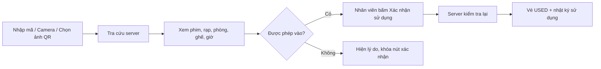
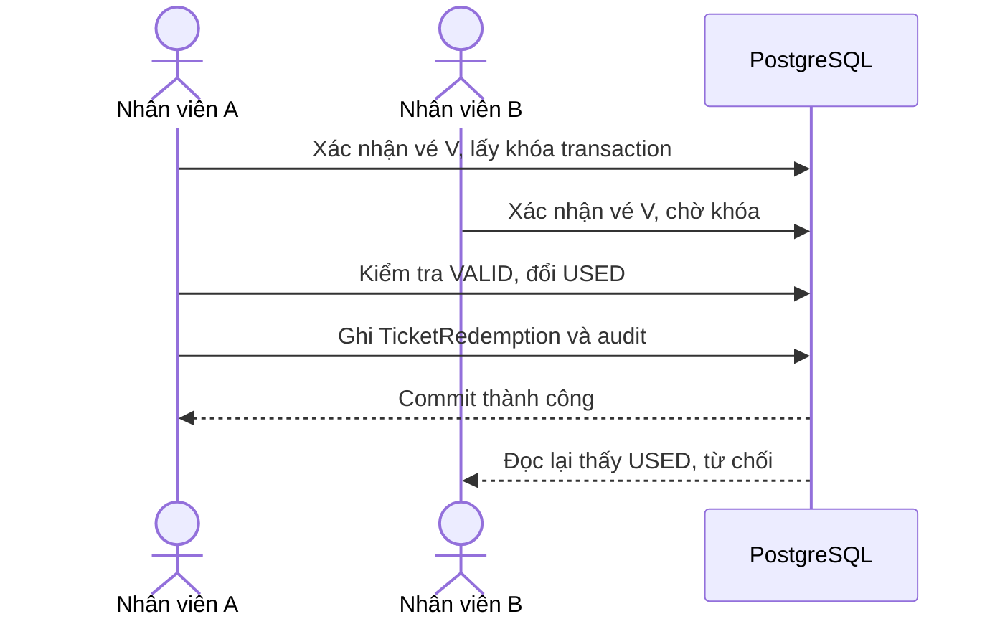

# QR và kiểm tra vé một lần

Ngày triển khai: 03/11/2026. Project CineReserve mới tại `D:/DA`.

## 1. Dùng thử

**Khách:** giữ ghế → thanh toán giả lập thành công → mở đơn trong `/vi/account/orders`. Mỗi ghế có QR riêng, mã vé, phim/rạp/phòng/giờ và trạng thái. Có nút tải QR dạng SVG và in/lưu PDF qua hộp thoại in của trình duyệt. Vé hủy không hiển thị QR; vé đã dùng vẫn có trạng thái và thời điểm sử dụng rõ ràng.

**Nhân viên:** đăng nhập tài khoản STAFF đã gán chi nhánh, vào `/vi/staff` → **Quét và kiểm tra vé**, hoặc `/vi/staff/tickets`. Tài khoản nhân viên phát triển được tạo ở bước auth, thông tin tại `.local/dev-accounts.md`; cần đổi mật khẩu tạm ở lần đầu. Tài khoản `admin` local vẫn là ADMIN, không được cấp quyền quét thay nhân viên.



Đổi `/vi` thành `/en` để xem giao diện tiếng Anh. Đọc QR không tự đánh dấu sử dụng. Nhân viên phải kiểm tra đúng phim/phòng/ghế rồi mới xác nhận; chưa có hoàn tác vé đã dùng.

## 2. QR là gì trong hệ thống này?

QR chỉ là cách biểu diễn chuỗi mã, ví dụ `CR1:TK-…`. Mã vé hiện là 12 byte ngẫu nhiên biểu diễn bằng 24 ký tự hex, khác nhau cho từng ghế. QR không chứa họ tên, email, giá hay thông tin thanh toán. Scanner chấp nhận mã TK hoặc tiền tố CR1; không mở URL bên ngoài được quét vào.

**QR không tự chứng minh vé còn hiệu lực.** Một ảnh QR cũ vẫn có thể đọc được sau khi vé đã hủy hoặc dùng. Server mới quyết định có được vào hay không bằng dữ liệu hiện tại. Vì thế chức năng này cần mạng và không hỗ trợ check-in offline.

Ảnh/mã QR là thông tin cần giữ kín: người có bản sao có thể dùng vé trước chủ vé. Một lần sử dụng được kiểm soát bằng server, không phải bằng cách làm ảnh QR biến mất. Không chia sẻ ảnh vé thật; các ảnh minh họa trong phiên phát triển là dữ liệu QA đã dọn.

## 3. Quy tắc kiểm tra

| Kiểm tra | Hành vi |
| --- | --- |
| Đăng nhập | Chỉ STAFF đang hoạt động, đã đổi mật khẩu tạm và có rạp được gán |
| Chi nhánh | Vé phải thuộc rạp hiện đang phân công; đọc và xác nhận đều kiểm tra lại |
| Thanh toán | Đơn phải PAID, có paidAt và vé khớp dòng đơn sở hữu ghế đã bán |
| Trạng thái | VALID mới được dùng; USED/CANCELLED bị từ chối |
| Rạp/phòng/suất | Đang hoạt động, suất không bị hủy/đưa về nháp |
| Giờ | Từ `max(startsAt - 30 phút, cleanupEndsAt của suất trước chưa hủy)` đến **trước** endsAt |
| Đọc trước, xác nhận sau | Inspection không thay đổi vé; confirm đọc lại mọi điều kiện trong transaction |
| Nhiều người cùng xác nhận | Chỉ một lần thành công; lần khác nhận ALREADY_USED |
| Mất phản hồi | Gửi lại đúng requestKey để nhận kết quả đã ghi, không tạo thêm lượt dùng |
| Hủy suất | Nếu đã có vé dùng, chặn hủy theo luồng thông thường; nếu chưa dùng, hủy/hoàn và xác nhận vé được xử lý tuần tự bằng cùng khóa |

Ví dụ suất sau bắt đầu 19:00, lẽ ra được vào từ 18:30, nhưng phòng dọn đến 18:45 thì chỉ được xác nhận từ 18:45. Đúng thời điểm phim kết thúc đã không được vào nữa. Hạn 10 phút ngừng bán chỉ áp dụng mua vé; không phải hạn ngừng kiểm tra vé.

API đọc/xác nhận có giới hạn riêng 900 yêu cầu/nhân viên/15 phút. Dữ liệu trả cho nhân viên chỉ gồm thông tin vận hành vé, không gồm danh tính khách. Không lưu raw mã QR vào audit; nhật ký dùng ticketId để tham chiếu.

## 4. Hai nhân viên cùng bấm xác nhận



Trong transaction, server cập nhật có điều kiện:

```ts
await tx.ticket.updateMany({
  where: { id, status: "VALID", redemption: { is: null } },
  data: { status: "USED" },
});
// Phải cập nhật đúng một bản ghi rồi mới ghi redemption và audit.
```

`TicketRedemption.ticketId` còn có UNIQUE để không ghi hai lượt cho cùng vé. Mỗi lần xác nhận có requestKey UUID; UNIQUE `(staffUserId, requestKey)` bảo vệ gửi lặp. Dùng lại mã yêu cầu cho vé khác bị chặn. Gửi lại đúng mã của cùng nhân viên trả kết quả đã ghi, kể cả vé lúc này đã USED.

Vé, TicketRedemption và audit cùng thành công hoặc cùng rollback. Bộ kiểm thử đã chèn ràng buộc SQL vào đúng vé QA để làm bước ghi redemption lỗi; kết quả vé vẫn VALID, không có lượt dùng dở dang. Ràng buộc QA được gỡ sau thử.

Hiện dùng chung khóa advisory ngắn với giữ ghế/thanh toán/quản trị để tránh hủy và sử dụng vé xen nhau. Không giữ khóa suốt thời gian khách xem phim. Đây là thiết kế tải nhỏ của đồ án; cần tối ưu khóa theo suất/vé và kiểm thử tải khi mở rộng.

## 5. Camera và đọc ảnh

- Camera chỉ mở sau thao tác bấm nút; ưu tiên camera sau, không lấy âm thanh.
- Xử lý frame bằng canvas và jsQR tại trình duyệt, khoảng 4 lần/giây. Đọc được một mã thì dừng camera rồi tra cứu.
- Tắt track khi người dùng dừng, tab bị ẩn hoặc component bị tháo. Camera cần localhost hoặc HTTPS và quyền của trình duyệt.
- Có nhập mã thủ công và đọc ảnh PNG/JPEG/WebP tối đa 5 MB. Ảnh được giải mã tại client, không tải ảnh lên server; chỉ gửi mã đã đọc.
- Khi mất mạng, không hiện thành công nếu chưa được server xác nhận. Trạng thái chưa rõ giữ requestKey để có thể gửi lại.

Đã kiểm chứng QR round-trip bằng ảnh PNG thật và đường đọc ảnh trên giao diện. **Chưa kiểm chứng camera vật lý trên điện thoại/webcam, quyền camera, ánh sáng và độ lấy nét của từng thiết bị.** Khi thử thực tế cần bật quyền camera và HTTPS nếu truy cập bằng IP máy tính từ điện thoại; luôn có nhập mã dự phòng. Chưa đo hiệu năng scan trên điện thoại yếu.

## 6. Dữ liệu và đường dẫn code

Migration `20261103020000_ticket_redemption` thêm TicketStatus.USED và TicketRedemption (tổng **21 bảng nghiệp vụ**): vé, nhân viên, rạp tại thời điểm sử dụng, requestKey, redeemedAt. Lịch sử giữ nguyên khi nhân viên đổi phân công sau này.

Migration `20261103021000_sold_seat_relation` đưa composite FK ghế đã bán ↔ đúng BookingItem vào mô hình Prisma, tránh việc schema diff bỏ ràng buộc SQL này trong các lần nâng cấp. Đã kiểm tra schema/database không còn khác biệt.

| File | Vai trò |
| --- | --- |
| `src/lib/tickets/shared.ts` | Nhận dạng payload QR, DTO inspection, thông báo VI/EN |
| `src/lib/tickets/service.ts` | Quyền/rạp/thời gian, đọc trước, dùng vé, replay và audit |
| `src/app/api/tickets/[id]/qr/route.ts` | Sinh SVG có kiểm tra chủ vé; private/no-store, có tải file |
| `src/app/api/staff/tickets/[action]/route.ts` | POST inspect/redeem, role/Origin/body và rate limit |
| `src/components/order-detail.tsx` | QR từng ghế, trạng thái USED, tải/in |
| `src/components/qr-reader.tsx` | Camera/canvas/ảnh, xử lý local |
| `src/components/ticket-scanner.tsx` | Quy trình hai bước và xử lý mất phản hồi |
| `src/app/[locale]/staff/tickets/page.tsx` | Trang nhân viên có chặn quyền server |
| `scripts/check-tickets.ts` | Bộ kiểm thử tích hợp và QR round-trip |

| API | Yêu cầu |
| --- | --- |
| GET `/api/tickets/:id/qr` | Chủ đơn PAID; vé chưa CANCELLED; trả SVG |
| GET `/api/tickets/:id/qr?download=1` | Như trên, trả file đính kèm |
| POST `/api/staff/tickets/inspect` | `{code}`; không thay đổi vé |
| POST `/api/staff/tickets/redeem` | `{code, requestKey}`; xác nhận một lần |

Chỉ chủ vé được lấy ảnh QR qua API khách. Nhân viên nhập mã để kiểm tra ở API nhân viên; không được tải QR của người khác qua API chủ vé. Kiểm tra role, trạng thái và phân công diễn ra cả ở API lẫn trong transaction.

## 7. Kiểm chứng và phần tiếp theo

Đã đạt **69 kiểm tra mới**, cùng 98 đơn/thanh toán, 64 giữ ghế, 73 quản trị và 44 auth: **348 kiểm tra tích hợp**. Bao gồm đọc QR, mã sai/URL ngoài, private cache/owner/download, quyền/rạp, giờ/dọn phòng, vé hủy/không thanh toán/đã dùng, đổi phân công/khóa tài khoản, hai nhân viên đồng thời, gửi lặp, lỗi giữa chừng, hủy suất cạnh tranh với dùng vé và trang VI/EN.

Đã thử trên giao diện với rạp/tài khoản/vé QA: chủ vé thấy QR, nhân viên chọn ảnh đọc đúng ghế A3, xác nhận thành công, đọc lại thì bị chặn. Camera vật lý chưa thử như ghi ở mục 5. Fixture, tài khoản và đơn/vé QA đã dọn sau khi chụp ảnh; không reset tài khoản phát triển của bạn.

```sh
npm run db:generate
npm run db:deploy
npm run dev
# PostgreSQL và website cần đang chạy:
npm run test:tickets
```

Bước tiếp theo: thống kê doanh thu theo phim/thời gian/chi nhánh từ payment/refund, sau đó chatbot tư vấn/gợi ý phim.

Tham chiếu thư viện: [node-qrcode — sinh QR](https://github.com/soldair/node-qrcode), [jsQR — giải mã ảnh RGBA](https://github.com/cozmo/jsQR). Không dùng dịch vụ QR bên ngoài để tránh gửi mã vé ra ngoài hệ thống.
