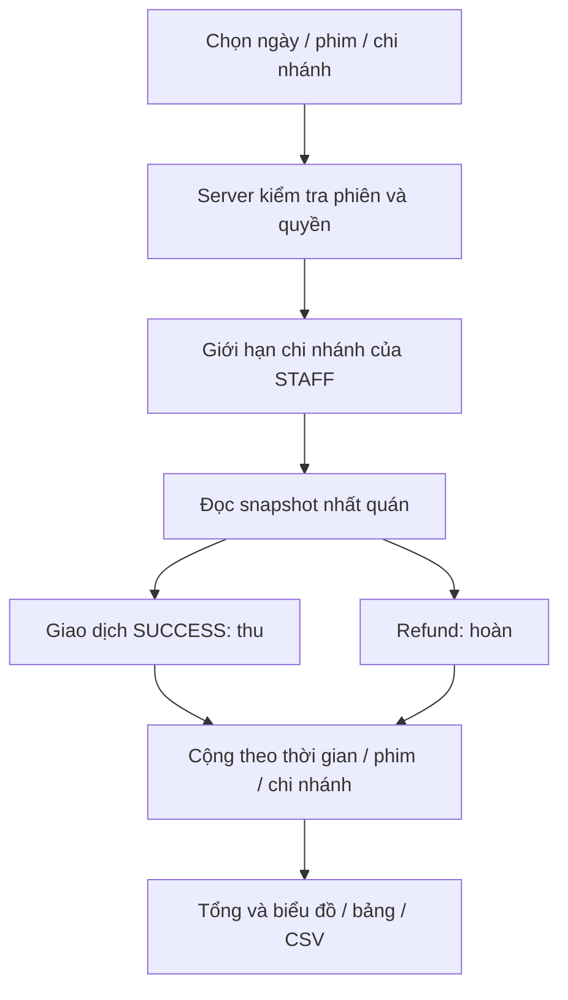

# Thống kê doanh thu

Đã triển khai ngày 03/11/2026 cho project độc lập `D:/DA`. Số tiền hiện đến từ **thanh toán giả lập**, chưa phải đối soát cổng thanh toán thật.

## Cách dùng

- ADMIN: vào **Quản trị → Doanh thu**, đường dẫn `/vi/admin/reports`.
- STAFF: vào **Nhân viên → Doanh thu chi nhánh**, đường dẫn `/vi/staff/reports`. Chỉ xem chi nhánh đang được phân công.
- Chọn từ ngày, đến ngày, gộp theo ngày/tháng, phim và chi nhánh; bấm **Xem báo cáo**. Khoảng chọn tối đa 366 ngày, tính cả hai đầu.
- Xem thẻ tổng, biểu đồ thu/hoàn và bảng theo phim, chi nhánh, thời gian. Các ngày không có giao dịch vẫn hiện số 0.
- **Tải CSV** xuất đúng bộ lọc; có tiếng Việt/Anh theo ngôn ngữ trang. Báo cáo mặc định từ đầu tháng đến hôm nay theo giờ Việt Nam.

## Hiểu số liệu trước khi đọc code

| Chỉ số | Cách tính |
| --- | --- |
| Tiền thu | Tổng PaymentAttempt có outcome SUCCESS trong khoảng ngày |
| Tiền hoàn | Tổng Refund đã hoàn thành trong khoảng ngày, thuộc đơn đã thanh toán thành công |
| Doanh thu ròng | Tiền thu trừ tiền hoàn |
| Đơn/ghế đã trả | Đếm đơn SUCCESS và BookingItem của những đơn đó |
| Đơn/ghế hoàn | Đếm đơn hoàn và BookingItem được hoàn toàn bộ |

**Ngày giao dịch khác ngày chiếu.** Ví dụ khách trả 200.000đ ngày 01/11 rồi rạp hoàn ngày 03/11: ngày 01 có thu 200.000đ; ngày 03 có hoàn 200.000đ và ròng −200.000đ. Chọn cả hai ngày thì ròng bằng 0. Số âm trong một ngày có thể đúng nghiệp vụ.

Đơn chờ, đơn hết hạn và lần thanh toán thất bại không tạo tiền thu. Không lọc doanh thu chỉ bằng Booking.status: đơn đã hoàn vẫn cần giữ lịch sử khoản thu ban đầu. Hiện hệ thống hoàn toàn bộ một đơn; chưa hỗ trợ hoàn từng ghế.

## Luồng xử lý

Điểm cần học: coi mỗi lần thu hoặc hoàn là một **sự kiện tiền**. SQL ghép hai nhóm bằng UNION ALL rồi tổng hợp; không nối trực tiếp nhiều ghế với nhiều lần thử thanh toán vì sẽ nhân bản số tiền. RepeatableRead giúp các bảng trong một lần đọc thấy cùng một trạng thái, tránh tổng và chi tiết lệch khi có người thanh toán đồng thời. Báo cáo chỉ đọc, không khóa luồng giữ ghế.

## Thiết kế dữ liệu và an toàn

- Booking lưu movieId/cinemaId tại lúc tạo đơn. Sau này chỉnh phân loại suất không chuyển doanh thu lịch sử sang phim/rạp khác. Tên hiển thị lấy tên hiện tại trong danh mục; giá tiền lấy bản ghi giao dịch đã lưu.
- Tiền và số lượng tổng hợp dùng BigInt; API trả chuỗi để tránh mất độ chính xác khi số lớn. Không dùng Number để cộng tiền.
- PostgreSQL và kết nối adapter dùng UTC; chia ngày/tháng theo Asia/Ho_Chi_Minh. Bộ lọc là từ 00:00 ngày đầu đến trước 00:00 ngày sau ngày cuối. Cách này bao gồm đúng cả giây cuối ngày.
- Migration đã backfill nguồn phim/rạp trên đơn cũ và chuẩn hóa các thời điểm ứng dụng từng ghi dưới timezone local. Có sao lưu local trước thay đổi; các timestamp do database now() sinh không bị cộng giờ lại.
- Server kiểm tra lại tài khoản, phiên, quyền và phân công rạp, không tin bộ lọc gửi từ trình duyệt. CUSTOMER không được truy cập; STAFF gửi ID rạp khác bị từ chối.
- SQL dùng tham số. CSV có UTF-8 BOM, escape dấu phẩy/ngoặc kép/xuống dòng và chặn công thức trong tên phim/rạp. Không xuất tên/email/số điện thoại khách hoặc mã vé.
- Kết quả không cache công khai. Mỗi lần xem/tải là snapshot mới, có thời điểm tạo; giao dịch phát sinh sau đó xuất hiện khi tải lại.

## Đọc code theo thứ tự

| File | Vai trò |
| --- | --- |
| `src/lib/reports/shared.ts` | Kiểu dữ liệu, nhãn VI/EN và định dạng tiền |
| `src/lib/reports/revenue.ts` | Kiểm tra bộ lọc/quyền và truy vấn tổng hợp |
| `src/lib/reports/csv.ts` | Chuyển cùng dữ liệu báo cáo thành CSV |
| `src/components/revenue-report.tsx` | Bộ lọc, thẻ tổng, biểu đồ và bảng |
| `src/app/api/reports/revenue/route.ts` | API JSON hoặc CSV có phân quyền |
| `scripts/check-revenue.ts` | Kiểm thử tích hợp bằng dữ liệu QA riêng |

## Kiểm tra và giới hạn

115 kiểm tra báo cáo đạt: tổng khớp ba nhóm, biên ngày Việt Nam, hoàn ngày khác, lọc giao nhau, chi nhánh STAFF, tài khoản khóa/đổi phân công, tên độc hại trong CSV, số vượt giới hạn Number, phim lưu trữ/rạp ngừng hoạt động và nguồn lịch sử trên đơn. Cộng với 348 kiểm tra chức năng trước, tổng 463 kiểm tra tích hợp đạt. Dữ liệu QA được dọn sau kiểm tra; không tự thêm doanh thu giả vào màn hình thật.

Đây là báo cáo dòng tiền vé theo ngày thu/hoàn. Chưa có doanh thu đồ ăn, thuế/phí, khuyến mãi, thanh toán thật, đối soát, hoàn từng phần hoặc báo cáo kế toán. Có thể bổ sung sau bằng sự kiện tiền phù hợp thay vì đổi ý nghĩa các chỉ số hiện tại.
