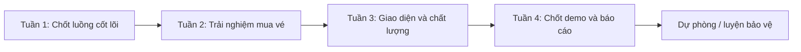

# Rà soát đặc tả và lộ trình v2

**Cập nhật 0.3.0:** [thiết kế lại giao diện khách hàng](20-thiet-ke-lai-giao-dien-khach-hang.md), có nghiên cứu nguồn công khai, hệ màu riêng và kiểm tra responsive. Đã đồng bộ trang chủ, thẻ phim, lịch, tiến trình mua vé và khung AI; 416 kiểm tra liên quan đạt. Chưa phải đợt thiết kế lại khu vận hành hoặc nghiệm thu thiết bị thật.

**Cập nhật 0.2.8:** [đã kiểm thử liên thông đặt vé → thanh toán → QR → soát vé → doanh thu](19-kiem-thu-toan-luong-dat-ve.md), 234 kiểm tra mới đạt; giao diện đọc QR từ ảnh và báo cáo thu/hoàn khớp. Chưa phát hiện lỗi ứng dụng trong các kịch bản này. Tiếp theo ưu tiên thiết bị thật, sao lưu/phục hồi và kịch bản demo/báo cáo.

**Cập nhật 0.2.7:** [đã kiểm tra câu ngắn/không dấu và ngữ cảnh](18-kiem-tra-chat-ngan-va-ngu-canh.md), thêm snapshot tuổi/rạp/ngày và gia cố lượt lỗi; 170 kiểm tra tự động liên quan đạt. Mẫu Gemini thật ghi cả thành công và lỗi dịch vụ.
**Cập nhật 0.2.6:** [Trợ lý hội thoại/câu ngắn và tốc độ](17-tro-ly-phim-hoi-thoai-va-toc-do.md) đã nâng cấp; 128 kiểm tra mô phỏng đạt, đã thử Gemini thật và ghi cả lỗi 503/timeout. Còn cần mở rộng đánh giá chất lượng/đồng tải, không kết luận mọi câu đều đúng hoặc nhanh.
**Cập nhật 0.2.5:** đã tối ưu và kiểm chứng viewport 320/390/768px cho lịch/chọn ghế/checkout; đọc [kết quả và giới hạn mobile](16-toi-uu-giao-dien-mobile.md). Chưa thay thế kiểm tra trên điện thoại thật.
**Cập nhật 05/11/2026 — đợt 4, 0.2.3:** hoàn thành V2-07/V2-10. Điều chỉnh 0.2.4 theo phản hồi: chọn ngày/rạp bằng nút bấm, bỏ form ở lịch chi tiết; 49 kiểm tra lịch đạt. [Chi tiết lịch, bộ lọc và trải nghiệm mua vé](15-lich-chieu-bo-loc-va-trai-nghiem-mua-ve.md). Đã kiểm tra 201 tình huống liên quan và giao diện trình duyệt; lint/build đạt. Chưa kết luận hoàn tất toàn bộ v2 hoặc kiểm chứng mobile thật.
**Quyết định phạm vi mới — 04/11/2026, đợt 3 (0.2.2):** theo yêu cầu chủ đồ án, làm nhân viên tối giản và ưu tiên luồng mua vé/giao diện/demo/báo cáo. Đã có danh sách/tìm/lọc/tạo STAFF/gán rạp khi tạo; 113 kiểm tra mới, tổng 840 kiểm tra đạt. Điều chuyển/khóa/mở/reset, quản trị cơ sở vật chất đầy đủ, hàng đợi hoàn thất bại và check-in riêng ADMIN chuyển sang mở rộng. Đặc tả hiện tại là 1.4; không coi các mục chuyển phạm vi là đã triển khai. [Chi tiết](14-quan-ly-nhan-vien-toi-gian.md).

Ngày rà soát: **04/11/2026**. Project độc lập `D:/DA`. Đặc tả đối chiếu: `00-dac-ta-san-pham.md` phiên bản 1.2; thiết kế DB 1.8; code, routes và các bộ kiểm tra hiện có.

**Cập nhật đợt 2 — 0.2.1:** đã hoàn tất V2-02/V2-03 (quyền mua CUSTOMER và xác nhận tuổi/chính sách). Tổng 727 kiểm tra đạt; đặc tả được làm rõ ở bản 1.3, DB 1.9. [Chi tiết triển khai](13-quyen-mua-ve-va-xac-nhan.md).

**Kết luận cập nhật:** luồng bán vé giả lập cốt lõi đã chạy từ tìm phim đến sử dụng QR và xem doanh thu. Theo phạm vi 1.4, không cần hoàn thiện toàn bộ công cụ vận hành như rạp thật. v2 tiếp tục sửa trải nghiệm, kiểm thử thiết bị và chuẩn bị demo/báo cáo; chưa chuyển sang thu tiền thật. Những phát hiện của lần rà soát đầu vẫn được lưu bên dưới nhưng đã phân loại lại theo quyết định mới.

Không gắn tỷ lệ hoàn thành tùy ý. “Có bảng dữ liệu”, “có code” và “đã nghiệm thu trên thiết bị” là ba mức khác nhau. Bảng dưới phân biệt rõ các mức này.

## 1. Kết quả theo nhóm chức năng

| Nhóm | Đánh giá sau đợt đầu v2 | Bằng chứng / phần còn lại |
| --- | --- | --- |
| Danh sách/chi tiết phim, tìm kiếm/thể loại, nhiều rạp | Đã hoàn thiện lịch và bộ lọc đợt 4 | Lọc rạp/ngày, tìm không dấu, lịch thực và đặt nhanh; 42 kiểm tra mới |
| Đăng ký/đăng nhập, hồ sơ, đổi mật khẩu | Đủ cho phạm vi tài khoản hiện tại | 44 kiểm tra auth; quên mật khẩu/đổi email nằm ngoài bản đầu |
| Phân quyền ADMIN/STAFF/CUSTOMER | Đã sửa quyền mua trong đợt 2 | Chỉ CUSTOMER chọn/giữ ghế, tạo đơn và thanh toán mới; nội bộ vẫn xem vé cá nhân cũ và dùng chức năng vận hành |
| Phim/lịch/giá | Đủ luồng quản lý hiện tại | 73 kiểm tra admin; nháp/mở bán/hủy, version, chống trùng và dọn phòng |
| Chi nhánh/phòng/sơ đồ ghế | Đủ dữ liệu cho luồng đồ án; CRUD UI là mở rộng | Có schema/seed, dữ liệu chọn lịch và ràng buộc; chưa có UI quản trị cơ sở vật chất đầy đủ |
| Chọn/giữ ghế | Đủ nghiệp vụ cốt lõi đã kiểm thử | 65 kiểm tra; 1–8 ghế, 5 phút, cutoff, tranh chấp, nhiều tab, báo giá |
| Xác nhận tuổi/chính sách trước trả tiền | Đã bổ sung đợt 2 | Hai xác nhận rõ ràng VI/EN, kiểm tra server, snapshot phân loại và dấu xác nhận theo lần thử, replay không tạo lần mới |
| Đơn/thanh toán giả lập/lịch sử cá nhân | Đủ luồng đã triển khai | 98 kiểm tra; idempotency, ghế bán/vé cùng transaction |
| QR/check-in | Có; cần kiểm chứng thiết bị | 69 kiểm tra server/QR; camera vật lý và điện thoại qua HTTPS còn phải thử |
| ADMIN kiểm tra vé | Ngoài phạm vi bắt buộc theo 1.4 | Luồng STAFF đã có và được kiểm tra; không cấp quyền admin ngầm |
| Hủy suất/hoàn giả lập | Đủ luồng mô phỏng đã chốt | Hoàn toàn bộ thành công cùng transaction; hàng đợi thất bại/chờ/thử lại là mở rộng chưa triển khai |
| Thống kê | Đủ các chiều yêu cầu đã triển khai | 115 kiểm tra theo phim/ngày/tháng/rạp, thu/hoàn/ròng, CSV; chưa phải báo cáo kế toán |
| Tra cứu đơn cho vận hành | **Đã bổ sung trong đợt này** | ADMIN lọc/phân trang; STAFF nhập đúng mã và giới hạn rạp; 80 kiểm tra mới, thông tin liên hệ che một phần |
| Nhân viên tối giản | Đã hoàn thành đợt 3 | UI danh sách/tạo/gán rạp khi tạo, mật khẩu tạm bắt buộc đổi; không có UI khóa/mở/điều chuyển/reset |
| Nhật ký | Có cho thay đổi hiện hữu | Phim/lịch/hủy/check-in/tạo STAFF có audit; mở rộng cơ sở vật chất nếu làm sau cũng phải có audit |
| AI chatbot | Có và đã thử Gemini thật | 89 kiểm tra mô phỏng + 7 câu mẫu thật/90 đối chiếu; còn cần mở rộng đánh giá ngữ cảnh, ý định, gợi ý |
| VI/EN | Phần lớn đã có; cần rà soát toàn diện | Menu, trang, lỗi chính đã dịch; vẫn có trạng thái/mã kỹ thuật/nội dung phụ rải rác cần thống nhất |
| Nội dung giao diện | **Đã sửa một nhóm trong đợt này** | Bỏ thông báo cũ “chưa bán vé”, “chatbot sẽ bổ sung”; mô tả đúng đặt vé/thanh toán giả lập |
| Triển khai/sao lưu/khôi phục/demo | Còn thiếu nghiệm thu | Đã chạy local; chưa có quy trình restore được thử, bản HTTPS được nghiệm thu và kịch bản demo trọn vẹn |
| Báo cáo/slide/bảo vệ | Chưa hoàn thành | Markdown là đầu vào kỹ thuật; chưa phải bản Word theo mẫu trường hoặc slide bảo vệ |

## 2. Những điểm cần sửa được tìm thấy trong code

P1 = ảnh hưởng đúng đặc tả/hành trình hoặc bảo vệ dữ liệu. P2 = hoàn thiện trải nghiệm/chất lượng. P3 = mở rộng khi còn thời gian.

| Mã | Mức | Điểm cần xử lý | Hướng xử lý / tiêu chí hoàn tất |
| --- | --- | --- | --- |
| V2-01 | P1 | Thiếu tra cứu đơn vận hành | **Đã làm đợt 1**: phân quyền tại server, staff không được liệt kê khách toàn rạp; không đưa QR/mã vé vào kết quả |
| V2-02 | P1 | Quyền mua vé | **Đã hoàn tất đợt 2:** giới hạn CUSTOMER tại API/transaction; thông báo dùng tài khoản khách; giữ quyền xem vé cá nhân cũ và dọn giữ cũ |
| V2-03 | P1 | Xác nhận tuổi/chính sách checkout | **Đã hoàn tất đợt 2:** checkbox VI/EN, kiểm tra server/version, ghi thời điểm và snapshot, replay an toàn, không tuyên bố xác minh tuổi |
| V2-04 | P1 | Nhân viên tối giản | **Đã hoàn thành đợt 3:** danh sách/tìm/lọc/tạo STAFF/gán rạp khi tạo, đổi mật khẩu tạm và audit; điều chuyển/khóa/mở/reset đã chuyển sang mở rộng |
| V2-05 | P3 | UI cơ sở vật chất | Tùy chọn sau đồ án; dữ liệu seed đủ demo hiện tại, giữ các ràng buộc bảo vệ lịch sử nếu mở rộng |
| V2-06 | P3 | Hàng đợi hoàn thất bại/retry | Ngoài bản mô phỏng 1.4; chưa triển khai, không ghi là đã có |
| V2-07 | P1 · Đã xong 0.2.3 | Lịch thực, bộ chọn rạp/ngày | Ngày gợi ý lấy theo suất đang mở bán; ngày ngoài gợi ý được giữ nguyên, không có suất báo rõ |
| V2-08 | P1 | Camera/triển khai/restore chưa nghiệm thu | Thử điện thoại/HTTPS, mất quyền camera, QR ảnh/mã dự phòng; thực hiện một lần sao lưu và khôi phục vào DB thử riêng |
| V2-09 | P2 | Thông báo giai đoạn cũ gây hiểu nhầm | **Đã sửa nhóm chính** ở i18n; tiếp tục rà README/tài liệu lịch sử và các màn hình |
| V2-10 | P2 · Đã xong 0.2.3 | Bộ lọc ngày/rạp và tìm không dấu | Lọc lịch thực, giữ rạp/ngày sang chi tiết; VI/EN giữ query, không tạo lựa chọn mua sai lịch |
| V2-11 | P2 | Quản trị chưa có trạng thái menu đang chọn; tổng quan sơ khai | Sidebar active, nhóm menu theo nghiệp vụ, KPI vận hành dẫn đến danh sách tương ứng |
| V2-12 | P2 | Chưa có đánh giá tải/độ trễ đầy đủ | Đo dữ liệu mẫu lớn và tranh ghế; khóa advisory chung đang phù hợp local/tải nhỏ, chưa hứa khả năng tải production |
| V2-13 | P2 | AI mới có bộ đánh giá nhỏ | Bộ câu hỏi chuẩn vi/en, nhiều cách diễn đạt, theo dõi kết quả/độ trễ, không đưa nội dung nhạy cảm vào log |
| V2-14 | P3 | Check-in riêng ADMIN | Tùy chọn; luồng STAFF đáp ứng demo đồ án và không cấp quyền admin ngầm |
| V2-15 | P2 | Ngày phát hành/không có dữ liệu/lỗi/tải chưa đồng đều | Truyền releaseDate vào DTO công khai, hiển thị phù hợp, skeleton/loading, thông báo và bàn phím trên mọi luồng |

## 3. Đối chiếu 25 tiêu chí nghiệm thu

“Đạt kiểm tra hiện có” không thay thế chạy demo toàn luồng trên thiết bị thật. Các kiểm tra tích hợp đọc/ghi bằng dữ liệu QA riêng và dọn sau chạy.

| Tiêu chí | Trạng thái | Bằng chứng / việc còn lại |
| --- | --- | --- |
| AC-01 chưa login không giữ/đặt | Đạt kiểm tra hiện có | auth/holds/orders |
| AC-02 tranh cùng ghế | Đạt kiểm tra hiện có | holds/orders, Promise.all kiểm tra đồng thời |
| AC-03 hết hạn, không gia hạn | Đạt kiểm tra hiện có | holds/orders |
| AC-04 giá server | Đạt kiểm tra hiện có | holds kiểm tra giá giả từ browser; orders tính lại |
| AC-05 gửi lặp/mất phản hồi | Đạt kiểm tra hiện có | orders; UI giữ request key và kiểm tra trạng thái |
| AC-06 đủ vé khi thành công | Đạt kiểm tra hiện có | orders/tickets |
| AC-07 staff sai rạp | Đạt kiểm tra hiện có | tickets + operations mới |
| AC-08 dùng vé một lần đồng thời | Đạt kiểm tra hiện có | tickets, redemption UNIQUE và transaction |
| AC-09 hủy/hoàn đúng không trùng | Đạt trong mô phỏng thành công | orders/tickets; chưa đủ nhánh hoàn thất bại |
| AC-10 phòng và dọn phòng | Đạt kiểm tra hiện có | admin + PostgreSQL exclusion constraint |
| AC-11 đúng cutoff/hết hạn | Đạt kiểm tra hiện có | holds/orders/tickets |
| AC-12 báo cáo đối chiếu giao dịch/vé | Đạt kiểm tra hiện có | revenue; tiền và ghế được tổng hợp riêng tránh nhân bản |
| AC-13 audit và không mất lịch sử | Có trong phạm vi đã triển khai | Tạo STAFF mới có audit cùng transaction; CRUD cơ sở vật chất ngoài phạm vi hiện tại |
| AC-14 toàn bộ VI/EN, giữ phiên | Một phần | Luồng chính có; cần rà đủ chuỗi và kiểm thử tương tác/điện thoại |
| AC-15 thu/hoàn/ròng theo phim/ngày/tháng | Đạt kiểm tra hiện có | revenue: 115 kiểm tra |
| AC-16 thay ghế nguyên tử/giới hạn | Đạt kiểm tra hiện có | holds/orders |
| AC-17 nhiều tab/mất kết nối | Có cơ chế và kiểm tra chính | version, polling, server restore; cần browser test mất mạng thực |
| AC-18 giờ server và biên thời gian | Đạt kiểm tra hiện có | databaseNow, các bộ giao dịch và kiểm tra DB UTC |
| AC-19 hủy/hoàn nhất quán | Có trong mô phỏng hiện tại | Tiêu chí 1.4 đã chuyển hàng đợi thất bại/retry sang mở rộng, giữ kiểm tra hủy/thanh toán không bỏ sót hoàn và không hoàn trùng |
| AC-20 báo giá và dọn hạn tức thời | Đạt kiểm tra hiện có | holds/admin/orders; không phụ thuộc worker chạy trước |
| AC-21 AI dựa dữ liệu thật | Đạt bộ mẫu, cần mở rộng | 7 câu thật/90 đối chiếu, không bảo đảm mọi câu đúng |
| AC-22 thiếu điều kiện/không kết quả | Một phần | Không bịa kết quả; câu lịch thiếu ngày hiện mặc định hôm nay, lệch câu chữ “hỏi thêm” trong đặc tả; cần thống nhất và ghi thay đổi nghiệp vụ |
| AC-23 AI không có quyền dữ liệu riêng/ghi | Có ranh giới code + bộ mẫu | Chỉ public repository, không SQL/tools ghi; prompt injection đa dạng vẫn cần đánh giá thêm |
| AC-24 không lưu hội thoại lâu dài | Có theo thiết kế/code | useState trong tab, reset/refresh, không có bảng chat; chính sách nhà cung cấp tách riêng |
| AC-25 AI VI/EN/lỗi/hạn mức | Đạt kiểm tra hiện có | chat 89 mô phỏng, UI VI/EN, thử AI thật |

## 4. Lộ trình khoảng một tháng

Mốc khởi đầu 04/11/2026. Chưa có ngày bảo vệ chính thức; dùng tuần tương đối để chủ động có thời gian dự phòng. Ưu tiên hoàn thiện đặc tả trước khi thêm ý tưởng mới.

| Chặng | Việc chính | Kết quả bàn giao |
| --- | --- | --- |
| Tuần 1 | Tra cứu đơn, quyền CUSTOMER, xác nhận tuổi/chính sách, nhân viên tối giản (đã có) | Đủ luồng vai trò cơ bản, không mở rộng quản trị nhân sự sâu |
| Tuần 2 | Lịch chiếu theo dữ liệu thực, bộ lọc rạp/ngày, trải nghiệm chọn ghế/checkout/vé cá nhân | Khách demo dễ theo dõi, sửa lỗi thay vì thêm nhiều màn hình vận hành |
| Tuần 3 | Nâng trải nghiệm khách/admin, lịch từ dữ liệu thật, tìm/lọc, vé của tôi, đánh giá AI/tải, HTTPS và camera | Bản giao diện v2 đồng bộ trên điện thoại/máy tính, kịch bản trọn luồng đã thử |
| Tuần 4 | Sửa lỗi cuối, đóng tính năng lớn, sao lưu/restore, dữ liệu demo, báo cáo theo mẫu trường, slide và câu hỏi | Bản demo ổn định, báo cáo khớp code, có phương án demo local dự phòng |

Mỗi tuần cập nhật báo cáo song song theo phần đã code, không dồn toàn bộ viết báo cáo vào tuần cuối. Trước bảo vệ chừa ít nhất vài ngày chỉ sửa lỗi/diễn tập. Không tự triển khai công khai hoặc phát sinh dịch vụ trả phí mới trong đợt rà soát này.

## 5. Gợi ý nâng cấp giao diện/tính năng sau phần bắt buộc

### Nên làm trong v2

- **Khách:** giữ phong cách điện ảnh hiện tại, làm lịch chiếu dễ thấy hơn; bộ lọc rạp/ngày rõ, trạng thái không có suất; checkout có ba bước Suất/ghế → Kiểm tra/thanh toán → Vé; “Vé sắp xem” nổi bật trong tài khoản.
- **Quản trị/nhân viên:** không ép dùng bố cục trang chủ; sidebar có trạng thái đang chọn, tìm kiếm/phân trang nhất quán, trạng thái dễ hiểu, nút thao tác dẫn đến đúng nghiệp vụ.
- **Chatbot:** từ thẻ phim chuyển tới đúng ngày/rạp, câu hỏi tiếp theo rõ hơn, thông báo lỗi có hướng xử lý; đánh giá chất lượng trước khi thêm công cụ mới.
- **Demo:** bộ dữ liệu và tài khoản mẫu riêng, không tự seed lại mỗi lần mở trang; lịch còn hiệu lực theo ngày demo, có kiểm tra xung đột trước khi tạo.

### Chỉ cân nhắc khi các P1 đã xong

Phim yêu thích, trailer, đánh giá phim có kiểm duyệt, voucher đơn giản hoặc gửi email vé. Chọn tối đa một tiện ích tạo giá trị rõ thay vì thêm tất cả. Chưa đưa combo/tích điểm/ghế đôi vào kế hoạch tháng này vì tăng đáng kể nghiệp vụ giá, tồn kho và hoàn tiền.

Thanh toán sandbox có thể là phần mở rộng cuối nếu giáo viên yêu cầu và còn thời gian; không coi là thiếu của bản đặc tả giả lập. Thu tiền thật cần thiết kế webhook/đối soát riêng, không chỉ thay nút thanh toán.

## 6. Đợt 1 đã bắt tay làm trong lượt này

- Mốc mã nguồn tăng `0.1.0 → 0.2.0` (bắt đầu v2, **chưa phải tuyên bố hoàn tất toàn bộ v2**).
- Thêm `/vi|en/admin/orders`, `/vi|en/staff/orders`, API GET `/api/operations/orders`.
- ADMIN tìm mã, trạng thái, chi nhánh, ngày tạo, phân trang 20; STAFF nhập đầy đủ mã và bị giới hạn chi nhánh ở server.
- Xem ghế, trạng thái vé, thanh toán/hoàn giả lập; không trả QR/mã vé, không ghi dữ liệu đặt vé; che email/điện thoại.
- Đơn PENDING qua hạn hiển thị EXPIRED theo server, có nhãn giải thích; tra cứu không tự dọn hạn hoặc kéo dài giữ ghế.
- Sửa nội dung VI/EN còn mô tả chatbot/thanh toán như chưa được triển khai.
- 552 kiểm tra cũ chạy lại đạt; 80 kiểm tra tra cứu đơn mới đạt. Đọc [hướng dẫn tra cứu đơn](12-tra-cuu-don-van-hanh.md).

## 7. Chỗ bạn cần hiểu

**Phân quyền không phải ẩn menu.** STAFF nhập mã của rạp khác phải không lấy được đơn dù tự gọi API. Bởi vậy điều kiện `cinemaId` được server gắn vào truy vấn theo phân công hiện tại, không lấy quyền từ bộ lọc trên trình duyệt.

**Snapshot nguồn đơn:** Booking.cinemaId chụp chi nhánh lúc tạo đơn. Tra cứu và doanh thu dựa vào nguồn đó để lịch sử không chuyển sang rạp khác khi ai chỉnh suất về sau.

**Rà soát khác thêm tính năng:** một yêu cầu đã viết mà chưa code là “còn thiếu”; một phần đã code nhưng lệch quy tắc là “cần sửa”; tính năng ngoài đặc tả là “đề xuất”. Không ghi tất cả vào một nhóm để tránh phát triển quá phạm vi và khó giải thích với hội đồng.

Bước tiếp theo sau đợt 4: **kiểm chứng giao diện trên điện thoại, chuẩn bị lịch/demo và viết báo cáo song song**. Lịch chiếu/bộ lọc và lời dẫn mua vé đã triển khai; chưa thiết kế lại toàn bộ checkout. V2-04 tối giản đã hoàn thành, không tiếp tục mở rộng quản trị nhân sự trong đợt này.
