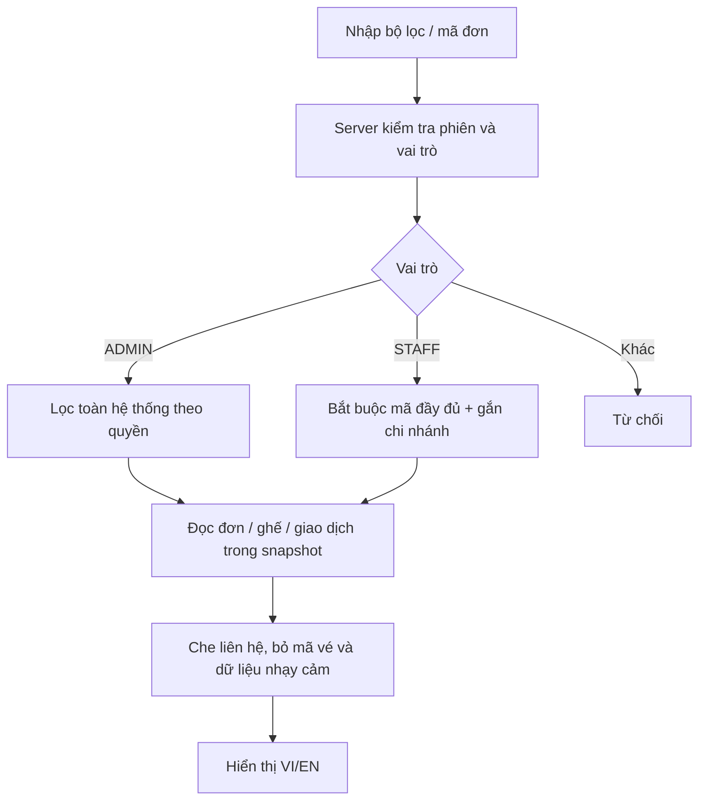

# Tra cứu đơn cho quản trị và nhân viên

Triển khai 04/11/2026, v2 đợt 1. Không thêm bảng/migration và không thay đổi luồng thanh toán hiện có.

## Dùng ở đâu?

- ADMIN: **Quản trị → Đơn hàng** (`/vi/admin/orders`, `/en/admin/orders`). Có tìm theo mã, trạng thái, chi nhánh, khoảng ngày tạo và phân trang 20 đơn.
- STAFF: **Nhân viên → Tra cứu đơn hàng tại chi nhánh** (`/vi/staff/orders`). Phải nhập đầy đủ mã `CR-` và 12 ký tự hex; không được duyệt danh sách toàn bộ khách.
- Mở **Xem chi tiết đối chiếu** để xem khách, thời điểm, ghế, trạng thái vé, tối đa 20 lần thử thanh toán gần nhất và hoàn giả lập.

Ngày lọc là **ngày tạo đơn**, không phải ngày chiếu hoặc ngày doanh thu. Chọn cả từ/đến ngày, tối đa 366 ngày tính cả hai đầu; tính theo giờ Việt Nam. Không chọn ngày thì ADMIN có thể xem lịch sử, STAFF vẫn phải có mã chính xác.

Thông tin liên hệ che bớt: `a***@domain`, điện thoại `***5678`. Đối chiếu với thông tin khách cung cấp; không cấp vé chỉ từ tên. Không hiển thị hoặc trả qua API mã vé/QR, mật khẩu/hash, session, payment idempotency key. Muốn sử dụng vé vẫn qua màn hình kiểm tra vé đúng cửa sổ giờ và chi nhánh.

## Dữ liệu và quyền

Service kiểm tra lại expiresAt/authVersion, tài khoản khóa, mật khẩu tạm và phân công rạp hiện tại trong transaction RepeatableRead. Tài khoản bị khóa/hết phiên không truy cập; đổi rạp thì mất quyền rạp cũ. Rạp ngừng hoạt động không cấp quyền STAFF, nhưng ADMIN vẫn xem được lịch sử rạp đó.

Phạm vi dùng `Booking.cinemaId` đã chụp khi tạo đơn. Đơn rạp khác và mã không tồn tại đều trả không có kết quả cho STAFF. STAFF gửi rõ bộ lọc rạp khác bị từ chối. Tìm theo email/tên/số điện thoại không được hỗ trợ trong đợt này.

Đọc báo cáo không dùng advisory lock bán vé, không gọi expireHolds và không sửa dữ liệu. Đơn PENDING đã qua expiresAt được **hiển thị** EXPIRED; trạng thái lưu sẽ được luồng giao dịch/dọn hạn xử lý. Bộ lọc PENDING/EXPIRED dùng cùng quy tắc này để không hiện đơn quá hạn như còn thanh toán được. Số tiền dùng BigInt → chuỗi, không cộng bằng Number.

## File để học

| File | Nội dung |
| --- | --- |
| `src/lib/operations/orders-shared.ts` | Kiểu kết quả, nhãn VI/EN, lỗi và định dạng tiền |
| `src/lib/operations/orders.ts` | Kiểm tra phạm vi, bộ lọc, đọc snapshot, che dữ liệu |
| `src/app/api/operations/orders/route.ts` | GET API có xác thực/phân quyền, private/no-store |
| `src/components/operations-orders.tsx` | Server Component: form GET, danh sách và chi tiết |
| `scripts/check-operations.ts` | 80 kiểm tra tích hợp bằng dữ liệu QA riêng |

Điểm học: **cùng component, khác quyền dữ liệu**. Hai trang admin/staff truyền session và đường dẫn vào component chung; service quyết định phạm vi. Không viết một bản truy vấn không giới hạn rồi chỉ ẩn bớt dòng ở giao diện.

## Kiểm tra

`npm run test:operations` đạt 80 kiểm tra: guest/customer bị chặn, staff đúng/sai rạp, bắt buộc mã đầy đủ, phân trang, lọc trạng thái/ngày Việt Nam, PENDING quá hạn, phiên hết hạn, tài khoản khóa, mật khẩu tạm, đổi phân công, rạp dừng hoạt động, dữ liệu che/không có QR và VI/EN. Test tạo dữ liệu QA riêng rồi dọn; không sửa đơn người dùng.

Chưa thêm thay đổi trạng thái đơn, cấp lại QR, hủy/hoàn thủ công hoặc xuất danh sách khách. Các nghiệp vụ đó cần thiết kế quyền và audit riêng, không gắn vào một nút “sửa đơn” chung.
