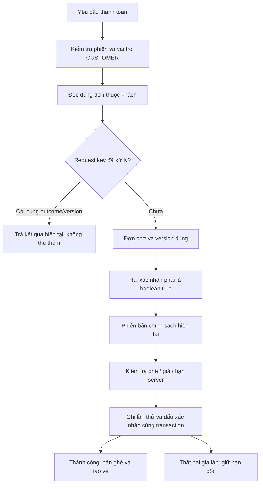

# Quyền mua vé và xác nhận tuổi/chính sách

Ngày 04/11/2026, **v2 đợt 2 — mã nguồn 0.2.1**. Hoàn tất V2-02 và V2-03 trong bản rà soát.

## Hành vi mới

| Tài khoản | Chọn/giữ ghế, tạo đơn, thanh toán mới | Đơn/vé đã phát sinh thuộc chính mình |
| --- | --- | --- |
| Chưa đăng nhập | Yêu cầu đăng nhập | Không truy cập |
| CUSTOMER | Có, kiểm tra lại ở API và transaction | Xem, tải QR; bỏ đơn chờ hợp lệ |
| STAFF / ADMIN | Không; trang chọn ghế giải thích dùng tài khoản khách | Vẫn xem/tải vé cũ; có thể bỏ đơn chờ hoặc giữ cũ để giải phóng ghế |

Vai trò nội bộ vẫn dùng đầy đủ nghiệp vụ vận hành được phân công như tra cứu đơn, kiểm tra vé và báo cáo. Không chặn CUSTOMER ngay trong transaction dùng chung vì service quét vé của STAFF cũng dùng transaction đó; chỉ truyền giới hạn CUSTOMER cho chọn/giữ ghế, tạo đơn và thanh toán.

Tài khoản nội bộ muốn mua vé cần đăng xuất, đăng nhập/đăng ký tài khoản khách. Không đổi quyền admin thành khách và không tự tạo tài khoản khác thay người dùng. Header có lối về khu vực làm việc, tách “Đơn cá nhân” khỏi “Đơn hàng” vận hành.

## Trước khi thanh toán

1. Xem phim, phân loại độ tuổi, ghế, tổng tiền và hạn giữ.
2. Khách tự xác nhận **tất cả người xem trong nhóm** đáp ứng điều kiện của phim; có người giám hộ nếu cần.
3. Đọc chính sách và tích ô đồng ý riêng: thanh toán giả lập, hạn giữ không gia hạn, không tự hủy/đổi sau thanh toán, rạp hủy hợp lệ thì hoàn toàn bộ giả lập.
4. Chỉ khi đủ hai ô mới mở nút thanh toán. Không tích sẵn, không ghi ngày sinh/giấy tờ vào database.

Đây là **tự xác nhận**, không phải hệ thống đã xác minh tuổi. Nhân viên vẫn có thể đối chiếu điều kiện tại rạp. P/K/T13/T16/T18 có giải thích VI/EN; mô tả được đối chiếu với [thông tin phân loại phim do Bộ VHTTDL công bố](https://bvhttdl.gov.vn/quy-dinh-tieu-chi-phan-loai-phim-va-thuc-hien-hien-thi-muc-phan-loai-phim-canh-bao-20230417152429268.htm). Các phân loại mẫu không có nghĩa các phim minh họa đã được project xác nhận giấy phép thực tế.

Thay đổi đơn/ghế, chuyển ngôn ngữ hoặc tải lại trang sẽ yêu cầu xác nhận lại trước **lần thử thanh toán mới**. Thanh toán giả lập thất bại tăng version của đơn: kiểm tra và tích lại, hạn giữ cũ giữ nguyên. Mất phản hồi thì giữ đúng yêu cầu đang chờ để kiểm tra/gửi lại; không bắt đầu một giao dịch mới chưa rõ kết quả cũ.

## Server kiểm tra gì?

Ẩn/khóa nút chỉ hỗ trợ thao tác. API gửi thiếu ô xác nhận, gửi chuỗi `"true"` thay boolean `true`, hoặc dùng chính sách cũ đều bị từ chối. Thời gian/mã phân loại do khách tự gửi không được dùng làm nguồn dữ liệu. Quyền được kiểm tra lại từ tài khoản hiện tại trong transaction; đổi CUSTOMER thành STAFF sau checkout không giữ được quyền thanh toán mới.

### Vì sao replay không bắt xác nhận lần nữa?

Ví dụ yêu cầu A đã thanh toán thành công nhưng browser mất phản hồi. Gửi lại A chỉ đọc kết quả giao dịch đã xử lý, không tạo thanh toán mới. Vì vậy kiểm tra request key đã tồn tại đứng trước bước yêu cầu xác nhận mới. Cùng key nhưng khác outcome hoặc version vẫn bị từ chối. Kể cả gửi lại sau hủy/hoàn, không bán lại ghế hoặc hoàn thêm.

## Dữ liệu mới và lịch sử cũ

- `Booking.ageRatingCode`: chụp từ `Showtime.ageRatingSnapshot` khi tạo đơn. Không đọc phân loại hiện tại trong danh mục để viết lại đơn cũ.
- `PaymentAttempt.confirmationVersion`: phiên bản nội dung xác nhận, hiện `booking-2026-11-04`.
- `PaymentAttempt.confirmedAt`: thời điểm server ghi nhận cùng lần thử thanh toán, kể cả kết quả giả lập thất bại.
- Các lần thanh toán cũ giữ hai trường NULL, không tự gán rằng khách đã đồng ý. Lịch sử cá nhân phân biệt bản ghi có dấu xác nhận với bản cũ chưa có.

Migration `20261104000000_checkout_confirmation` backfill phân loại từ suất cho đơn đã có, rồi đặt NOT NULL/CHECK. Hai trường xác nhận nullable để bảo toàn lịch sử; CHECK yêu cầu cùng NULL hoặc cùng có giá trị. Không thêm bảng, vẫn 21 bảng nghiệp vụ. Không đổi đơn đã thanh toán, mã vé hoặc số tiền.

Sau lấy code: `npm run db:generate`, `npm run db:deploy`, khởi động lại dev nếu cần để Prisma Client mới có hiệu lực. Không xóa database để cập nhật.

## Đọc code để học

| File | Bài toán |
| --- | --- |
| `src/lib/booking/service.ts` | Transaction nhận danh sách vai trò cho phép, đọc quyền từ server |
| `src/lib/booking/orders.ts` | Snapshot phân loại, thứ tự replay → kiểm tra xác nhận → thanh toán |
| `src/lib/booking/checkout-policy.ts` | Phiên bản, nhãn VI/EN và giải thích độ tuổi |
| `src/components/order-detail.tsx` | Hai checkbox theo version đơn, nút thanh toán và request đang chờ |
| `src/components/customer-booking-notice.tsx` | Hướng dẫn tài khoản nội bộ dùng tài khoản khách |
| `scripts/check-checkout.ts` | 94 kiểm tra mới bằng tài khoản và dữ liệu QA riêng |

Ý chính về state: mỗi lựa chọn checkbox gắn với `order.version`. Khi server trả một version mới, lựa chọn của version cũ không được coi là đã xác nhận cho phiên bản mới. Việc polling cùng version không tự bỏ tích ô. Body gửi lại khi mất kết quả giữ request key, version và xác nhận ban đầu.

## Kết quả kiểm tra

- **727 kiểm tra đạt**: auth 44, admin 73, holds 65, orders 98, tickets 69, revenue 115, chat 89, operations 80, checkout 94.
- Điều chỉnh test giữ ghế dùng một khách QA đang đăng nhập riêng để kiểm tra dọn hạn; ADMIN không còn được dùng API mua vé để kích hoạt tình huống này. Không nới quyền để giữ test cũ chạy.
- Kiểm tra cả API và gọi trực tiếp service: ADMIN/STAFF không tạo giữ/đơn/thanh toán; thiếu/giả xác nhận bị chặn; server tự ghi thời điểm; replay/current version/legacy payment; bảo toàn vé cũ sau đổi vai trò; hủy đơn cũ vẫn giải phóng ghế.
- Browser: thông báo chặn ADMIN, hai ô mặc định bỏ tích, một ô chưa đủ, đủ hai ô mở nút, thất bại đặt lại xác nhận và giữ hạn, lịch sử có dấu xác nhận, VI/EN. Đã khôi phục phiên admin local và dọn dữ liệu QA sau thử.
- Lint, TypeScript, production build và kiểm tra DB đạt. Bộ chat dùng phản hồi mô phỏng, không gọi thêm Gemini trong lần hồi quy này.

Ảnh kiểm thử local: `.qa/checkout-confirmation.jpg`, `.qa/booking-role-notice.jpg`; dùng dữ liệu QA đã dọn. Thẻ phim có thêm nhãn thể loại dự phòng để bản ghi thiếu thể loại không làm lỗi toàn bộ danh sách.

Bước tiếp theo theo kế hoạch: **quản lý nhân viên và phân công/khóa tài khoản qua giao diện ADMIN (V2-04)**.
