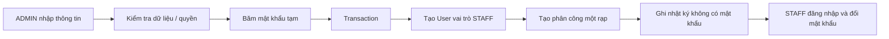

# Quản lý nhân viên tối giản cho đồ án

04/11/2026 — **v2 đợt 3, mã nguồn 0.2.2**. Phạm vi này thay thế kế hoạch quản lý nhân sự đầy đủ trước đó theo quyết định của chủ đồ án.

Hoàn tất kiểm tra giao diện ngày 05/11/2026: tìm đúng nhân viên theo email, biểu mẫu chỉ chọn rạp đang hoạt động và nhãn VI/EN đúng. Ảnh `.qa/staff-minimal.jpg`; không tạo nhân viên thật trong lần kiểm tra giao diện.

## Có những gì?

- ADMIN vào **Quản trị → Nhân viên** (`/vi/admin/staff`, `/en/admin/staff`).
- Xem danh sách, tìm theo tên/email, lọc rạp, phân trang 20 tài khoản.
- Tạo STAFF mới bằng họ tên, email, mật khẩu tạm 10–128 ký tự và một chi nhánh đang hoạt động.
- Có nút tạo mật khẩu ngẫu nhiên nếu cần; admin lưu để bàn giao trước khi tạo. Mật khẩu không được trả từ API hoặc xem lại từ danh sách.
- Nhân viên đăng nhập bằng mật khẩu tạm, bắt buộc tự đổi trước khi xem lịch/quét vé/tra cứu/báo cáo. Các quyền thao tác chỉ trong rạp được gán vẫn dùng cơ chế đã có.

Không có điều chuyển nhân viên cũ, khóa/mở, đổi vai trò, xóa hoặc reset mật khẩu qua màn hình này. Trạng thái tài khoản đang có được hiển thị để đối chiếu, không phải nút quản lý trạng thái. Không gửi email/SMS hay tự bàn giao mật khẩu qua dịch vụ ngoài.

## Cách demo

1. Đăng nhập ADMIN, mở Nhân viên → Tạo nhân viên.
2. Nhập tên/email mới, chọn rạp. Nhập hoặc tạo mật khẩu tạm, lưu lại để bàn giao; bấm tạo.
3. Kiểm tra tài khoản trong danh sách. Không tạo trùng hoặc dùng lại email của khách để nâng thành nhân viên.
4. Đăng xuất ADMIN, đăng nhập tài khoản STAFF vừa tạo. Trang đổi mật khẩu xuất hiện trước khu vực làm việc.
5. Đổi mật khẩu rồi vào khu vực nhân viên, kiểm tra lịch/vé/đơn/doanh thu tại rạp được gán.

Nếu mất phản hồi lúc tạo, kiểm tra danh sách bằng email trước khi gửi lại. Email duy nhất bảo vệ không tạo hai tài khoản; yêu cầu trùng báo rõ và không ghi đè mật khẩu hay quyền. Nếu quên mật khẩu tạm chưa có UI cấp lại; đây là giới hạn đã chốt, không phải tính năng ẩn.

## Chỗ cần hiểu

**Role và chi nhánh giải quyết hai câu hỏi khác nhau:**

| Dữ liệu | Trả lời | Ví dụ |
| --- | --- | --- |
| `User.role = STAFF` | Được làm việc gì? | Kiểm tra vé, tra cứu, báo cáo chi nhánh |
| `StaffAssignment.cinemaId` | Được làm ở đâu? | Hà Nội, không phải Bắc Ninh |
| `mustChangePassword = true` | Đã được dùng chức năng vận hành chưa? | Chưa, phải đổi mật khẩu tạm trước |

Đổi mật khẩu không nâng vai trò; nhân viên vẫn là STAFF, rạp phân công không đổi. Server kiểm tra quyền, không chỉ ẩn menu.

User + phân công + nhật ký được ghi cùng transaction: lỗi thì không để lại tài khoản tạo dở. `role`, trạng thái và yêu cầu đổi mật khẩu do server quyết định; body tự thêm `role: ADMIN`, `mustChangePassword: false` hoặc trường sửa tài khoản bị từ chối. Email chuẩn hóa và UNIQUE ngăn trùng khi hai yêu cầu gửi đồng thời.

Mật khẩu chỉ được băm bằng cơ chế scrypt sẵn có, không lưu dạng đọc được. Không ghi mật khẩu/hash vào audit, log hay HTML danh sách; biểu mẫu chỉ giữ mật khẩu tạm trong bộ nhớ khi đang nhập, xóa khi đóng hoặc tạo thành công.

## Phạm vi tài liệu đã điều chỉnh

| Phần | Bắt buộc trong đồ án | Mở rộng chưa triển khai |
| --- | --- | --- |
| Nhân viên | Danh sách, tìm/lọc, tạo mới/gán rạp lúc tạo, đổi mật khẩu tạm | Điều chuyển, khóa/mở qua UI, reset, quản trị nhân sự đầy đủ |
| Cơ sở vật chất | Có rạp/phòng/ghế qua seed, dùng đúng trong lịch/đặt vé | CRUD đầy đủ cơ sở vật chất/sơ đồ ghế |
| Hoàn tiền | Hủy suất hợp lệ hoàn giả lập toàn bộ, không trùng | Hàng đợi lỗi, xử lý bất đồng bộ, cổng tiền thật |
| Kiểm tra vé | STAFF kiểm tra đúng rạp và dùng một lần | Công cụ check-in riêng cho ADMIN |
| Trọng tâm còn lại | Trải nghiệm mua vé, lịch/bộ lọc, mobile, AI, demo và báo cáo | Không tự tăng danh sách nghiệp vụ vận hành như doanh nghiệp thực tế |

Đã cập nhật đặc tả **1.4**, lộ trình v2, tài liệu giao diện và phần tài khoản của thiết kế DB. Không sửa dữ liệu hoặc gỡ cơ chế kiểm tra tài khoản bị khóa đã có; chỉ thu gọn các màn hình/nghiệp vụ phải bàn giao. AC-19 đã được điều chỉnh rõ cho mô phỏng hiện tại, có lịch sử phiên bản; không đánh dấu hàng đợi hoàn thất bại là đã làm.

## File để đọc

| File | Vai trò |
| --- | --- |
| `src/lib/admin/staff.ts` | Kiểm tra quyền/phiên, danh sách và tạo STAFF + phân công + audit |
| `src/lib/admin/staff-shared.ts` | Kiểu dữ liệu và nhãn VI/EN |
| `src/app/api/admin/staff/route.ts` | GET/POST, kiểm tra nguồn gửi và response private/no-store |
| `src/app/[locale]/admin/staff/page.tsx` | Trang có kiểm tra quyền, bộ lọc và phân trang |
| `src/components/admin/staff-manager.tsx` | Danh sách, biểu mẫu, mật khẩu tạm trong state |
| `scripts/check-staff.ts` | Kiểm thử bằng tài khoản QA riêng, không in mật khẩu |

Không thêm bảng/migration; dùng User, StaffAssignment và AuditLog đã có.

## Kiểm tra

**113 kiểm tra mới đạt**: guest/STAFF/CUSTOMER bị chặn, server cố định role, input sai/trường nâng quyền bị từ chối, chi nhánh không hoạt động, email trùng/đồng thời, không sửa khách có sẵn, hash mật khẩu, audit không chứa bí mật, phân trang/tìm/lọc, đổi mật khẩu lần đầu và phiên cũ mất hiệu lực, VI/EN, không có PATCH/DELETE quản trị nâng cao.

Đã chạy lại toàn bộ bộ kiểm tra, tổng **840 kiểm tra đạt**; lint, TypeScript và production build đạt. Các tài khoản QA được dọn; không tạo nhân viên thật hoặc thay đổi mật khẩu người dùng trong quá trình kiểm thử. Bộ chat dùng phản hồi mô phỏng, không gọi AI trả phí trong lượt hồi quy này.
