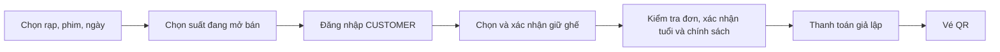

# Lịch chiếu, bộ lọc và trải nghiệm mua vé

Phiên bản mã nguồn: **0.2.4**, ngày 05/11/2026. Hoàn thành V2-07 và V2-10 trong lộ trình v2; phạm vi đồ án vẫn theo đặc tả 1.4. Không cần migration hoặc cài thêm thư viện.

## Những gì đã thay đổi

| Màn hình | Hành vi hiện tại |
| --- | --- |
| Danh sách phim | Lọc tên, thể loại, trạng thái, rạp, ngày. Tìm tên Việt không dấu. Khi chọn rạp/ngày, chỉ trả phim có suất đang mở bán đúng điều kiện đó. |
| Đặt nhanh ở trang chủ | Rạp → phim thực sự mở bán tại rạp → ngày có suất của phim đó. Bao gồm phim sắp chiếu đã mở bán trước. Tự chọn phương án hợp lệ khi thay đổi rạp/phim. |
| Chi tiết phim | Mặc định chọn ngày mở bán gần nhất của phim; không còn giới hạn 5 ngày. Chọn ngày bằng dãy ô bấm cuộn ngang, chọn rạp bằng nút Tất cả/Hà Nội/Bắc Ninh. Bấm cập nhật ngay, không có ô nhập ngày hoặc nút tìm. Ngày lấy từ lịch thực của phim ở tất cả rạp, thêm ngày đang xem nếu chưa có trong dãy. |
| Ngày không có suất | Giữ nguyên ngày người dùng chọn, giải thích không có kết quả và cho tìm lịch gần nhất ở tất cả rạp. Không tự chuyển sang ngày khác. |
| URL không hợp lệ | Ngày sai, rạp không tồn tại hoặc bộ lọc sai được báo rõ; không trả suất của điều kiện khác. |
| Điều hướng | MovieCard giữ rạp/ngày sang chi tiết; nút quay lại danh sách giữ rạp/ngày. Từ chọn ghế quay lại đúng phim/rạp/ngày của suất đó. Đổi VI/EN tiếp tục giữ query hiện tại. Các bộ lọc tên/thể loại/trạng thái không được mang qua trang chi tiết. |

Trang lịch hiển thị giờ theo Việt Nam, tên phòng và giá ghế thường; VIP có phụ thu. Đã bổ sung lời dẫn ngắn về các bước mua vé và thời điểm bắt đầu giữ ghế. Việc tìm phim/xem lịch không tạo phiên giữ.

## Phần cần hiểu khi học code

**Nhãn phim và quyền bán vé là hai việc khác nhau.** `COMING_SOON` mô tả phim, còn suất `ON_SALE` quyết định có đang bán trước hay không. Vì vậy không được chỉ lọc phim `NOW_SHOWING` cho đặt nhanh.

**Server lấy dữ liệu, component nhận dữ liệu qua props.** `getScheduleOptions()` gom các tổ hợp công khai `{ movie, cinema, day }` trong PostgreSQL; không lấy ghế, đơn hay khách hàng. Trang chủ truyền mảng đó vào `QuickBooking`. Component lọc các lựa chọn phù hợp ngay trên trình duyệt khi đổi rạp/phim. Server kiểm tra lại lịch và ghế khi người dùng đi tiếp.

**Ngày xem phim khác một thời điểm tuyệt đối.** `2026-11-14` là ngày tại Việt Nam. Suất 00:30 ngày đó vẫn thuộc ngày 13/11 ở UTC. Truy vấn gom ngày dùng `Asia/Ho_Chi_Minh`; truy vấn chi tiết lấy từ 00:00 đến trước 00:00 ngày sau, cùng múi giờ. `validDay()` chặn cả ngày không tồn tại như 30/02 trước khi gọi Prisma.

**URL lưu điều kiện lọc.** Ví dụ `/vi/movies?cinema=ha-noi&date=2026-11-14`. MovieCard nhận thêm `cinema` và `day` qua props để tạo liên kết đúng. Có thể tải lại hoặc chia sẻ URL mà vẫn giữ điều kiện đó.

**Đang mở bán không cam kết còn ghế trống.** Dữ liệu đặt nhanh là ảnh chụp tại lúc tải trang; khi suất vừa đóng/hủy hoặc ghế bị người khác giữ, lớp chọn ghế/checkout hiện có sẽ xử lý lại. Không thêm bộ đếm ghế trống dễ lỗi thời. Giữ ghế tối đa 5 phút chỉ bắt đầu sau khi xác nhận giữ; xem lịch và đổi bộ lọc không gia hạn thời gian.

## Kiểm tra và giới hạn

- `npm run test:schedule`: **49 kiểm tra** ngày hợp lệ, tìm không dấu, tổ hợp công khai, bán trước, giờ qua nửa đêm Việt Nam, lịch xa hơn 5 ngày, bộ lọc/URL VI/EN, rạp/phòng ngừng hoạt động, phim nháp, suất hủy/đóng bán. Fixture có tiền tố ngẫu nhiên, được dọn sau chạy.
- Trong mốc 0.2.3 đã chạy lại `test:holds` **65** và `test:checkout` **94**: tổng **201 kiểm tra của mốc 0.2.3** đạt. Mốc 0.2.4 thay giao diện và chạy lại 49 kiểm tra lịch; không thay nghiệp vụ giữ ghế/thanh toán. Không cộng thành tuyên bố đã chạy lại toàn bộ các bộ kiểm tra cũ.
- Đã thử trình duyệt: đặt nhanh sang lịch, tìm không dấu, giữ rạp/ngày khi quay lại, thông báo ngày không có suất; ở 0.2.4 đã bấm rạp Hà Nội rồi Tất cả rạp, xác nhận giữ nguyên ngày và chỉ hiện nhóm rạp có suất. Dữ liệu QA riêng được dọn sau kiểm tra.
- Lint và production build đạt.
- Chưa kiểm tra lại trên thiết bị di động thật trong đợt này. Giao diện dùng các breakpoint hiện có; kiểm chứng mobile là bước tiếp theo.
- Chế độ dữ liệu minh họa không kết nối DB vẫn xem được catalogue/lịch mẫu ở chi tiết, nhưng đặt nhanh không tạo lựa chọn mua vé giả.
- Chưa bổ sung ngày khởi chiếu vào DTO công khai, loading/error toàn hệ thống, hoặc thiết kế lại toàn bộ checkout. Đây vẫn là những hạng mục có thể làm sau.

**Chuẩn bị demo:** lịch cũ đã qua giờ bán tại thời điểm rà soát. Ngày 05/11 đã thêm 48 suất mới cho 05–10/11/2026: Robot hoang dã (10:00), Dune (13:00), Interstellar (17:00), Vùng đất linh hồn (20:00), cả Hà Nội và Bắc Ninh. Mỗi suất có snapshot 32 ghế. Dùng quản trị tạo suất mới, chọn phòng, giờ, giá và mở bán; không tự dời lịch cũ vì có thể đã gắn đơn/vé. Nếu không có suất mở bán, đặt nhanh báo trống và không cho bấm tìm. Ảnh `schedule-filters.jpg` / `schedule-detail.jpg` trong `.qa` sử dụng dữ liệu QA và không phải dữ liệu phim kinh doanh.

## Điều chỉnh giao diện theo phản hồi người dùng — 0.2.4

Bỏ form ngày/rạp ở chi tiết phim vì trùng với dãy ngày. Ngày có nhãn Hôm nay/Ngày mai hoặc thứ và ngày tháng; rạp là các nút bấm có trạng thái đang chọn. Dùng Link của Next.js để lưu điều kiện trên URL và chuyển trang mà giữ vị trí cuộn. Vì đây là điều hướng, phần tử HTML là liên kết được trình bày như nút, hỗ trợ bàn phím và mở tab mới. Khi xem tất cả rạp, chỉ hiện rạp có suất phù hợp; không lặp nhiều khung trống.

Tham khảo [Galaxy](https://www.galaxycine.vn/dat-ve/bo-sua-bay/) về dãy ngày và nhóm giờ theo rạp; [Cinenjoy](https://cinenjoy.com/lich-chieu) về nhãn Hôm nay/Ngày mai. Đây là lựa chọn thiết kế cho CineReserve, không sao chép toàn bộ quy trình của các dịch vụ đó. Bộ lọc form trên trang danh sách phim và đặt nhanh ở trang chủ giữ nguyên; đợt này sửa khu lịch trong chi tiết phim.

### Làm mới lịch mẫu trong các lần demo sau

Chạy `npm run demo:showtimes` khi PostgreSQL local đang mở. Script chỉ chấp nhận đúng database demo local của dự án, thêm lịch hôm nay và 5 ngày tới; bỏ qua giờ quá gần/đã qua, phòng bận hoặc khóa mẫu đã tồn tại. Giữ nguyên phim, phòng, suất cũ, đơn và vé. Tạo suất và snapshot ghế cùng transaction, tính đóng bán trước 10 phút và dọn phòng 20 phút. Chạy lại ngay lần hai đã xác nhận 0 suất mới, 48 suất hiện có, không tạo trùng. Không có reset ghế hoặc phát sinh thanh toán.

Khách thử mua bằng CUSTOMER; ADMIN/STAFF vẫn bị chặn mua vé mới theo đặc tả.
