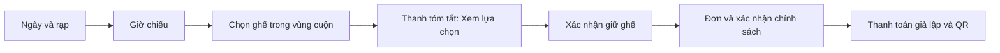

# Tối ưu giao diện mobile — 0.2.5

Ngày 05/11/2026. Đợt này kiểm tra bằng kích thước viewport trong trình duyệt, chưa xác nhận trên thiết bị Android/iPhone thật. Không thay đổi thời gian giữ ghế, giá, quyền mua hay quy trình thanh toán.

## Đã thay đổi

| Khu vực | Điều chỉnh |
| --- | --- |
| Chọn ngày | Dãy ngày cuộn riêng, nút trước/sau 44px, tự đưa ngày đang chọn vào vùng nhìn thấy khi chuyển ngày. Giữ query ngày/rạp, tôn trọng thiết lập giảm chuyển động. |
| Chọn rạp | Các nút có chiều cao tối thiểu 44px và tự xuống hàng. Không ép cả trang cuộn ngang. |
| Menu | Trên mobile đưa thông tin tài khoản/đơn hàng/đăng xuất vào menu mở rộng, thay vì nhiều chữ nhỏ trên header. Menu đóng bằng Escape hoặc khi chọn liên kết điều hướng chính. |
| Ghế | Giữ ghế 44 × 44px thay vì thu còn 34 × 35px. Sơ đồ có vùng cuộn ngang riêng, nhãn hàng bám bên trái, có hướng dẫn vuốt và hỗ trợ focus bàn phím. |
| Tổng tiền khi chọn ghế | Thanh dưới màn hình hiển thị số ghế đang chọn, tạm tính và liên kết **Xem lựa chọn**. Có khoảng bù và safe-area phía dưới. Liên kết chỉ đưa đến bảng tóm tắt, không tự giữ ghế hoặc tạo đơn. |
| Checkout | Vùng nhấn của nhãn xác nhận lớn hơn, checkbox 22px, chữ dễ đọc hơn. Tổng thanh toán nằm ngay trước nút trả tiền. Bảng ghế/giá và QR không đẩy trang ra ngoài màn hình nhỏ. |
| Đăng nhập/tìm kiếm | Ô nhập và select ở mobile dùng chữ 16px, chiều cao tối thiểu 48px; mục đích hạn chế việc tự phóng to ô nhập trên iOS. Bàn phím ảo thật chưa được thử. |
| Chatbot | Thu nút mở thành biểu tượng 48px trên mobile, vẫn có tên truy cập. Các trang chọn ghế/đơn hàng vốn đã ẩn chatbot; tiếp tục giữ điều này. Không gọi dịch vụ AI trong kiểm tra mobile. |

## Phần cần hiểu khi học code

**Responsive không có nghĩa là thu nhỏ mọi thứ.** Nếu ép 8 ghế vào điện thoại bằng cách thu mỗi ghế thật nhỏ, người dùng dễ bấm nhầm. Giữ kích thước bấm rồi cho sơ đồ cuộn trong một vùng riêng sẽ phù hợp hơn. Trang vẫn giữ chiều rộng điện thoại.

**CSS media query quyết định bố cục theo chiều rộng.** Thanh tóm tắt chỉ xuất hiện ở màn hình tối đa 600px; máy tính vẫn dùng bảng tóm tắt hiện có. Cùng một state `selected` và cùng phép tính tiền được dùng cho cả hai chỗ, nên không có bản dữ liệu riêng dễ lệch nhau.

**State lựa chọn khác dữ liệu đã giữ trên server.** Bấm ghế chỉ sửa lựa chọn trên trình duyệt; thanh dưới màn hình ghi “ghế đang chọn”. Bấm **Xem lựa chọn** chỉ cuộn đến phần xác nhận. Chỉ nút giữ ghế gọi API giữ, và hạn giữ cũ không được gia hạn khi đổi ghế/qua checkout.

**Client component chỉ dùng cho phần cần tương tác.** `DateStrip` dùng ref để cuộn dãy ngày và quan sát kích thước vùng cuộn, không tự tính lại lịch mở bán. Lịch vẫn do server lấy; nút ngày là Link lưu lựa chọn trên URL. Component dọn sự kiện/ResizeObserver khi không còn dùng.

**Cùng ngày nhưng định dạng ở server và trình duyệt có thể khác.** Khi thử phát hiện thứ Bảy có thể thành “Th 7” ở server nhưng “Thứ 7” ở trình duyệt. Dãy ngày dùng nhãn VI/EN xác định và ngày/tháng từ chuỗi `YYYY-MM-DD`, tránh sai khác lúc React tiếp quản HTML.

## Kiểm chứng

| Kích thước | Đã thử |
| --- | --- |
| 320 × 740 | Lịch/rạp, sơ đồ 32 ghế cuộn riêng, menu, QR; document không tràn ngang. |
| 390 × 844 | Mũi tên ngày, chọn ngày cuối dãy tự hiện trong vùng nhìn thấy, lọc rạp, ghế thường/VIP cuối hàng, thanh tóm tắt, giữ ghế, checkout và QR bằng dữ liệu QA. |
| 768 × 1024 | Đối chiếu lịch và chọn ghế, không tràn trang, thanh tóm tắt mobile ẩn đúng breakpoint. |

Trong thử nghiệm QA đã chọn thêm ghế, cập nhật giữ mà đồng hồ không quay lại 5 phút, tạo đơn, xác nhận hai điều kiện và thanh toán giả lập thành công, nhận QR. Dùng tài khoản/đơn riêng có tiền tố QA rồi dọn toàn bộ; khôi phục phiên admin trước khi kết thúc. Ở lịch mẫu thật chỉ thử chọn ghế trên trình duyệt, không tạo đơn hoặc giữ ghế mẫu của người dùng.

Các bộ kiểm tra liên quan: lịch **49**, giữ ghế **65**, checkout **94**; tổng **208**. Lint và production build đều đạt. Không coi các con số này là kiểm tra tự động toàn bộ thiết bị/browser hoặc toàn bộ suite của dự án.

Ảnh tham khảo nằm trong `.qa/mobile-seats.jpg`, `.qa/mobile-schedule.jpg`; ảnh màn hình được chụp ở viewport 390px. Thông tin đo đã quan sát: ghế 44 × 44px, checkbox 22 × 22px kèm nhãn lớn hơn 44px, ngày cuối dãy nằm trong vùng nhìn thấy sau khi chọn.

## Còn phải kiểm tra thực tế

- Safari iOS/Chrome Android: vuốt bằng tay, bàn phím ảo, xoay màn hình và vùng an toàn của thiết bị.
- Khi bàn phím mở, có thể nhìn và dùng nút đăng nhập/đăng ký; font 16px chỉ là điều chỉnh thiết kế, chưa phải bằng chứng thiết bị thật.
- Mất mạng/đổi tab khi gần hết hạn và QR trên điện thoại/camera thật tiếp tục nằm trong đợt kiểm chứng demo.
- Chưa thêm thanh toán thật, đổi sơ đồ phòng hoặc thay đổi các quy tắc nghiệp vụ để phục vụ giao diện.
