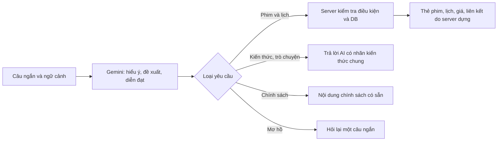

# Trợ lý CineReserve — hội thoại và tốc độ

**Cập nhật 0.2.7:** [kiểm tra câu ngắn và bộ nhớ điều kiện](18-kiem-tra-chat-ngan-va-ngu-canh.md). Tuổi/rạp/ngày có snapshot riêng trong tab, không chỉ phụ thuộc bốn lượt gần nhất. Các con số/mô tả 0.2.6 bên dưới là mốc trước nâng cấp ngữ cảnh.

Mã nguồn **0.2.6**, ngày 05/11/2026. Đặc tả sản phẩm cập nhật 1.5. Không cần migration, không thay API key/model trong `.env`, không truy cập dự án cũ.

## Hành vi mới

| Câu hỏi | Cách xử lý |
| --- | --- |
| “phim vui” | Hiểu là gu/tâm trạng; không yêu cầu đúng tên thể loại hoặc đúng câu mẫu. Gợi ý từ catalogue và mô tả lý do. |
| “bé 8 tuổi” rồi “mai Bac Ninh” | Dùng ngữ cảnh gần nhất, giữ tuổi nhỏ nhất và chuyển điều kiện ngày/rạp; server lọc lại phim và lịch. |
| “phim đó” sau nhiều gợi ý | Nếu không xác định duy nhất thì hỏi chọn tên phim; có các nút trả lời nhanh từ tên thật. |
| “so sánh các phim này” | Hướng dẫn AI so sánh các phim đã được nhắc đến, tránh nhầm tham chiếu số nhiều thành một phim mơ hồ. |
| Nội dung, cảm xúc, thể loại, đạo diễn, so sánh | Trò chuyện bằng kiến thức Gemini, ưu tiên không spoil, có nhãn kiến thức chung; không coi là dữ liệu lịch/giá của hệ thống. |
| Chào hỏi/câu hỏi thông thường | Có thể trả lời ngắn, không từ chối chỉ vì ngoài vé phim. Không có công cụ tra tin tức/thời tiết trực tiếp. |
| Cách giữ ghế/thanh toán/QR/hoàn tiền | AI chọn chủ đề; câu trả lời lấy từ nguồn chính sách công khai của ứng dụng. |
| Nhờ đặt/trả tiền hoặc xem dữ liệu riêng | Hướng dẫn đến màn hình phù hợp, không có công cụ thực hiện giao dịch/đọc đơn riêng. |

Các mode là `catalogue`, `conversation`, `clarify`, `policy`, `restricted`. Mode và câu trả lời AI vẫn có thể bị hiểu sai; không phải bộ phân loại hoàn hảo.

## Câu hỏi ngắn có cần “train” trước không?

Không huấn luyện lại Gemini và không làm bộ câu hỏi–đáp để bắt khách gõ đúng từng câu. Mô hình có sẵn hiểu ngôn ngữ; ứng dụng cung cấp vai trò, quy tắc, dữ liệu công khai và hội thoại gần nhất. Ví dụ trong prompt minh họa hành vi, không giới hạn các câu được phép hỏi.

Browser gửi tối đa 4 lượt trước đó cộng câu mới, tổng tối đa 9 tin nhắn/7.000 ký tự, mỗi tin tối đa 1.200 ký tự. Không phải trí nhớ vô hạn. Lượt thất bại/dừng vẫn giữ câu người dùng cùng một ghi chú trung tính; không tự mất thông tin tuổi chỉ vì AI bị gián đoạn.

Có lớp bổ sung nhận tuổi được nói rõ như “8 tuổi”/“8 years old” từ tin nhắn người dùng, giữ tuổi nhỏ nhất khi thêm người lớn. Với thay đổi/đính chính mơ hồ, vẫn để AI hiểu và hỏi lại; có thể nói rõ “đổi nhóm” hoặc “chỉ người lớn”. Đây không phải xác minh tuổi hoặc bảo đảm phim phù hợp tâm lý với mọi trẻ. Phân loại P cũng không đồng nghĩa phim luôn nhẹ nhàng hay không có cảnh gây sợ/buồn.

## Tối ưu tốc độ thực hiện

- Luồng cũ: AI chuyển thành điều kiện → DB → AI chọn/giải thích, có thể hai lần gọi nối tiếp.
- Luồng mới: gửi catalogue công khai có mô tả rút gọn, thể loại, đạo diễn, phân loại; một lượt AI trả điều kiện, hướng hội thoại và lý do. Server lọc lại sau đó. Không chấp nhận ID ngoài catalogue, phim không hợp điều kiện hoặc URL do AI tự tạo.
- Nội dung phim đưa vào prompt có giới hạn: tối đa 80 phim, mô tả 400 ký tự/phim; 30 rạp và 40 thể loại. Không gửi ghế, khách, đơn, vé hoặc báo cáo. Catalogue lớn hơn cần tìm kiếm rút gọn phù hợp, không tăng prompt vô hạn.
- Với model Gemini 3.x phù hợp đang cấu hình, đặt `thinkingLevel: MINIMAL`, tối đa 1.600 output token. Không đổi model/key của người dùng. Lựa chọn này ưu tiên độ trễ; cần đánh giá chất lượng khi chuyển model.
- Lỗi HTTP 503 tạm thời được thử lại **một lần** sau 250ms, dùng cùng hạn 18 giây. Không tự thử lại khi hết quota 429, lỗi đầu vào hoặc kết quả sai schema. Vì vậy bình thường là một lượt gọi, nhưng có thể hai HTTP attempt khi dịch vụ bận; không tuyên bố mọi request chỉ tốn đúng một lần gọi dịch vụ.
- API hỗ trợ JSON cũ và NDJSON cho giao diện mới. Tiến độ “đang hiểu”/“đang đối chiếu” tới ngay, rồi trả kết quả đã kiểm tra. **Chưa stream từng token văn bản trực tiếp từ Gemini**; không hiển thị JSON/giá chưa kiểm tra và không tạo hiệu ứng gõ giả để gọi là nhanh hơn.
- Có dừng, thử lại, câu hỏi tiếp nối, khung mở rộng; hủy không tự hoàn hạn mức. Tìm kiếm/mua vé thông thường không phụ thuộc AI.
- Log chỉ requestId, kết quả, thời gian directory/model/search/total, số lượt logic và metadata lỗi HTTP/finishReason. Không log câu hỏi, câu trả lời, API key, IP, cookie hoặc payload lỗi của nhà cung cấp. Chưa thống kê chi phí/token thực tế theo request.

Tài liệu kỹ thuật đã đối chiếu: [Generate Content API](https://ai.google.dev/api/generate-content), [cấu hình thinking](https://ai.google.dev/gemini-api/docs/thinking). Định dạng structured output vẫn phải kiểm tra phía ứng dụng; đúng JSON không bảo đảm đúng ý nghĩa.

## Kiểm chứng và giới hạn đo

**Tự động:** `npm run test:chat` đạt **88**, `npm run test:chat-dialogue` đạt **40**, tổng **128** kiểm tra mô phỏng. Bộ cũ giảm một đối chiếu do không còn lần gọi AI thứ hai; không phải giảm một quy tắc nghiệp vụ. Các kiểm tra gồm dữ liệu công khai, tuổi/rạp/ngày, không có quyền ghi, chính sách, một lượt logic, mơ hồ/so sánh, ngữ cảnh sau lỗi, tuổi người đi cùng, retry có giới hạn, stream chia giữa ký tự UTF-8, khung lỗi, thiếu kết quả, trùng kết quả và giới hạn kích thước. Không dùng các test mock để khẳng định AI hiểu mọi câu.

**Gemini thật:** đã thử các câu ngắn, câu nối tiếp, chào hỏi, phép tính, chính sách, yêu cầu đặt thay. Có lượt “bé 8 tuổi” → “mai Bac Ninh” giữ đúng tuổi 8 và rạp Bắc Ninh. Không phải mọi lượt đều thành công do có 503/timeout. Bộ thử giữ cả kết quả lỗi trong `.qa`, không đưa key vào log/file kết quả.

| Phép đo nhỏ ở local | Kết quả |
| --- | --- |
| Bản cũ, 2 câu | 15.700ms và 15.790ms |
| Một batch NDJSON 8 câu trước retry 503 | 7 thành công, 1 lỗi dịch vụ; median các lượt thành công 2.264ms; tiến độ đầu 14–71ms |
| Batch 8 câu sau thêm retry 503 | 5 thành công, 3 timeout; median các lượt thành công 2.167ms; tiến độ đầu 16–98ms |

Không so median thành công với toàn bộ request để cam kết tốc độ: lỗi vẫn có thể chờ tới hạn. Các batch nhỏ, thời điểm khác nhau, không phải benchmark đồng tải; chưa chứng minh SLA hay một tỷ lệ thành công ổn định. Retry 503 không khắc phục được mọi lỗi nhà cung cấp. Khi demo nên kiểm tra quota/kết nối trước và vẫn có đường tìm phim thường.

**Giao diện:** đã quan sát gửi “phim vui” nhận thẻ phim/lịch/giá, tiến độ phản hồi, mở rộng khung, nút tiếp nối và trả lời so sánh không spoil. Trong thử so sánh, AI từng hỏi lại chưa cần thiết; đã sửa hướng dẫn và thêm regression test để câu số nhiều không bị xử lý thành tham chiếu một phim. AI cũng từng nhận xét quá tuyệt đối về độ nhẹ nhàng; prompt được bổ sung yêu cầu tránh cam kết “không có cảnh buồn/đáng sợ”. Nhận xét nội dung phim vẫn cần bộ đánh giá lớn hơn hoặc nguồn biên tập đáng tin cậy, không thể chỉ dựa prompt mà bảo đảm đúng.

Không phát sinh thanh toán, đơn hoặc vé qua chatbot. Không có dữ liệu hội thoại lưu lâu dài trong database; không cam kết chính sách lưu dữ liệu của Google thay cho nhà cung cấp. Reload hoặc cuộc trò chuyện mới xóa ngữ cảnh trong tab.

## Việc còn nên làm sau

Đánh giá thêm tiếng lóng/viết tắt/đổi nhóm, kiểm thử nhiều người dùng và thiết bị thật; đo phân vị độ trễ bao gồm lỗi, đối chiếu quota và token. Nếu cần tư vấn nội dung phim đáng tin cậy hơn, bổ sung ghi chú tone/cảnh báo nội dung do người quản trị biên tập và cho AI dựa vào nguồn đó. Chưa có tìm web tự động, voice hoặc agent tự đặt vé.
