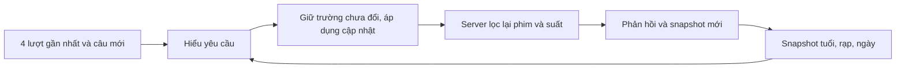

# Kiểm tra câu ngắn và ngữ cảnh chatbot — 0.2.7

Ngày 05/11/2026. Mục tiêu: đối chiếu tuổi, rạp, ngày qua câu ngắn/không dấu, cập nhật điều kiện và hội thoại nối tiếp. Không thay model/key, không tăng hạn mức hoặc thêm quyền đọc dữ liệu riêng.

## Kết quả thử Gemini thật

| Lượt thử | Kết quả |
| --- | --- |
| Hai chuỗi ban đầu, 8 câu | 8/8 nhận phản hồi, cả 8 giữ đúng tuổi/rạp/ngày và thẻ suất phù hợp. |
| Hai chuỗi sau sửa, 10 câu, có chuỗi dài 6 lượt | 7 phản hồi thành công đều khớp điều kiện; 3 lượt lỗi dịch vụ/không nhận được phản hồi hợp lệ. Không tính 3 lỗi là hiểu đúng. |
| Tổng đợt này | 18 lượt gửi, 15 phản hồi khớp, 3 lỗi dịch vụ; chưa có trường hợp trả lời thành công nhưng sai tuổi/rạp/ngày trong mẫu nhỏ này. |

Ví dụ chuỗi đã đối chiếu theo ngày Việt Nam 05/11:

| Câu khách nhập | Tuổi | Rạp | Ngày |
| --- | --- | --- | --- |
| `phim cho be 8 tuoi mai Bac Ninh` | 8 | Bắc Ninh | 06/11 |
| `Ha Noi nhe` | 8 | Hà Nội | 06/11 |
| `ngay kia` | 8 | Hà Nội | 07/11 |
| `them anh 20 tuoi` | 8 | Hà Nội | 07/11 |
| `tim phim khac` | 8 | Hà Nội | 07/11 |
| `con phim nao nua` | 8 | Hà Nội | 07/11 |

Chuỗi còn lại thử `mai Ha Noi, di voi be 10t` → `doi sang Bac Ninh` → `khong phai 10, be 12 tuoi` → `hom nay`. Chuỗi trước sửa nhận đủ bốn phản hồi đúng; trong lượt sau sửa, hai câu cuối gặp lỗi dịch vụ. Không dùng kết quả mock để thay cho hai phản hồi thật còn thiếu đó.

Mỗi phản hồi thành công được so tuổi/rạp/ngày; mọi phim gợi ý kiểm tra phân loại theo tuổi kỳ vọng và mọi suất kiểm tra đúng chi nhánh/ngày Việt Nam. File `.qa/chat-context-*.json` lưu câu QA, điều kiện kỳ vọng, phản hồi, độ trễ và lỗi; không lưu API key hoặc cookie. Đây là bộ mẫu có kiểm soát, chưa phải kết luận cho mọi cách diễn đạt.

## Những điểm đã sửa và gia cố

1. **Qua cửa sổ 4 lượt vẫn giữ điều kiện.** Trước đây browser chỉ gửi bốn lượt gần nhất, không có bản tóm tắt riêng của tuổi/rạp/ngày. Nay giữ `ChatContext` trong bộ nhớ tab và gửi cùng câu mới; server kiểm tra rồi trả bản cập nhật. Thông tin phim và lời trò chuyện dài vẫn có giới hạn, không phải trí nhớ vô hạn.
2. **Thay đổi đúng trường.** Đổi rạp giữ nguyên tuổi/ngày; đổi ngày giữ nguyên tuổi/rạp; câu “còn phim nào” không cho một kế hoạch AI nhầm làm tự đổi cả ba điều kiện. Câu nhắc chung “còn phim nào ở rạp không” cũng không được coi là yêu cầu đổi rạp.
3. **Tuổi ngắn và thành viên nhóm.** Nhận `10t`, `8 tuoi`, `years old`; thêm anh/bố lớn tuổi không xóa tuổi nhỏ nhất. Sửa tuổi bằng “không phải … mà …” hoặc đổi nhóm phải thay được tuổi cũ. Sửa rạp có từ “không phải” không được xóa tuổi của bé.
4. **Sau lượt lỗi/dừng.** Snapshot là điều kiện của lượt đã hoàn tất. Khi có các câu chưa được trả lời ở cuối lịch sử, áp dụng lại phần cập nhật đó trước câu mới. Ví dụ sửa 8 thành 12 bị lỗi, rồi hỏi ngày hôm nay vẫn phải giữ 12. Trường hợp này đã có kiểm tra hồi quy mô phỏng riêng; không tuyên bố đã có phản hồi Gemini thật cho mọi tình huống lỗi.
5. **Xóa điều kiện có chủ ý.** “bỏ lọc tuổi”, “tất cả rạp”, “ngày nào cũng được” xóa đúng trường; lượt sau không tự khôi phục điều kiện cũ từ đoạn hội thoại trước đó. Bấm “Cuộc trò chuyện mới” xóa cả hội thoại và snapshot.
6. **Rạp không còn hoạt động.** Snapshot trỏ tới rạp không còn trong danh mục công khai thì hỏi chọn lại; không tự thay bằng một rạp khác hoặc tra dữ liệu riêng.
7. **Câu mơ hồ kèm điều kiện.** Chỉ dùng hỏi lại nhanh cho tham chiếu đơn giản như “phim đó”. Khi câu có thêm tuổi/rạp/ngày, để AI phân tích và giữ các điều kiện đã nói thay vì bỏ chúng chỉ để hỏi tên phim.

## Phần cần hiểu khi học code

Hội thoại giúp hiểu “phim đó”, sở thích và cách nói tự nhiên. Snapshot giữ ba điều kiện ngắn để không phụ thuộc việc câu đầu còn nằm trong cửa sổ hội thoại hay không. Snapshot không lưu lịch/giá/ghế; các dữ liệu đó được tra lại ở server khi tìm phim.

`context.ts` bổ sung quy tắc cho các điều kiện rõ ràng và bảo toàn trường chưa đổi; Gemini vẫn xử lý ý nghĩa chung, cách diễn đạt, rạp/ngày cụ thể và nhu cầu hỏi lại. Không phải viết một đáp án cố định cho từng câu. Những cách nói quá mơ hồ/đặc biệt vẫn có thể cần hỏi rõ hoặc cải thiện thêm.

Snapshot là sở thích do khách tự khai, không phải quyền truy cập hoặc bằng chứng xác minh tuổi. API chỉ nhận age/cinemaId/date hợp lệ; không chấp nhận role/token/trường tùy ý. Chỉ rạp công khai đang hoạt động được dùng. Dữ liệu ở bộ nhớ tab, không thêm localStorage, cookie nội dung chat, bảng DB hoặc migration. Bộ đếm chống lạm dụng và kiểm tra quyền mua vé giữ nguyên.

## Kiểm tra tự động

- `npm run test:chat`: **88** kiểm tra nền trên dữ liệu QA local, phản hồi AI mô phỏng.
- `npm run test:chat-dialogue`: **43** kiểm tra hội thoại/stream, gồm snapshot round-trip, mô hình bỏ/đổi nhầm trường và rạp không còn phục vụ.
- `npm run test:chat-context`: **39** kiểm tra bảo toàn/cập nhật/xóa điều kiện, lượt lỗi, viết ngắn, định dạng và trường không được nhận; không gọi API hoặc ghi DB.

Tổng **170 kiểm tra** liên quan đạt. Lint và production build đạt. Không tự cộng các bộ kiểm tra cũ chưa chạy lại thành tuyên bố kiểm tra toàn bộ dự án.

Script gọi Gemini thật là `scripts/check-chat-context-live.ts`: mỗi chuỗi dùng tối đa 6 câu, giữ cookie chống lạm dụng trong lượt thử và tuân thủ hạn mức. Không đưa vào bộ test thường xuyên để tránh tự phát sinh lượt AI. Khi dùng lại vào ngày khác, ngày kỳ vọng tính theo giờ Việt Nam; cần lịch mẫu tương ứng nếu muốn kiểm tra thẻ suất có kết quả.

## Giới hạn còn lại

Mẫu hiện có chưa bao phủ mọi tiếng lóng/lỗi gõ, thay đổi nhóm phức tạp hoặc việc quá nhiều lượt lỗi liên tiếp vượt cửa sổ hội thoại. Quy tắc bảo toàn không thay thế việc hỏi lại khi thiếu thông tin. Gemini vẫn có thể bận/timeout; kết quả mới không cam kết tốc độ hoặc tỷ lệ thành công tuyệt đối. Gợi ý nội dung/độ nhẹ nhàng vẫn mang tính AI và cảm nhận, không phải xác nhận mọi phim phù hợp với từng trẻ.
