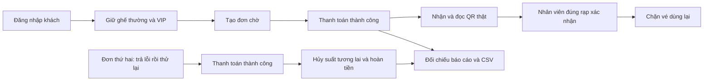

# Kiểm thử toàn luồng đặt vé — 0.2.8

Ngày kiểm tra: **05/11/2026**, project độc lập `D:/DA`, thanh toán và hoàn tiền giả lập. Không thu tiền thật.

## 1. Luồng đã kiểm tra



Script mới `scripts/check-journey.ts` đăng nhập qua API thật, gọi các API hiện hành và đối chiếu dữ liệu lưu trong PostgreSQL. QR lấy từ đường dẫn tải vé thật, chuyển ảnh bằng Sharp rồi giải mã bằng jsQR; không bỏ qua bước đọc QR bằng cách lấy sẵn mã trong database.

| Nhóm | Kết quả đã kiểm tra |
| --- | --- |
| Giữ ghế | Ghế thường/VIP đúng giá; khách khác không giữ được ghế đang bị giữ |
| Đơn chờ | Chưa tính doanh thu, chưa phát hành vé |
| Thanh toán | Thành công mới có vé; gửi lại cùng yêu cầu không thu tiền hoặc phát hành vé lần hai |
| Thất bại rồi thử lại | Lần thất bại không tăng doanh thu; lần thành công tiếp theo mới tính tiền |
| Quyền xem QR | Chỉ chủ đơn tải được; khách khác không lấy được QR |
| Soát vé | Nhân viên đúng chi nhánh được kiểm tra/xác nhận; sai rạp bị chặn; khách hàng không có quyền soát vé |
| Dùng lại vé | Gửi lại cùng yêu cầu được trả kết quả cũ; yêu cầu mới với vé đã dùng bị chặn |
| Hủy và hoàn | Suất tương lai chưa dùng được hủy/hoàn toàn bộ; QR vé hủy không tải được, không được vào rạp |
| Vé đã dùng | Không cho hủy suất có vé đã sử dụng |
| Doanh thu | Tổng, theo ngày, phim, rạp và CSV khớp giao dịch; nhân viên chỉ xem phạm vi rạp được giao |

## 2. Ví dụ đối chiếu tiền

| Mốc | Tiền thu | Tiền hoàn | Sau hoàn |
| --- | ---: | ---: | ---: |
| Đơn chờ | 0 | 0 | 0 |
| Đơn 1: thường 90.000 + VIP 110.000 | 200.000 | 0 | 200.000 |
| Gửi lại thanh toán / quét vé | 200.000 | 0 | 200.000 |
| Đơn 2 thanh toán thất bại | 200.000 | 0 | 200.000 |
| Đơn 2 thử lại thành công | 290.000 | 0 | 290.000 |
| Hủy suất của đơn 2 | 290.000 | 90.000 | 200.000 |

**Cần hiểu:** doanh thu tính theo ngày thu/hoàn tiền, không theo ngày chiếu. Quét QR chỉ ghi nhận khách đã vào, không tạo khoản thu mới. Số ghế đã bán là 3, đã hoàn 1; hai chỉ số được trình bày riêng.

## 3. Kết quả và giới hạn

- Bộ toàn luồng mới đạt **234 kiểm tra**.
- Chạy lại giữ ghế 65, đơn hàng 98, vé 69, doanh thu 115, quyền/xác nhận checkout 94, quản trị 73 và tra cứu vận hành 80: **594 kiểm tra đạt**. Cộng bộ toàn luồng là **828 kiểm tra đạt trong đợt này**, không phải 828 tình huống độc lập hoàn toàn.
- Lint và production build (bao gồm TypeScript) đạt. Kiểm tra database sau khi dọn QA: 6 phim, 2 rạp, 7 phòng, 224 ghế, 153 suất; bản dịch và ràng buộc lịch hợp lệ.
- Trên giao diện đã đăng nhập STAFF QA, chọn ảnh QR của vé còn hiệu lực, đọc đúng ghế A2, xác nhận sử dụng thành công; kiểm tra lại báo vé đã dùng và khóa xác nhận.
- Trên giao diện ADMIN QA, báo cáo theo phim/rạp/ngày hiển thị thu **290.000đ**, hoàn **90.000đ**, sau hoàn **200.000đ**, khớp sau lần quét thứ hai.
- Đã lưu ảnh tại `.qa/journey-scan.jpg`, `.qa/journey-report.jpg`; dữ liệu QA riêng đã được dọn và phiên trình duyệt trở lại tài khoản admin local.
- Chưa phát hiện lỗi ứng dụng trong những kịch bản trên. Một kỳ vọng của script về bộ lọc phim ngoài phạm vi nhân viên đã được sửa: server trả lỗi bộ lọc không hợp lệ, thay vì báo cáo rỗng.
- Đây là kiểm thử phần mềm local và đọc QR từ ảnh. **Camera vật lý, điện thoại thật và HTTPS chưa được nghiệm thu**. Không thay thế kiểm thử tải lớn hoặc cổng thanh toán thật.

## 4. Chạy lại

Mở database và web ở hai terminal bằng `npm run db:local`, `npm run dev`, sau đó:

```sh
npm run test:journey
```

Mặc định script tự tạo và dọn dữ liệu có tiền tố QA riêng, chỉ cho chạy trên database local chuyên dụng với `ALLOW_DEMO_SEED=true`. Không sửa tài khoản hoặc lịch thật. Để kiểm tra thêm bằng giao diện:

```sh
npm run test:journey -- --keep-ui
# Sau khi kiểm tra xong:
npm run test:journey -- --cleanup-ui
```

Chế độ giữ dữ liệu lưu thông tin đăng nhập QA tạm ở `.qa/journey-ui.json`; không chia sẻ file này. Dọn bằng lệnh trên sau mỗi lượt. Suất kiểm thử bắt đầu sau khoảng 20 phút, vì vậy nên kiểm tra giao diện ngay sau khi script chạy xong.

## 5. Việc tiếp theo

1. Thử một vòng trên điện thoại thật: mua vé, lưu QR, dùng thiết bị khác quét camera qua HTTPS.
2. Kiểm tra sao lưu và phục hồi database để chuẩn bị buổi bảo vệ.
3. Chốt dữ liệu demo, kịch bản trình diễn, ảnh minh họa và báo cáo; sửa lỗi giao diện/ngôn ngữ còn thấy trong quá trình này.

Không cần thêm nghiệp vụ vận hành sâu để hoàn thành phạm vi đồ án hiện tại.
