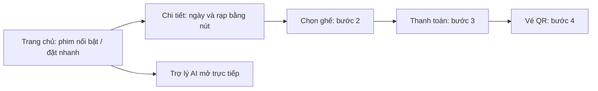

# Giao diện khách hàng — 0.3.0

Ngày thực hiện: **05/11/2026**. Định hướng riêng cho CineReserve: **phòng chiếu hiện đại**, tập trung vào phim, ghế và một hành trình mua vé dễ theo dõi.

## 1. Tham khảo và quyết định thiết kế

Đã nghiên cứu các trang công khai:

| Nguồn | Điều tham khảo | Cách áp dụng cho CineReserve |
| --- | --- | --- |
| [Curzon — Films](https://www.curzon.com/films/) | Tách đang chiếu/sắp chiếu, bộ lọc và đặt nhanh | Hai nhóm phim riêng, liên kết lịch rõ; không sao chép giao diện hoặc nhận diện thương hiệu |
| [MoMo Cinema](https://www.momo.vn/cinema) | Poster, phân loại tuổi và thông tin phim hỗ trợ lựa chọn | Thẻ phim ưu tiên hình, tuổi, thể loại, thời lượng và nút lịch chiếu |

Đã tìm thêm nguồn chính thức CGV; mở trang trực tiếp bị timeout nên không dùng để kết luận về bố cục hiện tại của họ. Đây là nghiên cứu cách tổ chức thông tin, chưa phải thử nghiệm người dùng hoặc đo tỷ lệ mua vé.

**Điểm riêng:** logo đã duyệt, xanh mực và champagne, khung phim nổi bật có dấu CR / SELECT, thẻ sắp chiếu gọn trên desktop, trợ lý phim có đường mở trực tiếp. Không thêm khuyến mãi, điểm đánh giá hoặc lời chứng thực giả.

## 2. Hệ thống thị giác

| Thành phần | Quy tắc |
| --- | --- |
| Nền chính | `#0C121A` — xanh mực |
| Khối nội dung | `#141E2B`; lớp nổi `#1B2838` |
| Màu nhấn | `#EDC076` — champagne theo logo, chủ yếu cho hành động chính và trạng thái chọn |
| Chữ chính / phụ | `#F4F2ED` / `#A6B1C0` |
| Kiểu chữ | Be Vietnam Pro; có Arial/sans-serif dự phòng |
| Bố cục | Rộng tối đa 1240px; khoảng cách theo bội số 4/8; bo góc 8–20px tùy cấp khối |
| Thao tác | Viền focus bàn phím, nút mua vé rõ, vùng chạm mobile đủ lớn; hỗ trợ giảm chuyển động |

Các biến màu nằm trong `src/app/globals.css`. CSS Modules giữ bố cục riêng của từng component. Khi đổi màu nền chung, nhiều màn hình nhận được cùng màu; không phải viết lại riêng mỗi trang.

## 3. Các thay đổi đã triển khai

- **Trang chủ:** dùng tên phim, tuổi, thời lượng và tóm tắt thay cho tiêu đề quảng bá chung; đặt nhanh ngay dưới banner; bỏ đoạn hướng dẫn dài lặp lại. Hiển thị riêng đang chiếu, sắp chiếu, trợ lý và rạp.
- **Thẻ phim:** cùng tỷ lệ poster, nội dung và nút được căn theo hàng; sắp chiếu dùng thẻ ngang nhỏ trên desktop, về hai cột trên điện thoại. Nút chi tiết phim sắp chiếu mở thông tin phim, không nhảy thẳng xuống lịch trống.
- **Header/footer:** thu gọn chiều cao và chữ, trạng thái trang đang xem rõ hơn; tài khoản vào menu ở màn hình vừa/nhỏ để tránh chen chúc.
- **Danh sách và chi tiết:** đồng bộ nền, ô tìm/lọc, thẻ rạp và nút giờ chiếu; giữ cơ chế chọn ngày/rạp bằng nút ở lịch chi tiết.
- **Chọn ghế/checkout/vé:** thêm thanh 4 bước, dùng cùng nền/panel/bo góc; tóm tắt ghế bám khi cuộn desktop; vé QR có khung riêng. Đơn hủy/hết hạn không hiển thị tiến trình như một lần mua đang diễn ra.
- **Chatbot:** khối giới thiệu có nút mở đúng trợ lý, tự focus ô nhập; đồng bộ nền/header khung chat. Không đổi model hoặc quy tắc tư vấn trong đợt thiết kế này.
- **Đăng nhập/hồ sơ:** nhận hệ màu/panel/ô nhập chung. Logo hiện tại được giữ lại.

Phạm vi chính là giao diện khách hàng. Quản trị và nhân viên vẫn sử dụng bố cục vận hành hiện hữu; header/footer chung có cập nhật. Không coi đây là thiết kế lại toàn bộ công cụ quản trị.

## 4. Kiểm chứng

- Lint, TypeScript và production build đạt trong quá trình triển khai.
- **416 kiểm tra đạt:** lịch 49, checkout 94, ngữ cảnh chat 39, toàn luồng đặt vé 234. Đây là tổng kiểm tra của các bộ, có phần nghiệp vụ giao nhau.
- Trình duyệt: thử đặt nhanh Bắc Ninh → đúng ngày/rạp trên lịch; mở trợ lý từ khối AI; tìm `robot hoang da` ra Robot hoang dã; kiểm tra VI/EN.
- Responsive: kiểm tra trang chủ ở 320/390/768px và desktop, menu mobile, dãy ngày cuộn riêng; rà soát chọn ghế/checkout/vé ở 390px. Không thay thế nghiệm thu điện thoại thật.
- Tài khoản khách QA: chọn/giữ A3 → tạo đơn chờ 90.000đ → xem checkout → hủy/bỏ giữ; xem đơn đã thanh toán và QR. Dữ liệu QA đã dọn, khôi phục admin local.
- Ảnh minh chứng tại `.qa/design-v2-home-desktop.jpg`, `.qa/design-v2-home-mobile.jpg`, `.qa/design-v2-schedule-mobile.jpg`, `.qa/design-v2-seats-mobile.jpg`, `.qa/design-v2-checkout-mobile.jpg`, `.qa/design-v2-ticket-mobile.jpg`.

Ảnh poster/backdrop và ảnh rạp dùng các nguồn đã có trong project. Font và ảnh từ bên ngoài cần kết nối mạng; việc chuẩn bị bộ tài nguyên phù hợp để demo offline còn có thể làm sau. Trong lúc chỉnh CSS có thông báo thay nóng của công cụ dev; bản build hoàn chỉnh vẫn đạt.

## 5. Phần cần hiểu khi học code

1. **Design tokens:** các biến màu/khoảng cách giúp nhiều màn hình thống nhất. Không cần mỗi nút một màu riêng.
2. **Component có biến thể:** `MovieCard` dùng thêm `compact` cho khu sắp chiếu, vẫn nhận cùng dữ liệu phim. Không nhân đôi component chỉ để đổi cách xếp hình và chữ.
3. **Giao diện và nghiệp vụ:** thanh `BookingProgress` chỉ trình bày bước hiện tại. Quyền mua, hạn giữ 5 phút, số tiền và phát hành vé vẫn do server kiểm tra.
4. **Responsive:** desktop ưu tiên xem đồng thời nhiều phim, mobile ưu tiên chữ rõ và vùng chạm; vùng ngày/ghế được phép cuộn riêng thay vì ép cả trang rộng hơn màn hình.
